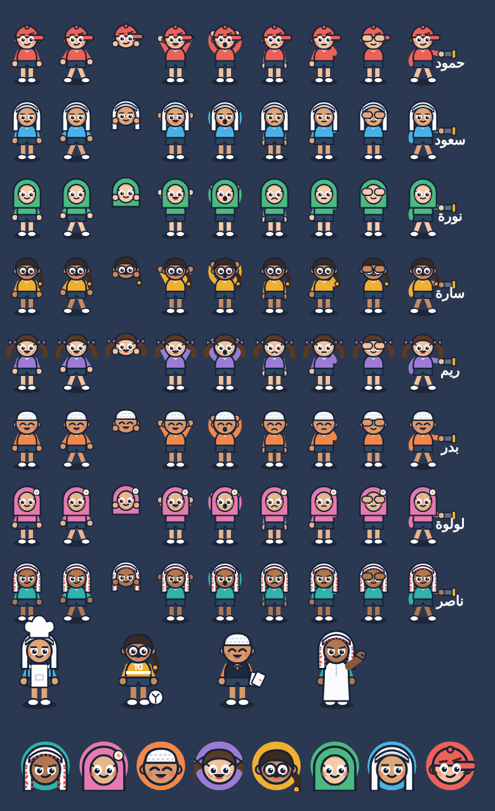
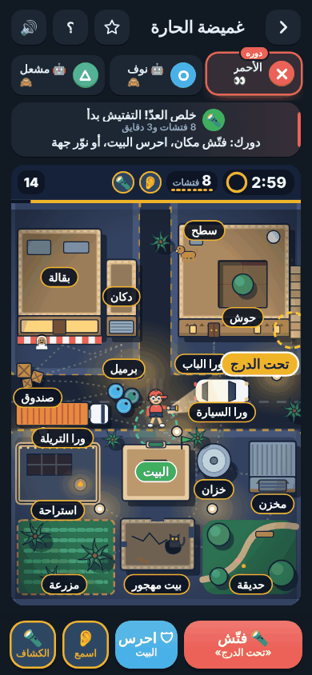

# الشخصيات: «عيال الحارة»

«عيال الحارة» ثمان عيال من الحارة، **واحد لكل لون لاعب**: حمود للأحمر، وسعود للأزرق، وهكذا بنفس ترتيب `COLS` في `core.js`. صاحب المشروع اعتمدهم («الشخصيات اعتمدها»)، وصاروا شخصيات التطبيق كله، مو بس ألعاب الحارة.



*في الصورة: كل صف شخصية بوضعياتها (واقف، يمشي، يطل، يهلل، انمسك، زعلان، يفكر، يعدّ، بالكشاف). وتحت: أمثلة على الملابس (مريول وطاقية طبخ، طقم رياضة وكورة، موزّع ورق، ثوب وقفاز صقّار)، والوجوه الدائرية للصور.*

## الثمانية

| # | الاسم | اللون | البشرة | الشكل | الطبع |
|---|---|---|---|---|---|
| 0 | **حمود** (ولد) | أحمر `#EC6158` | `#F2C29B` | كاب أحمر للأمام، خصلات شعر، حاجب مرفوع بشقاوة | شقي وسريع |
| 1 | **سعود** (ولد) | أزرق `#4AB1E8` | `#E0A577` | غترة بيضاء على الراس والكتوف، عيون نص مسكّرة هادية | هادي ويفكر |
| 2 | **نورة** (بنت) | أخضر `#4CB97F` | `#F5CBA7` | حجاب أخضر حول وجه مدوّر، رموش | ذكية وتلاحظ كل شي |
| 3 | **سارة** (بنت) | أصفر `#EDB02F` | `#C98A5E` | شعر غامق بضفيرة على جنب، نظارة مدوّرة، ربطة شعر صفراء | تحب الألغاز |
| 4 | **ريم** (بنت) | بنفسجي `#9C7BD6` | `#F2C29B` | ذيلين شعر بفيونكات بنفسجية، نمش | نشيطة وما تهدى |
| 5 | **بدر** (ولد) | برتقالي `#F2874B` | `#D99A6C` | طاقية بيضاء محبوكة، وجه مليان ضحوك | ضحوك |
| 6 | **لولوة** (بنت) | وردي `#E57AAE` | `#E8B48C` | حجاب وردي فيه وردة بيضاء صغيرة | لطيفة وشجاعة |
| 7 | **ناصر** (ولد) | فيروزي `#2FB3AA` | `#B07750` | شماغ أحمر وأبيض، حواجب ثابتة | واثق وهادي |

4 عيال و4 بنات، ولكل واحد لون بشرة ووجه وطبع خاص فيه. البيانات في `KH.CAST[i]`: `{n, g, c, skin, m, t}` (الاسم، ولد أو بنت، اللون، البشرة، الفم الافتراضي، الطبع).

## الرسم

- **المكونات:** الشخصية `<g>` فيها 3 إلى 6 `<use>` (تقريبًا 300 بايت). كل `<use>` قطعة:
  - جسم بوضعية: القميص بلون `--kc`، والجلد بلون `--ks`؛
  - طبقة لبس فوقه؛
  - الراس الخاص فيه (اللبس والشعر والعيون)؛
  - فم حسب المزاج؛
  - إكسسوار.
- **الأسلوب:** حد كحلي `#17233A`، وتعبئة مسطّحة، وظل بيضاوي تحت الرجلين.
- **القوالب** تنحط بالصفحة مرة وحدة (`KH.ensureDefs()`) وترجع لحالها إذا انمسحت. لذلك 8 لاعبين على الشاشة ما يكلفون شي تقريبًا.

### الوضعيات (`pose`)

| الوضعية | الوصف | المزاج الافتراضي |
|---|---|---|
| `stand` | واقف | فم الشخصية |
| `walk` | يمشي | فم الشخصية |
| `peek` | راس ويدين يطلّون من ورا شي | فم الشخصية |
| `cheer` | يدينه فوق يهلل | `g` (ضحكة) |
| `caught` | يدينه على راسه: انمسك | `o` (مفجوع) |
| `sad` | زعلان | `sad` |
| `think` | يد على الذقن | `hm` |
| `count` | مغمّض بيدينه يعدّ | `s` |
| `torch` | ماسك كشاف | فم الشخصية |

وضعيات القعدة (أضافتها «طاق طاق طاقية»، `KH.sit`): `sit` متربّع، و`situp` يد فوق، و`sitcheer` اليدين فوق، و`sitlook` يلتفت ويده على راسه.

### المزاج (`mood`، الفم)

`s` ابتسامة، و`g` ضحكة، و`o` مفجوع، و`sad` زعلان، و`k` شقاوة، و`hm` يفكر.

### الملابس (`outfit`) والإكسسوارات (`acc`)

| النوع | المتوفر |
|---|---|
| ملابس | `apron` مريول، `sport` طقم رياضة رقم 10، `dealer` صدرية موزّع ورق مع ببيونة، `thobe` ثوب |
| إكسسوارات | `glove` قفاز صقّار، `ball` كورة، `cards` ورق باليد، `chefhat` طاقية طبخ |

### شخصيات ثانية (`KH.sprite`)

- `sil`: ظل متخبّي بعيون، للكشاف.
- `mom`: الأم.
- `cat`: القطو.
- `sleepcat`: قطو نايم.
- `dog`: الكلب.
- `grocer`: أبو سعد صاحب البقالة.

### الطاقية (`KH.cap`)

`cap` بيضاء محبوكة، و`gold` ذهبية، و`fake` خرقة مرقّعة.

## الاستخدام في الألعاب (API)

الكود كله في `public/js/kit-hara.js` تحت متغير واحد `KH`، وتنسيقه في `public/css/kit-hara.css`.

```js
// شخصية داخل <svg> اللعبة: who = رقم اللون (0..7)، وفي اللعبة غالبًا d.pl[s]
KH.kid({who: d.pl[s], pose: 'cheer', outfit: 'sport', acc: 'ball', s: 1.2, flip: false, x: 120, y: 200});

// صورة دائرية مستقلة (شريط اللاعبين، الغرفة، النتائج)
KH.face({who: r, size: 32, ring: true, mood: 'g'});

// قاعد على الأرض (الدوائر والجلسات)
KH.sit({who: r, pose: 'sitlook', x, y});

// الشخصيات الثانية والطاقية
KH.sprite('cat', x, y, {s: .9});
KH.cap(x, y, 'gold', 1);

// فقاعة كلام ونجمة «لقيتك!»
KH.say(x, y, 'أربعة…', {fs: 13});
KH.burst(x, y, 'لقيتك!');
```

| الدالة | وش ترجع |
|---|---|
| `KH.kid(o)` | `<g>` للشخصية. `o`: `who` أو `seat` أو `c` (لون)، `pose`، `mood`، `outfit`، `acc`، `s` (الحجم)، `flip`، `x`، `y` |
| `KH.face(o)` | `<svg>` دائري صغير. `o`: `who`، `size`، `ring` (دائرة بلون اللاعب)، `bg`، `mood` |
| `KH.sit(o)` | شخصية قاعدة متربّعة (الراس عند 0,-33) |
| `KH.sprite(pose,x,y,o)` | الشخصيات الثانية، أو أي وضعية من وضعيات العيال |
| `KH.cap(x,y,kind,s)` | الطاقية |
| `KH.say` و`KH.burst` و`KH.beam` | فقاعة كلام، ونجمة، وضوء الكشاف |
| `KH.walk(el,pts,o)` | يمشّي عنصر على نقاط بـ `transform` بس: 150 إلى 250ms للمقطع، و1.2 ثانية كحد أقصى، و450ms في الوضع الخفيف، وما فيه مشي مع «تقليل الحركة». `o.step()` ينادى عند كل نقطة (صوت خطوات) |
| `KH.graph({pos,edges})` | شبكة ممرات: المسافات بالخطوات (`D`)، والمسار (`path`)، ونقاطه (`pts`) |
| `KH.banner` و`KH.card` | قطع HTML للحالة: شريط وبطاقة حدث |
| `KH.snd(kind)` | أصوات صغيرة مولّدة (Web Audio)، تسكت مع كتم الصوت: `step`، `heart`، `found`، `safe`، `meow`، `bark`، `count`، `call`، `whoosh`، `tick` |
| `KH.art.*` و`KH.bg` | رسومات الحارة، وتحويل الخريطة الثابتة لخلفية CSS |

**ملاحظة للمطورين:** `kit-hara.js` حاليًا ينحمّل مع الألعاب بعد أول شاشة (في `later-js`). إذا بنستخدم `KH.face` في شريط اللاعبين أو الغرفة قبل تحميل الألعاب، لازم ينتقل لقائمة السكربتات الأولى قبل `core.js`.

## القاعدة: كل لعبة تستخدم «عيال الحارة» بلبسها الخاص

- أي لعبة فيها ناس (لاعبين أو شخصيات) ترسمهم من «عيال الحارة»، **وما ترسم شخصيات ثانية**. لون اللاعب = شخصيته: الأحمر دايمًا حمود.
- كل لعبة تلبّسهم حسب جوها: طاقية طبخ في ألعاب الأكل، طقم رياضة في الكورة، صدرية موزّع في الورق، قفاز في الصقور.
- **إضافة لبس جديد:** أضف عنصر في `OUTFIT` أو `ACC` داخل `kit-hara.js` (رسمة SVG بنفس الأسلوب: حد `KH.OL`، تعبئة مسطّحة، وألوان من `--kc` و`--ks` إذا يلزم). **لا تغيّر وجوه الشخصيات ولا ألوانهم.**
- الشخصيات تتحرك بـ `transform` بس، والحركة تحترم الوضع الخفيف و«تقليل الحركة».
- الشرط مكتوب كمان في [game-checklist.md](game-checklist.md): «أيقونة وشكل بنفس روح التطبيق، وشخصيات عيال الحارة».

## وين مستخدمين الحين

| المكان | الحالة |
|---|---|
| «غميضة الحارة» (`n-hide.js`) | كل لاعب شخصيته: يمشي على الممرات، ويطل من مخباه، والغمّاض يعدّ ويمشي بالكشاف. وفيها القطو والكلب وأبو سعد والأم |
| «طاق طاق طاقية» (`n-taqiya.js`) | العيال قاعدين بدائرة في الحوش |
| باقي التطبيق (شريط اللاعبين، الغرفة، النتائج، باقي الألعاب) | قيد التعميم (انظر [roadmap.md](roadmap.md)) |


