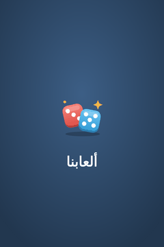
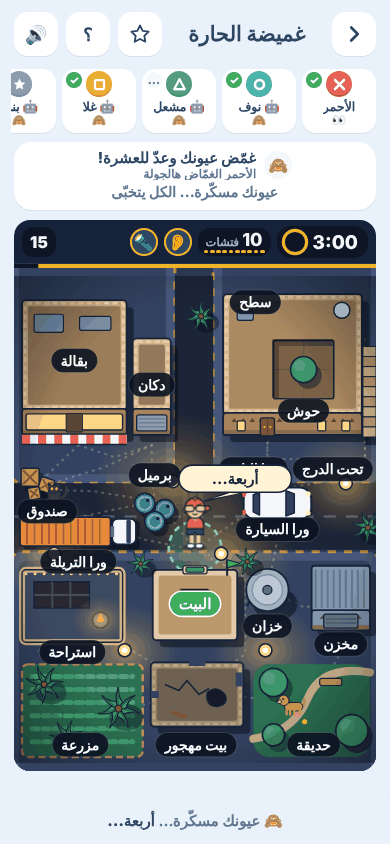

# نظام التصميم واللغة البصرية

الروح العامة: ألوان مرحة ومشبعة على خلفية هادية، أزرار «منفوخة» لها حافة سفلية (كأنها تنضغط)، زوايا دائرية واسعة، وحركة قصيرة ونطّاطة. كل شي من اليمين لليسار، والخط عربي مدوّر. وكل شي لازم يكون خفيف على الجوال الضعيف.

## 1. الرموز (Design tokens)

كل الشاشات والألعاب تاخذ ألوانها ومقاساتها من متغيرات CSS في أول `public/css/style.css`. **أسماء المتغيرات عقد ثابت**، والقيم ممكن تتعدّل. أي لعبة جديدة تستخدم هذي المتغيرات بدل ما تكتب ألوان جديدة.

### الألوان الأساسية

| المتغير | الفاتح | الداكن | الاستخدام |
|---|---|---|---|
| `--bg` | `#E9F1FA` | `#111923` | خلفية الصفحة |
| `--card` / `--surface` | `#fff` | `#1C2733` | البطاقات واللوحات |
| `--surface-2` | `#F4F8FC` | `#243241` | سطح ثاني (أزرار صغيرة، مجموعات الاختيار) |
| `--ink` | `#2D4763` | `#E7EEF6` | النص الأساسي |
| `--mut` | `#5F7590` | `#94A7BD` | النص الثانوي |
| `--navy` | `#2D4763` | `#2D4763` | الكحلي: لون الهوية، والأزرار الأساسية |
| `--red` | `#EC6158` | | زر «أنشئ غرفة» وأزرار البداية |
| `--blue` | `#4AB1E8` | | الأونلاين والتركيز |
| `--gold` | `#F0B429` | | الفوز والتنبيه وزر «كمّل» |
| `--ok` / `--bad` | `#3FAE5C` / `#E5534B` | | صح وغلط |
| `--sel` | `#FFD84D` | | التحديد (`--ring`: حلقة 3px بهذا اللون) |
| `--line` | `#d3e0ee` | `#070b10` | الحافة السفلية للأزرار والبطاقات |
| `--edge` | `#D9E4F0` | `#2E3E50` | خط رفيع يبان في الثيمين |
| `--link` | `#2B8BC6` | `#6CC4F2` | الروابط |
| `--glow` | `#fff` | `#1b2836` | توهج الصفحة من فوق (`body::before`) |

### الزوايا

| المتغير | القيمة |
|---|---|
| `--r-s` | 10px |
| `--r-m` | 14px |
| `--r-l` | 18px (البطاقات واللوحات) |
| `--r-xl` | 24px (مربعات الصفحة الرئيسية) |

`--r` و`--sh` باقيين عشان قواعد الألعاب القديمة.

### الارتفاع (الظلال)

| المتغير | الوصف |
|---|---|
| `--e1` | خط سفلي + ظل خفيف: البطاقات العادية |
| `--e2` | ظل أوضح: العناصر المرفوعة |
| `--e3` | ظل كبير: الشيتات والنوافذ |
| `--lip` | حافة سفلية 4px: الأزرار الكبيرة «المنفوخة» (تنزل 3px لما تنضغط) |

في الداكن الظلال أغمق، وفي «الحركة الخفيفة» تصير خطوط بدون تمويه.

### الحركة

| المتغير | القيمة |
|---|---|
| `--ease` | `cubic-bezier(.2,.8,.2,1)`: الحركة العادية |
| `--spring` | `cubic-bezier(.34,1.56,.64,1)`: النطّة (ظهور، فوز) |
| `--t1` | .12s: ضغطة زر |
| `--t2` | .22s (و.18s بعد `perf.css`): انتقال |
| `--t3` | .36s (و.26s بعد `perf.css`): دخول عنصر |

### الخامات

ألوان جاهزة للوحات الألعاب، عشان كل الألعاب الخشبية أو البحرية تطلع بنفس الروح:

| الخامة | المتغيرات |
|---|---|
| خشب | `--wood-1 #EED3A8`، `--wood-2 #D4A56A`، `--wood-3 #8A5A2B` |
| جوخ (طاولة الورق) | `--felt-1 #2E9A62`، `--felt-2 #1C6B43` |
| بحر | `--sea-1 #4FA3D8`، `--sea-2 #2F7DB3` |

## 2. ألوان اللاعبين

كل لاعب له لون وشكل ثابت (`COLS` و`LIGHT` و`NAMES` و`SHP` في `public/js/core.js`)، والشكل يخلي الألوان تنفرق حتى لو أحد عنده عمى ألوان:

| # | الاسم | اللون (`COLS`) | الفاتح (`LIGHT`) | الشكل | شخصيته في «عيال الحارة» |
|---|---|---|---|---|---|
| 0 | الأحمر | `#EC6158` | `#FAD2CE` | ✕ | حمود |
| 1 | الأزرق | `#4AB1E8` | `#CDEAFA` | دائرة | سعود |
| 2 | الأخضر | `#4CB97F` | `#D0EFDD` | مثلث | نورة |
| 3 | الأصفر | `#EDB02F` | `#FBEAC2` | مربع | سارة |
| 4 | البنفسجي | `#9C7BD6` | `#E5DAF6` | نجمة | ريم |
| 5 | البرتقالي | `#F2874B` | `#FCDCC6` | معيّن | بدر |
| 6 | الوردي | `#E57AAE` | `#F8D5E7` | زائد | لولوة |
| 7 | الفيروزي | `#2FB3AA` | `#C9EEEA` | سداسي | ناصر |

ألوان الفرق (`TEAMS`): 🐯 النمور `#E5483F`، 🦅 الصقور `#2F80ED`، 🐺 الذئاب `#6C7A89`، 🐆 الفهود `#E8A33D`.

## 3. الخط

**Baloo Bhaijaan 2** من Google Fonts، بالأوزان 500 و700 و800. الخط ينحمّل **بعد** أول شاشة (`public/js/boot.js`)، فإذا النت بطيء أو مقطوع التطبيق يطلع على طول بخط الجوال (`system-ui`) وبعدين يتبدّل. العناوين والأزرار 800، والنص العادي 500 إلى 700.

## 4. الفاتح والداكن

- التطبيق يمشي على إعداد الجوال (`prefers-color-scheme`)، وما فيه زر داخلي يغيّر الثيم.
- كل لون له قيمة للداكن في نفس الملف (`@media (prefers-color-scheme:dark)`).
- `theme-color` في `index.html`: `#E9F1FA` للفاتح و`#111923` للداكن.
- ألعاب الحارة رسمها ليلي دايمًا، في الثيمين.
- كل لقطة شاشة تنأخذ بالثيمين (انظر [testing.md](testing.md)).

## 5. وضع «الحركة الخفيفة» (`html.lite`)

ملفه `public/css/perf.css`، وهو آخر ملف CSS ينحمّل.

**متى يشتغل:**
- **لحاله**، إذا الجوال ذاكرته 4 جيجا أو أقل، أو أنويته 4 أو أقل (`LITE_AUTO` في `core.js`، من `navigator.deviceMemory` و`navigator.hardwareConcurrency`).
- **يدويًا** من الإعدادات: «على هذا الجوال: حركات كاملة / خفيفة وأسرع». الاختيار ينحفظ في `alaabna.lite` ويغلب الاختيار التلقائي.
- `KH.lite()` في ألعاب الحارة يعتبر كمان إعداد «تقليل الحركة» في الجوال (`prefers-reduced-motion`).

**وش يسوي:**
- يوقف حركات الدخول والنطّ، ويخلي الانتقالات شبه فورية.
- الظلال تصير خطوط بدون تمويه.
- يشيل فلاتر `drop-shadow` وتوهج الصفحة والقصاصات الملونة (confetti).
- يبقى منه بس اللي يوصّل معلومة: الردود الطايرة، «دورك!»، والتنبيهات (تختفي بالتلاشي)، والمؤشرات اللي تدور وقت الانتظار، وشريط الوقت.
- مشي شخصيات الحارة يقصر لـ 450ms كحد أقصى، ومع «تقليل الحركة» ما فيه مشي أبد.

## 6. قواعد الأداء (للمصممين والمطورين)

التطبيق لازم يكون سلس على جوال رخيص، وكل تصميم يلتزم بهذي القواعد:

1. **الحركة بـ `transform` و`opacity` بس.** لا تحرّك `width` أو `top` أو `left` أو `box-shadow` أو `filter`.
2. **لا حلقات لا نهائية.** أي حركة متكررة تلف عدد محدود (2 إلى 9 مرات) وتوقف، والتلميح يبقى ثابت (حلقة، توهج، لون). الاستثناء الوحيد: مؤشر انتظار صغير يدور.
3. **لا تمويه.** ممنوع `filter: blur` و`backdrop-filter`، وخفّف `drop-shadow` (ينشال في الوضع الخفيف).
4. **SVG قليل العناصر.** الرسومات الثابتة الكبيرة (خريطة الحارة مثلًا) تتحول لخلفية CSS مرة وحدة (`KH.bg`)، فما تكلف عناصر في الصفحة. الشخصيات قوالب `<use>` تنرسم مرة.
5. **مربع اللعبة في القائمة عناصر قليلة.** النجمة وعدد اللاعبين مرسومة بـ CSS. 200 مربع لازم يبقون خفاف، وأقسام القائمة تستخدم `content-visibility:auto`.
6. **الشاشة تترقّع ما تنرسم من جديد.** المحرك يقارن الـ HTML ويغيّر اللي تغيّر بس (`morph` في `core.js`)، فلا تحط أرقام عشوائية أو أوقات في الـ HTML تتغير كل رسمة.
7. **قسها.** أي شاشة جديدة تنقاس بإبطاء المعالج ×4 إلى ×6 (`tools/test/perf.js`). الهدف: الرسمة أقل من 16ms، والضغطة ترد بأقل من 100ms.
8. **احترم الوضع الخفيف وتقليل الحركة** في أي حركة جديدة: `html.lite` و`@media (prefers-reduced-motion:reduce)`.

## 7. الشاشات

### الصفحة الرئيسية

شاشة وحدة ما تنزل على الجوال. من فوق لتحت:
1. **الشعار:** زهرتين، حمراء وزرقاء، تنطّ مرتين بس.
2. **العنوان «ألعابنا»** وتحته عدد الألعاب و«من 2 إلى 8 لاعبين».
3. **بطاقة «كمّل اللعبة»** إذا فيه لعبة ما خلصت على هذا الجوال.
4. **أربع مربعات متساوية لطرق اللعب:** على نفس الجهاز (أحمر)، أونلاين (أزرق)، ضد البوت (كحلي)، قريب بدون نت (أخضر، ويطلع باهت برّا التطبيق).
5. **شريط آخر الألعاب** وزر الإحصائيات.

الصفحة الرئيسية تطلع قبل ما تنحمّل ملفات الألعاب، وتعرض أسماء آخر الألعاب وأيقوناتها من نسخة محفوظة (`GMETA`).

### قائمة الألعاب

- **فوق:** إعداد اللاعبين على نفس الجهاز (العدد، الأسماء، بوت أو إنسان ومستواه، الفرق)، أو شريط الغرفة أونلاين (الرمز ونسخه، صور اللاعبين، 👑 صاحب الغرفة، الإعدادات).
- **بحث** يتجاهل التشكيل والهمزات والتاء المربوطة و«ال»، وزر «عشوائية» 🎲.
- **شرائح الأقسام** مع عدد كل قسم، وبعدها ⭐ المفضلة و«لعبت مؤخرًا».
- **أقسام المربعات:** ألعاب لوحة، ورق ودومينو، زهر، جماعية، مسابقات، كلمات وحروف، ذكاء وتخمين، ألغاز وتركيب، سرعة وردة فعل، قتالية، رياضة ومهارة.
- **المربع:** أيقونة اللعبة مربعة، والاسم تحتها، ونجمة المفضلة، وشارة «+3» إذا تحتاج لاعبين أكثر. اللعبة اللي ما تناسب العدد الحالي تطلع باهتة.
- شرائط «جديد» و«مطوّرة» انشالت (انظر [decisions.md](decisions.md)).

### شاشة اللعبة

من فوق لتحت:
1. **شريط علوي:** رجوع، اسم اللعبة، المفضلة، ؟ القوانين، الصوت.
2. **شريط اللاعبين:** لون وشكل كل لاعب ونقاط الجلسة، واللي دوره يتحدد.
3. **بطاقة الحالة:** ارتفاعها ثابت، وفيها سطر هادي «وش صار» وسطر «وش تسوي الحين»، وتاخذ لون اللي دوره، وتحتها شريط الوقت.
4. **اللوحة.**

**النتيجة** تطلع كشيت من تحت فيه: كأس أو ميدالية، ومنصة لأول ثلاثة، والترتيب، و«جولة جديدة»، و«العبوا بعدها» (اقتراح لعبة ثانية).

**على جوال واحد:** قبل كل لاعب تطلع شاشة تغطية بلونه وشكله، فيها «الجهاز الحين لـ…» و«خل الباقين ما يشوفون الشاشة 🙈».

### المحادثة والستيكرات

- **زرين طايرين** في الغرفة: «رد سريع» (إيموجي يطير من شارة اللاعب) و«المحادثة» (مع عدد الرسائل الجديدة).
- **المحادثة شيت من تحت:**
  - الرسائل متجمعة حسب المرسل بلونه وصورته، والستيكر يطلع كبير بدون فقاعة؛
  - 10 عبارات سريعة: «دورك!»، «يلا بسرعة»، «كفو!»…؛
  - درج ستيكرات، وعدّاد حروف (160 حرف للرسالة)؛
  - زر «👥» لإخفاء رسائل لاعب؛
  - صاحب الغرفة يقدر يقفل المحادثة للكل.
- **رسالة جديدة والمحادثة مسكّرة:** تطلع فقاعة صغيرة فوق، تضغطها وتنفتح المحادثة.
- **حدود:** 6 رسائل كل 10 ثواني لكل جوال، والردود السريعة 8 كل 10 ثواني.

### الإيموجي الخاص فينا (`public/js/emoji.js`)

- إيموجي الجوالات يختلف من جوال لجوال، فعندنا مجموعة خاصة فينا (`EMJ`) بشكل واحد على كل الأجهزة.
- كل واحد SVG مسطّح صغير بألوان التطبيق (`viewBox 0 0 64 64`)، بدون معرّفات ولا فلاتر، عشان يتكرر كثير بنفس الشاشة.
- فيه وجوه (ضحك، واو، معصّب، زعلان، أفكر، غمزة، يبكي، نعسان…)، ورموز (تصفيق، نار، حب، زهر، ورقة، جمل، دلة…)، وستيكرات كلام بفقاعة.
- **أول 20 تصلح صورة للاعب** (`EMJ_AV`).
- **قاعدة ثابتة:** الرد والستيكر والصورة تنرسل كرقم (ترتيبها في `EMJ`) وما تنرسل أبد كـ HTML، فلا تغيّر الترتيب أبد. أي إيموجي جديد ينضاف في الآخر.

## 8. الأيقونة وشاشة البداية

- **الأيقونة:** زهرتين، حمراء مايلة وزرقاء، على خلفية كحلية بتدرّج دائري (`#3D5F86` إلى `#22374F`)، ومعهم نجمة ذهبية ونقطة. نفس زهرتين الشعار في الصفحة الرئيسية.
- **أيقونة أندرويد** «متكيفة» (adaptive):
  - الخلفية لون `#2D4763`، والزهرتين طبقة أمامية داخل الدائرة الآمنة؛
  - الملفات في `app/android/app/src/main/res/mipmap-*`، و`mipmap-anydpi-v26/ic_launcher.xml`.
- **أيقونات الموقع** في `public/icons/`: 32 و180 و192 و512، ونسخة maskable 512. `manifest.webmanifest` لونه الكحلي `#2D4763`.
- **شاشة البداية:** `splash.png` في `app/android/app/src/main/res/drawable*` (طولي وعرضي بكل الكثافات).

## 9. ملفات التصميم لكل مجموعة ألعاب

`style.css` فيه التصميم العام وأشكال الألعاب الكلاسيكية. وبعده كل مجموعة ألعاب لها ملفها، وينحمّلون بعد أول شاشة بالترتيب المكتوب في `<template id="later-css">` في `index.html`:

| الملف | الألعاب |
|---|---|
| `g-boards.css` | ألعاب اللوحة الأولى (إكس أو، أربعة في صف، معركة السفن، السلم والثعبان…) |
| `g-cards.css` | الورق الأول (أونو، بلاك جاك، الشايب…) |
| `g-dice.css` | الزهر الأول |
| `g-quiz.css` | المسابقات (اللوحة المشتركة `.qz`) |
| `g-mind.css` | ألعاب الذكاء (كل لعبة داخل `.gm.gm-<id>`) |
| `g-party.css` | ألعاب الجمعات الأولى (حركاتها تبدأ بـ `pa-`) |
| `n-boards2.css` | الألعاب الشعبية: لوحات خشب وحجارة وعاج |
| `n-cards2.css` | ورق عربي وخليجي (طرنيب، كوت، سبيتة، تركس، باصرة، شكبة…) |
| `n-dice2.css` | الزهر الثاني |
| `n-party2.css` | ألعاب الجمعات الثانية (تمثيل صامت، الكلمات الممنوعة…) |
| `n-quiz2.css` | المسابقات الثانية (أعلام، إيموجي، ألغاز) |
| `n-pencil2.css` | ألعاب الورقة والقلم: ورق وحبر وقطع خشب |
| `n-speed2.css` | السرعة وردة الفعل (داخل `.s2`) |
| `n-puzzle2.css` | الألغاز: ورق فاتح، أخضر للسطر المكتمل، أحمر للتعارض |
| `n-sport2.css` | الرياضة والمهارة |
| `n-tiles2.css` | الدومينو والأحجار (أوكي، الخمسات، القطار…) |
| `n-words2.css` | ألعاب الكلمات (داخل `.w2`) |
| `kit-hara.css` | عدّة ألعاب الحارة: البانرات والبطاقات ونبضة القلب |
| `n-hide.css` | «غميضة الحارة» |
| `n-taqiya.css` | «طاق طاق طاقية» |
| `perf.css` | دايمًا الأخير: قواعد الأداء والوضع الخفيف |

**قاعدة:** كل قاعدة CSS للعبة تكون داخل صنف اللعبة (مثل `.tq` أو `.hd` أو `.gm-<id>`)، عشان ما تأثر على لعبة ثانية. والحركات (`@keyframes`) لها بادئة المجموعة.

## 10. أسلوب رسم ألعاب الحارة (المعتمد: «الأسلوب A»)

صاحب المشروع اختار لـ «غميضة الحارة» **الأسلوب A**: **خريطة حارة بالليل من فوق**. وهذا صار الأسلوب الثابت لكل ألعاب الحارة:

- **المنظور:** من فوق، والبيوت لها واجهة جنوبية بزاوية 3/4. البيوت نجدية: سطوح بدروة متدرجة، وحوش، وأبواب خشب، ودرج للسطح.
- **الليل:** أرضية كحلية غامقة (`#16223A`)، وشبابيك مضوية أصفر دافي (`#FFD27A`)، وأعمدة نور، وقمر بتوهّجه، وسلسلة لمبات ملونة.
- **عناصر الحارة:** بقالة بمظلة مخططة، ودكان، وسيارة، وتريلة، وبراميل، وصناديق، ونخل، وشجر، وخزان ماء، ومزرعة، وحديقة، وبيت مهجور، وزير، وعربية الآيس كريم.
- **الخطوط:** حد كحلي غامق `#17233A` (`KH.OL`) بسماكة 1.2 إلى 1.6، وتعبئة مسطّحة، وتدرجات قليلة.
- **الأسماء:** كل اسم مكان على حبة غامقة صلبة بخط 13px أو أكبر. ما فيه اسمين فوق بعض، والاسم المختار يكبر ويصير ذهبي.
- **الحياة:** القطو والكلب وأبو سعد صاحب البقالة والأم، والشخصيات تمشي على الممرات وتطل من مخابيها.
- **الأداء:** الخريطة الثابتة تنرسم مرة وحدة وتصير خلفية CSS (`KH.bg`)، وفوقها بس العناصر اللي تتحرك.

الرسومات كلها في `public/js/kit-hara.js` (`KH.art.*`)، والتفاصيل في [characters.md](characters.md) و[street-games.md](street-games.md).
