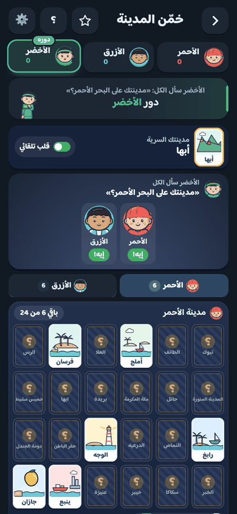
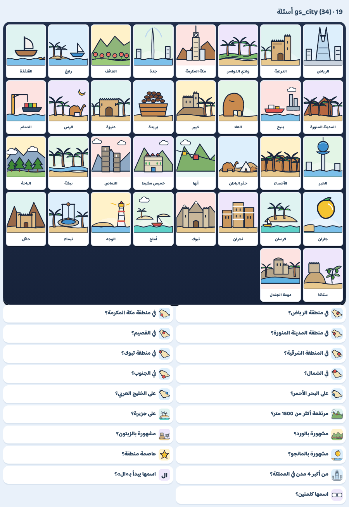

# خمّن المدينة

> «خمّن المدينة» وحدة من عائلة ألعاب التخمين الثمان: [خمّن الشخص](guess.md)، [خمّن الحيوان](gs_animal.md)، [خمّن الدولة](gs_country.md)، [خمّن المعلم](gs_land.md)، [خمّن الأكلة](gs_food.md)، [خمّن المهنة](gs_job.md)، [خمّن المدينة](gs_city.md)، [خمّن الفاكهة والخضار](gs_fruit.md). القرارات والاقتراحات العامة للعائلة (طريقة العرض، اللعب الجماعي، «بدون تلميحات قبل الجواب») مكتوبة في [سجل خمّن الشخص](guess.md).

<!-- auto:start header -->
<!-- هذا الجزء يتولّد آليًا بالأمر node tools/gen-game-logs.js. لا تعدّل بين auto:start وauto:end، واكتب ملاحظاتك برا. -->

| | |
|---|---|
| **الاسم** | خمّن المدينة |
| **المعرّف** | `gs_city` |
| **القسم** | [ذكاء وتخمين](README.md#cat-mind) |
| **اللاعبين** | من 2 إلى 8 |
| **الفرق** | تنلعب فرق من 4 لاعبين |
| **البوت** | بوت خاص فيها (سهل، متوسط، صعب) |
| **معلومات مخفية أونلاين** | `hide.seat`: `el`، `lg` (كل لاعب يشوف حقه بس)؛ `net`: ضغطات تحتاج الحالة المخفية يلعبها صاحب الغرفة |
| **الملفات** | `public/js/games/n-guess.js`، `public/css/n-guess.css`، وقوانينها في `HELP.gs_city` |
| **في الكتالوج** | [games.md](../games.md#g-gs_city) |

## يناسب أي طريقة لعب

| الطريقة | يناسب؟ | ليش |
|---|---|---|
| على نفس الجهاز | ✅ نعم | تنلعب بالدور، والسر (إن وجد) يكفيه غطاء واحد بكل دور |
| ضد البوت | ✅ نعم | لها بوت خاص بثلاث مستويات (سهل، متوسط، صعب) |
| أونلاين / قريب بدون نت | ✅ نعم | كل الألعاب تنلعب أونلاين وقريب بدون نت |

القاعدة في [game-checklist.md](../game-checklist.md)، والقرار في [decisions.md](../decisions.md) (2026-11-14: «كل طريقة لعب لها ألعابها»).

## القوانين

من زر «؟» داخل اللعبة (`HELP`):

- لكل واحد مدينة سرية من الـ24 مدينة سعودية اللي على اللوحة.
- في دورك اختار سؤال (في المنطقة الشرقية؟
- على البحر الأحمر؟
- عاصمة منطقة؟…) ويروح لكل الباقين، وكل واحد يجاوب عن مدينته، والجواب لك بس.
- البطاقات اللي ما تنطبق تنقلب.
- «الشمال» يعني مناطق تبوك والجوف والحدود الشمالية وحائل، و«الجنوب» مناطق عسير وجازان ونجران والباحة.
- بعد الأجوبة تقدر تخمّن أو تخلّص دورك: صح = نقاط (أكثر كل ما سألت أقل) وتقدر تخمّن غيرها، غلط = يروح دورك وتنقص نقطة.
- أول واحد يعرف مدن الكل ياخذ +3 وتخلص، والأكثر نقاط يفوز.
- مع ثلاثة أو أكثر فيه «الكل ضد واحد».
<!-- auto:end header -->

## التصميم والشخصيات

<!-- auto:start design -->
<!-- هذا الجزء يتولّد آليًا بالأمر node tools/gen-game-logs.js. لا تعدّل بين auto:start وauto:end، واكتب ملاحظاتك برا. -->

من الكود:

- **ملف اللعبة:** `public/js/games/n-guess.js` وتنسيقه `public/css/n-guess.css`.
- **«عيال الحارة»:** ملف اللعبة يرسم بعدّة الحارة (`KH` في `public/js/kit-hara.js`)، يعني الشخصيات الثمان بلبسها. التفاصيل في [characters.md](../characters.md).
- **طريقة اللعب:** على جوال واحد فيها شاشة تغطية وتمرير للجوال.
- **صور التصميم:** 2 صورة في [img/gs_city/](img/gs_city/).
<!-- auto:end design -->

### ملاحظات البناء
- **المحتوى:** 34 مدينة سعودية معروفة من كل المناطق، و19 سؤال بثلاث مواضيع («وين؟، الطبيعة، المدينة»). كل جولة 24 مدينة.
- **الرسم:** كل مدينة مشهد صغير مرسوم من عندنا باللي تنعرف فيه (برج المملكة، نافورة جدة، ورد الطائف، تلفريك أبها، برج مياه الخبر، بئر هداج في تيماء، قلعة مارد في دومة الجندل…)، **وبدون الأماكن المقدسة**: مكة بساعتها وجبالها، والمدينة بنخلها وجبل أحد.
- **أسئلة المكان:** صورة السؤال خريطة صغيرة للمملكة عليها النقطة. «الشمال» مناطق تبوك والجوف والحدود الشمالية وحائل، و«الجنوب» عسير وجازان ونجران والباحة، ومكتوب هذا في «؟».
- **الدقة:** الأسئلة على أشياء ما يختلف عليها أحد: المنطقة الإدارية، وعاصمة المنطقة، وعلى البحر الأحمر أو الخليج، والارتفاع فوق 1500 متر، وأكبر 4 مدن (تعداد 2022)، وأول الاسم. «مشهورة بـ» بس للمشهور جدًا: الورد للطائف، والزيتون للجوف، والمانجو لجازان. انشالت أسئلة «مشهورة بالتمر» و«فيها آثار» و«مدينة صناعية» لأن الجواب يختلف عليه الناس. الحقائق مكتوبة في تعليق فوق المجموعة في الكود.
- **مدن انشالت عشان ما تتشابه أجوبتها مع غيرها:** الخرج (نفس أجوبة الدرعية)، والجبيل والقطيف (نفس الخبر)، وعرعر (نفس حائل)، وضباء (نفس أملج).
- **قوة البوت** (200 مبارزة): الصعب ضد السهل 162-38 (المعلم 166-34).
- **طرق اللعب:** تنفع لكل الطرق مثل باقي العائلة: على نفس الجهاز السر ينعرض لصاحبه بس ورا الغطاء، وضد البوت بثلاث مستويات، وأونلاين الأسرار مخفية.
- **اسم طويل:** «خميس مشيط» عريضة، فلها خط أصغر شوي على البطاقة (`fit` في المحرك، ما يغيّر شي في باقي العائلة).

### الاختبارات (2026-11-25)
- **فاحص المجموعات:** كل سؤال يقسم المجموعة، وكل عنصر أجوبته ما تتكرر مع غيره، فأي لوحة من 24 تنحل («ALL DECKS UNIQUE» للعائلة كلها).
- **على جهاز واحد** (`smoke.js`، 200 خطوة لكل وحدة): لاعبين، و3، و8، وضد البوتات (سهل وصعب)، وفرق 4 مع بوتات، و4 بوتات تلعب لحالها: صفر أخطاء وصفر تعليق.
- **أونلاين** (`online/tfull.js`): لاعبين، و8، و4 بفريقين: كل الجوالات تشوف نفس الشي، و0 تسريب أسرار، وكل لعبة وصلت لآخرها: بلاعبين 95 حركة، وبفريقين 117، وبثمانية 1280.
- **الصور:** 390×844 بالفاتح والداكن (بداية، ونص اللعب، والنهاية).

### الصور

| لحظة الجواب بالداكن | كل مدن المجموعة |
|---|---|
|  |  |

## السجل

<!-- auto:start history -->
<!-- هذا الجزء يتولّد آليًا بالأمر node tools/gen-game-logs.js. لا تعدّل بين auto:start وauto:end، واكتب ملاحظاتك برا. -->

من git، الأحدث أول (الإصدارات والدمج العادي ما تنعرض):

| التاريخ | وش تغيّر | الكومت |
|---|---|---|
| 2026-11-25 | **انضافت اللعبة.** لعبة جديدة في عائلة التخمين (بموافقة صاحب المشروع): 34 مدينة سعودية معروفة مرسومة بمشاهد من عندنا (بدون الأماكن المقدسة)، و19 سؤال عن المنطقة والبحر والارتفاع واللي تنعرف فيه والاسم، على نفس محرك العائلة وطرقها وبوتها | `6bce2da` |
<!-- auto:end history -->

### من المحادثات
- **2026-11-25:** صاحب المشروع وافق على لعبتين جديدة من اقتراحات العائلة: «خمّن المدينة» و«خمّن الفاكهة والخضار»، بنفس الطريقة والشكل. ([decisions.md](../decisions.md))

## القرارات

### 2026-11-25 ✅ لعبة جديدة في عائلة التخمين
- انبنت على محرك العائلة نفسه (`n-guess.js`): نفس الطرق («كل واحد سره» و«الكل ضد واحد» والفرق)، ونفس الشكل والبوت. الجديد المحتوى والأسئلة بس.
- القرارات العامة للعائلة في [سجل خمّن الشخص](guess.md#القرارات).

## الاقتراحات

**الحالات:** ✅ معتمد • ❌ مرفوض • ⏸ معلّق • ❓ ينتظر قرار صاحب المشروع

- الاقتراحات العامة للعائلة في [سجل خمّن الشخص](guess.md#الاقتراحات).

## ملاحظات مفتوحة

ما فيه شي مفتوح لين الحين.
