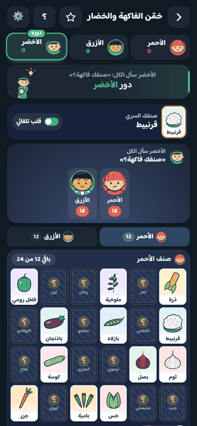
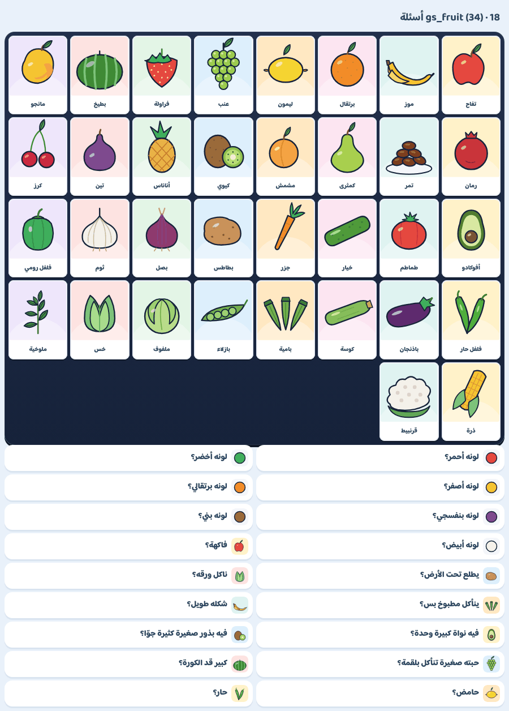

# خمّن الفاكهة والخضار

> «خمّن الفاكهة والخضار» وحدة من عائلة ألعاب التخمين الثمان: [خمّن الشخص](guess.md)، [خمّن الحيوان](gs_animal.md)، [خمّن الدولة](gs_country.md)، [خمّن المعلم](gs_land.md)، [خمّن الأكلة](gs_food.md)، [خمّن المهنة](gs_job.md)، [خمّن المدينة](gs_city.md)، [خمّن الفاكهة والخضار](gs_fruit.md). القرارات والاقتراحات العامة للعائلة (طريقة العرض، اللعب الجماعي، «بدون تلميحات قبل الجواب») مكتوبة في [سجل خمّن الشخص](guess.md).

<!-- auto:start header -->
<!-- هذا الجزء يتولّد آليًا بالأمر node tools/gen-game-logs.js. لا تعدّل بين auto:start وauto:end، واكتب ملاحظاتك برا. -->

| | |
|---|---|
| **الاسم** | خمّن الفاكهة والخضار |
| **المعرّف** | `gs_fruit` |
| **القسم** | [ذكاء وتخمين](README.md#cat-mind) |
| **اللاعبين** | من 2 إلى 8 |
| **الفرق** | تنلعب فرق من 4 لاعبين |
| **البوت** | بوت خاص فيها (سهل، متوسط، صعب) |
| **معلومات مخفية أونلاين** | `hide.seat`: `el`، `lg` (كل لاعب يشوف حقه بس)؛ `net`: ضغطات تحتاج الحالة المخفية يلعبها صاحب الغرفة |
| **الملفات** | `public/js/games/n-guess.js`، `public/css/n-guess.css`، وقوانينها في `HELP.gs_fruit` |
| **في الكتالوج** | [games.md](../games.md#g-gs_fruit) |

## يناسب أي طريقة لعب

| الطريقة | يناسب؟ | ليش |
|---|---|---|
| على نفس الجهاز | ✅ نعم | تنلعب بالدور، والسر (إن وجد) يكفيه غطاء واحد بكل دور |
| ضد البوت | ✅ نعم | لها بوت خاص بثلاث مستويات (سهل، متوسط، صعب) |
| أونلاين / قريب بدون نت | ✅ نعم | كل الألعاب تنلعب أونلاين وقريب بدون نت |

القاعدة في [game-checklist.md](../game-checklist.md)، والقرار في [decisions.md](../decisions.md) (2026-11-14: «كل طريقة لعب لها ألعابها»).

## القوانين

من زر «؟» داخل اللعبة (`HELP`):

- لكل واحد صنف سري من الـ24 فاكهة وخضار اللي على اللوحة.
- في دورك اختار سؤال (لونه أحمر؟
- فاكهة؟
- يطلع تحت الأرض؟
- فيه نواة؟…) ويروح لكل الباقين، وكل واحد يجاوب عن صنفه، والجواب لك بس.
- اللون هو لونه من برا مثل ما هو مرسوم، والطماطم والخيار خضار مثل ما تنباع.
- البطاقات اللي ما تنطبق تنقلب.
- بعد الأجوبة تقدر تخمّن أو تخلّص دورك: صح = نقاط (أكثر كل ما سألت أقل) وتقدر تخمّن غيره، غلط = يروح دورك وتنقص نقطة.
- أول واحد يعرف أصناف الكل ياخذ +3 وتخلص، والأكثر نقاط يفوز.
- مع ثلاثة أو أكثر فيه «الكل ضد واحد».
<!-- auto:end header -->

## التصميم والشخصيات

<!-- auto:start design -->
<!-- هذا الجزء يتولّد آليًا بالأمر node tools/gen-game-logs.js. لا تعدّل بين auto:start وauto:end، واكتب ملاحظاتك برا. -->

من الكود:

- **ملف اللعبة:** `public/js/games/n-guess.js` وتنسيقه `public/css/n-guess.css`.
- **«عيال الحارة»:** ملف اللعبة يرسم بعدّة الحارة (`KH` في `public/js/kit-hara.js`)، يعني الشخصيات الثمان بلبسها. التفاصيل في [characters.md](../characters.md).
- **طريقة اللعب:** على جوال واحد فيها شاشة تغطية وتمرير للجوال.
- **صور التصميم:** 2 صورة في [img/gs_fruit/](img/gs_fruit/).
<!-- auto:end design -->

### ملاحظات البناء
- **المحتوى:** 34 صنف من بيوتنا (17 فاكهة و17 خضار)، و18 سؤال بثلاث مواضيع («اللون، النوع، الشكل والطعم»). كل جولة 24 صنف.
- **الرسم:** رسومات ملونة من عندنا بنفس خط العائلة، وكل صنف بلون واحد واضح.
- **الدقة:** اللون هو لونه من برا مثل ما هو مرسوم (البصل بنفسجي، والعنب أخضر، والمانجو أصفر). «فاكهة» مثل ما تنباع بالسوق (الطماطم والخيار خضار). «ينأكل مطبوخ بس» للبطاطس والباذنجان والكوسة والبامية والبازلاء والملوخية والذرة والقرنبيط. البازلاء والذرة هي نفسها البذور، فجوابها «لا» في «فيه بذور صغيرة كثيرة جوّا». الحقائق مكتوبة في تعليق فوق المجموعة في الكود.
- **انشالت:** أسئلة «يطلع على شجرة؟» (الموز والعنب يختلف عليها الناس) و«نقشره؟» و«حلو؟». وانشال البقدونس والنعناع (نفس أجوبة الخس) واليوسفي (نفس البرتقال) والجوافة (نفس الكمثرى).
- **قوة البوت** (200 مبارزة): الصعب ضد السهل 156-44.
- **طرق اللعب:** تنفع لكل الطرق مثل باقي العائلة: على نفس الجهاز السر ينعرض لصاحبه بس ورا الغطاء، وضد البوت بثلاث مستويات، وأونلاين الأسرار مخفية.

### الاختبارات (2026-11-25)
- **فاحص المجموعات:** كل سؤال يقسم المجموعة، وكل عنصر أجوبته ما تتكرر مع غيره، فأي لوحة من 24 تنحل («ALL DECKS UNIQUE» للعائلة كلها).
- **على جهاز واحد** (`smoke.js`، 200 خطوة لكل وحدة): لاعبين، و3، و8، وضد البوتات (سهل وصعب)، وفرق 4 مع بوتات، و4 بوتات تلعب لحالها: صفر أخطاء وصفر تعليق.
- **أونلاين** (`online/tfull.js`): لاعبين، و8، و4 بفريقين: كل الجوالات تشوف نفس الشي، و0 تسريب أسرار، وكل لعبة وصلت لآخرها: بلاعبين 47 حركة، وبفريقين 175، وبثمانية 977.
- **الصور:** 390×844 بالفاتح والداكن (بداية، ونص اللعب، والنهاية).

### الصور

| لحظة الجواب بالداكن | كل أصناف المجموعة |
|---|---|
|  |  |

## السجل

<!-- auto:start history -->
<!-- هذا الجزء يتولّد آليًا بالأمر node tools/gen-game-logs.js. لا تعدّل بين auto:start وauto:end، واكتب ملاحظاتك برا. -->

من git، الأحدث أول (الإصدارات والدمج العادي ما تنعرض):

| التاريخ | وش تغيّر | الكومت |
|---|---|---|
| 2026-11-24 | تجربة الرسمة الجديدة لـ«عيال الحارة» (بموافقة صاحب المشروع: «طبقه خلني اجربه»): جسم على هيكل عظمي بأطراف متصلة، وعيون صغيرة والحواجب تبيّن المزاج، وبدون غترة ولا شماغ ولا حجاب، ولبس المهن انرسم من جديد على الجسم | `486b5fd` |
| 2026-11-15 | عائلة التخمين: عيال المهن صاروا أهدى، وبوت «الكل ضد واحد» يسأل بعدين يخمّن، وتصليحات في مشهد الجواب والأسماء | `9f505cd` |
| 2026-11-15 | عائلة التخمين: محرك واحد لست ألعاب (الشخص، الحيوان، الدولة، المعلم، الأكلة، المهنة)، بتبويبات أسئلة ومشهد للجواب وشريط تاريخ، و«كل واحد سره» افتراضي | `c38c006` |
<!-- auto:end history -->

### من المحادثات
- **2026-11-25:** صاحب المشروع وافق على لعبتين جديدة من اقتراحات العائلة: «خمّن المدينة» و«خمّن الفاكهة والخضار»، بنفس الطريقة والشكل. ([decisions.md](../decisions.md))

## القرارات

### 2026-11-25 ✅ لعبة جديدة في عائلة التخمين
- انبنت على محرك العائلة نفسه (`n-guess.js`): نفس الطرق («كل واحد سره» و«الكل ضد واحد» والفرق)، ونفس الشكل والبوت. الجديد المحتوى والأسئلة بس.
- القرارات العامة للعائلة في [سجل خمّن الشخص](guess.md#القرارات).

## الاقتراحات

**الحالات:** ✅ معتمد • ❌ مرفوض • ⏸ معلّق • ❓ ينتظر قرار صاحب المشروع

- الاقتراحات العامة للعائلة في [سجل خمّن الشخص](guess.md#الاقتراحات).

## ملاحظات مفتوحة

ما فيه شي مفتوح لين الحين.
