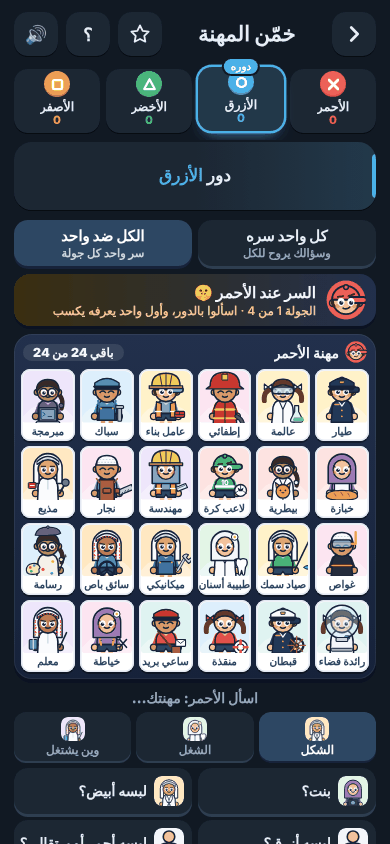
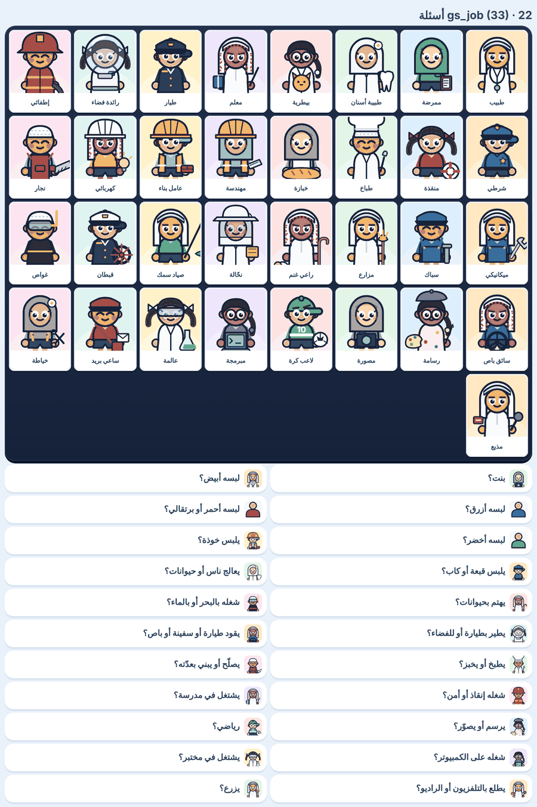

# خمّن المهنة

> «خمّن المهنة» وحدة من عائلة ألعاب التخمين الست: [خمّن الشخص](guess.md)، [خمّن الحيوان](gs_animal.md)، [خمّن الدولة](gs_country.md)، [خمّن المعلم](gs_land.md)، [خمّن الأكلة](gs_food.md)، [خمّن المهنة](gs_job.md). القرارات والاقتراحات العامة للعائلة (طريقة العرض، اللعب الجماعي، «بدون تلميحات قبل الجواب») مكتوبة في [سجل خمّن الشخص](guess.md).

<!-- auto:start header -->
<!-- هذا الجزء يتولّد آليًا بالأمر node tools/gen-game-logs.js. لا تعدّل بين auto:start وauto:end، واكتب ملاحظاتك برا. -->

| | |
|---|---|
| **الاسم** | خمّن المهنة |
| **المعرّف** | `gs_job` |
| **القسم** | [ذكاء وتخمين](README.md#cat-mind) |
| **اللاعبين** | من 2 إلى 8 |
| **الفرق** | تنلعب فرق من 4 لاعبين |
| **البوت** | بوت خاص فيها (سهل، متوسط، صعب) |
| **معلومات مخفية أونلاين** | `hide.seat`: `el`، `lg` (كل لاعب يشوف حقه بس)؛ `net`: ضغطات تحتاج الحالة المخفية يلعبها صاحب الغرفة |
| **الملفات** | `public/js/games/n-guess.js`، `public/css/n-guess.css`، وقوانينها في `HELP.gs_job` |
| **في الكتالوج** | [games.md](../games.md#g-gs_job) |

## يناسب أي طريقة لعب

| الطريقة | يناسب؟ | ليش |
|---|---|---|
| على نفس الجهاز | ✅ نعم | تنلعب بالدور، والسر (إن وجد) يكفيه غطاء واحد بكل دور |
| ضد البوت | ✅ نعم | لها بوت خاص بثلاث مستويات (سهل، متوسط، صعب) |
| أونلاين / قريب بدون نت | ✅ نعم | كل الألعاب تنلعب أونلاين وقريب بدون نت |

القاعدة في [game-checklist.md](../game-checklist.md)، والقرار في [decisions.md](../decisions.md) (2026-11-14: «كل طريقة لعب لها ألعابها»).

## القوانين

من زر «؟» داخل اللعبة (`HELP`):

- لكل واحد مهنة سرية من الـ24 اللي على اللوحة (عيال الحارة لابسين لبس الشغل).
- في دورك اختار سؤال (يلبس خوذة؟
- لبسه أبيض؟
- يعالج ناس؟
- شغله بالبحر؟…) ويروح لكل الباقين، وكل واحد يجاوب عن مهنته، والجواب لك بس.
- البطاقات اللي ما تنطبق تنقلب.
- بعد الأجوبة تقدر تخمّن أو تخلّص دورك: صح = نقاط (أكثر كل ما سألت أقل) وتقدر تخمّن غيرها، غلط = يروح دورك وتنقص نقطة.
- أول واحد يعرف مهن الكل ياخذ +3 وتخلص، والأكثر نقاط يفوز.
- مع ثلاثة أو أكثر فيه «الكل ضد واحد».
<!-- auto:end header -->

## التصميم والشخصيات

<!-- auto:start design -->
<!-- هذا الجزء يتولّد آليًا بالأمر node tools/gen-game-logs.js. لا تعدّل بين auto:start وauto:end، واكتب ملاحظاتك برا. -->

من الكود:

- **ملف اللعبة:** `public/js/games/n-guess.js` وتنسيقه `public/css/n-guess.css`.
- **«عيال الحارة»:** ملف اللعبة يرسم بعدّة الحارة (`KH` في `public/js/kit-hara.js`)، يعني الشخصيات الثمان بلبسها. التفاصيل في [characters.md](../characters.md).
- **طريقة اللعب:** على جوال واحد فيها شاشة تغطية وتمرير للجوال.
- **صور التصميم:** 2 صورة في [img/gs_job/](img/gs_job/).
<!-- auto:end design -->

### ملاحظات البناء
- **المحتوى:** 33 مهنة، و22 سؤال بثلاث مواضيع (الشكل، الشغل، وين).
- **الرسم:** «عيال الحارة» بلبس المهن وأدواتها (انضافت للعدّة بـ`KH.extend`)، وفم هادي على كل الأطفال. وبعد الإطلاق صاروا «أهدى» (`9f505cd`). هذي أول لعبة غير ألعاب الحارة تستخدم الشخصيات بلبس خاص، على القاعدة في [characters.md](../characters.md).
- **قوة البوت** (200 مبارزة): الصعب ضد السهل 160-40.
- **طرق اللعب:** تنفع لكل الطرق: على نفس الجهاز السر ينعرض لصاحبه بس ورا الغطاء، وضد البوت بثلاث مستويات، وأونلاين الأسرار مخفية (0 تسريب).

### الصور

| بداية جولة بالداكن | كل المهن بعيال الحارة |
|---|---|
|  |  |

## السجل

<!-- auto:start history -->
<!-- هذا الجزء يتولّد آليًا بالأمر node tools/gen-game-logs.js. لا تعدّل بين auto:start وauto:end، واكتب ملاحظاتك برا. -->

من git، الأحدث أول (الإصدارات والدمج العادي ما تنعرض):

| التاريخ | وش تغيّر | الكومت |
|---|---|---|
| 2026-11-15 | عائلة التخمين: عيال المهن صاروا أهدى، وبوت «الكل ضد واحد» يسأل بعدين يخمّن، وتصليحات في مشهد الجواب والأسماء | `9f505cd` |
| 2026-11-15 | عائلة التخمين: محرك واحد لست ألعاب (الشخص، الحيوان، الدولة، المعلم، الأكلة، المهنة)، بتبويبات أسئلة ومشهد للجواب وشريط تاريخ، و«كل واحد سره» افتراضي | `c38c006` |
<!-- auto:end history -->

### من المحادثات
- **2026-11-15:** صاحب المشروع طلبها لعبة منفصلة: «وخمن الأشخاص طورها وسوي العاب منفصله خمن الأشخاص - خمن الحيوان - خمن الدوله - خمن المعلم - خمن الاكله - خمن المهنه -واقترح». وانرفعت مع باقي العائلة. التفاصيل في [سجل خمّن الشخص](guess.md).

## القرارات

### 2026-11-15 ✅ لعبة منفصلة في عائلة التخمين
- القرارات العامة للعائلة في [سجل خمّن الشخص](guess.md#القرارات): بدون تلميحات قبل الجواب («لازم عنصر المفاجأة»)، وعرض الأسئلة بتبويبات، و«كل واحد سره» افتراضي.

## الاقتراحات

**الحالات:** ✅ معتمد • ❌ مرفوض • ⏸ معلّق • ❓ ينتظر قرار صاحب المشروع

- الاقتراحات العامة للعائلة (عرض الأسئلة، اللعب الجماعي، وألعاب تخمين زيادة) في [سجل خمّن الشخص](guess.md#الاقتراحات).

## ملاحظات مفتوحة

- **«الكل ضد واحد» ضد البوت ضعيف** على مستوى العائلة كلها (39% للصعب والحظ 33%). التفاصيل في [سجل خمّن الشخص](guess.md).
- **ينتظر:** اعتماد شخصيات المهن الجديدة من صاحب المشروع (ورقة الشخصيات في [سجل خمّن الشخص](guess.md)).
