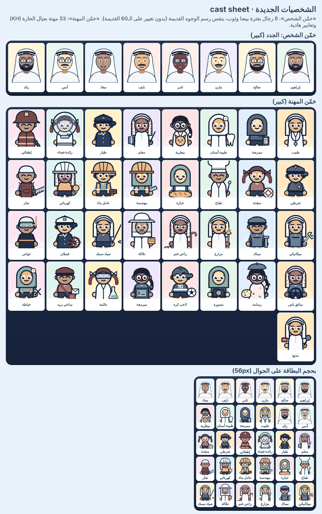
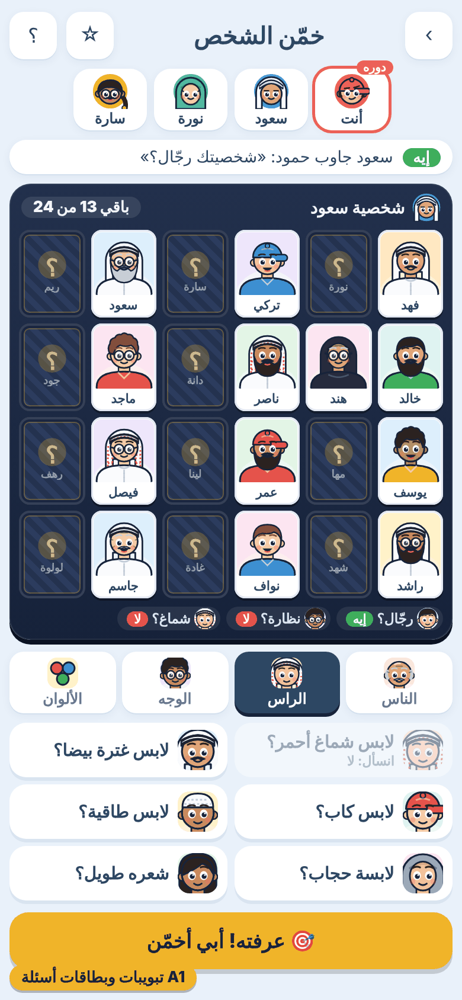
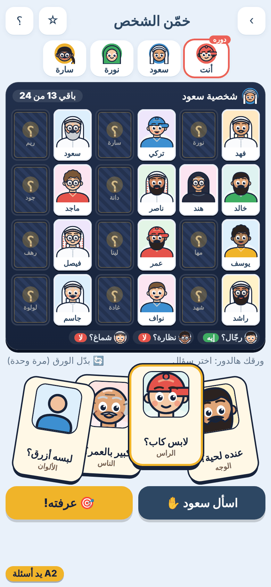
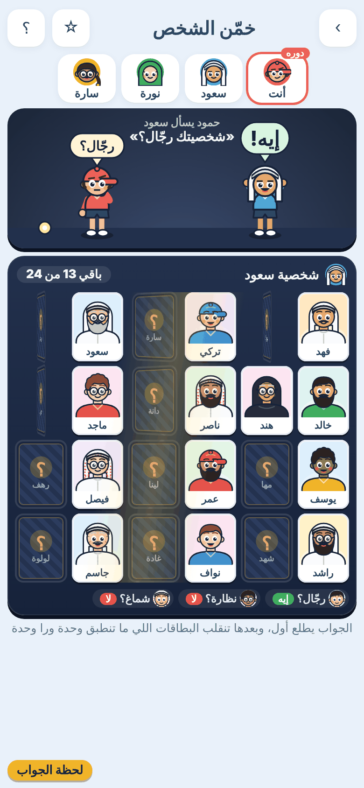
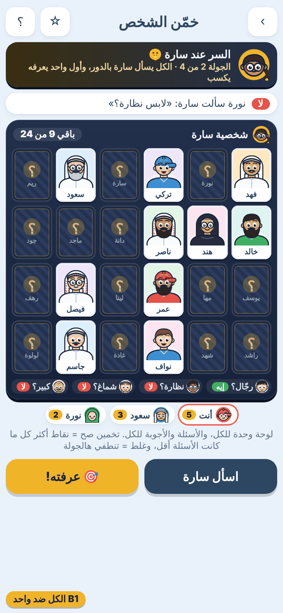
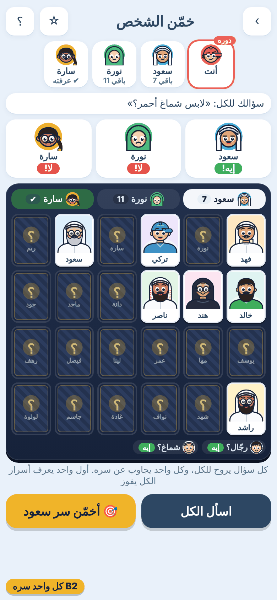
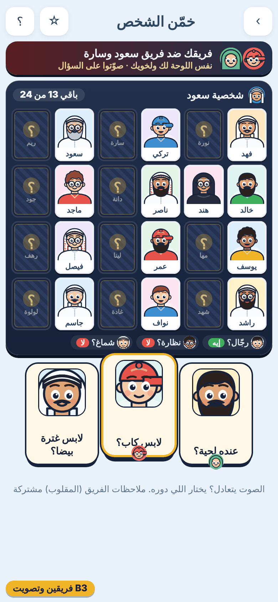
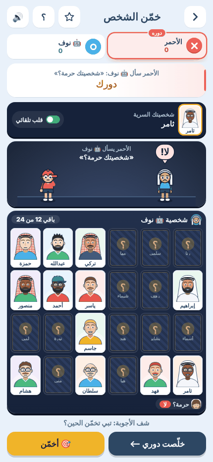
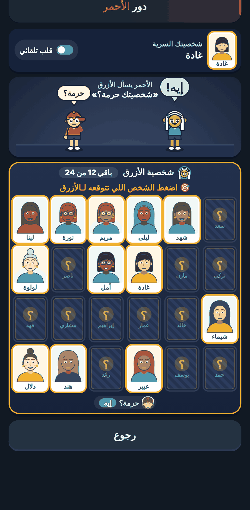

# خمّن الشخص

> هذا السجل الرئيسي لعائلة ألعاب التخمين الست: [خمّن الشخص](guess.md)، [خمّن الحيوان](gs_animal.md)، [خمّن الدولة](gs_country.md)، [خمّن المعلم](gs_land.md)، [خمّن الأكلة](gs_food.md)، [خمّن المهنة](gs_job.md). كلها على محرك واحد في `public/js/games/n-guess.js`، والقرارات والاقتراحات العامة مكتوبة هنا.

<!-- auto:start header -->
<!-- هذا الجزء يتولّد آليًا بالأمر node tools/gen-game-logs.js. لا تعدّل بين auto:start وauto:end، واكتب ملاحظاتك برا. -->

| | |
|---|---|
| **الاسم** | خمّن الشخص |
| **المعرّف** | `guess` |
| **القسم** | [ذكاء وتخمين](README.md#cat-mind) |
| **اللاعبين** | من 2 إلى 8 |
| **الفرق** | تنلعب فرق من 4 لاعبين |
| **البوت** | بوت خاص فيها (سهل، متوسط، صعب) |
| **معلومات مخفية أونلاين** | `hide.seat`: `el`، `lg` (كل لاعب يشوف حقه بس)؛ `net`: ضغطات تحتاج الحالة المخفية يلعبها صاحب الغرفة |
| **الملفات** | `public/js/games/n-guess.js`، `public/css/n-guess.css`، وقوانينها في `HELP.guess` |
| **في الكتالوج** | [games.md](../games.md#g-guess) |

## يناسب أي طريقة لعب

| الطريقة | يناسب؟ | ليش |
|---|---|---|
| على نفس الجهاز | ✅ نعم | تنلعب بالدور، والسر (إن وجد) يكفيه غطاء واحد بكل دور |
| ضد البوت | ✅ نعم | لها بوت خاص بثلاث مستويات (سهل، متوسط، صعب) |
| أونلاين / قريب بدون نت | ✅ نعم | كل الألعاب تنلعب أونلاين وقريب بدون نت |

القاعدة في [game-checklist.md](../game-checklist.md)، والقرار في [decisions.md](../decisions.md) (2026-11-14: «كل طريقة لعب لها ألعابها»).

## القوانين

من زر «؟» داخل اللعبة (`HELP`):

- لكل واحد شخصية سرية من الـ24 اللي على اللوحة.
- في دورك اختار سؤال (شماغ؟
- نظارة؟
- لون الشعر؟…) ويروح لكل الباقين، وكل واحد يجاوب عن شخصيته: الجواب لك أنت بس، والبطاقات اللي ما تنطبق تنقلب لحالها (أو اقلبها بنفسك لو قفلت «قلب تلقائي»).
- بعد الأجوبة تقدر تخمّن، أو تخلّص دورك.
- اضغط «عرفته!» واختار البطاقة: صح = نقاط (أكثر كل ما سألت أقل) وتقدر تخمّن غيره، غلط = يروح دورك وتنقص نقطة.
- أول واحد يعرف أسرار الكل تخلص اللعبة وياخذ +3، والأكثر نقاط يفوز.
- مع ثلاثة أو أكثر تقدرون تختارون «الكل ضد واحد»: كل جولة واحد عنده السر والباقين يسألونه بالدور، وأول واحد يعرفه ياخذ الجولة.
- مع الفرق: البطاقات والأجوبة مشتركة بينك وبين خويك، وتصوّتون على السؤال.
<!-- auto:end header -->

## التصميم والشخصيات

<!-- auto:start design -->
<!-- هذا الجزء يتولّد آليًا بالأمر node tools/gen-game-logs.js. لا تعدّل بين auto:start وauto:end، واكتب ملاحظاتك برا. -->

من الكود:

- **ملف اللعبة:** `public/js/games/n-guess.js` وتنسيقه `public/css/n-guess.css`.
- **«عيال الحارة»:** ملف اللعبة يرسم بعدّة الحارة (`KH` في `public/js/kit-hara.js`)، يعني الشخصيات الثمان بلبسها. التفاصيل في [characters.md](../characters.md).
- **طريقة اللعب:** على جوال واحد فيها شاشة تغطية وتمرير للجوال.
- **صور التصميم:** 9 صورة في [img/guess/](img/guess/).
<!-- auto:end design -->

### طريقة العرض المعتمدة
- **الأسئلة تحت تبويبات مواضيع** («الناس، الراس، الوجه، الشعر، اللبس» في الأشخاص)، وكل سؤال جملة طبيعية مع صورة صغيرة («شخصيتك لابس نظارة؟»). السؤال اللي انسأل يبين جوابه.
- **ما فيه أي تلميح قبل الجواب:** لا عدّاد ولا معاينة ولا تبهيت للأسئلة «اللي ما تفيد».
- **لحظة الجواب مشهد:** الطفل يرد «إيه!» أو «لا!» بفقاعة (أو صف وجوه الخصوم بأجوبتهم)، وبعدها تنقلب البطاقات المستبعدة بموجة.
- **شريط تاريخ** تحت اللوحة فيه الأسئلة وأجوبتها لكل خصم، وتبويب لكل خصم فيه «باقي N» و✔ لما تعرف سره.
- **قلب تلقائي** تقدر توقفه من جوالك وتقلب بنفسك، و**تأكيد** قبل كل تخمين.
- **6 بطاقات بالصف** على كل المقاسات، بأسماء تنسيق خاصة فيها (`gsx-`) ما يستخدمها أي ملف ثاني.

### اللعب الجماعي
- **«كل واحد سره والسؤال للكل» (الافتراضي):** سؤالك يروح لكل خصم مرة وحدة، وكل واحد يجاوب عن سره لك بس (ولفريقك). التخمين الصح ياخذ max(1، 6 − أسئلتك) وتقدر تخمن مرة ثانية، والغلط ينهي دورك وينقصك نقطة. أول واحد يعرف أسرار الكل ينهي اللعبة بـ+3. باثنين ترجع المبارزة العادية.
- **«الكل ضد واحد»** (من 3، بدون فرق): واحد عنده السر كل جولة، والباقين يسألون بالدور والأجوبة للكل. أفضل طريقة على جوال واحد.
- **الفرق:** الفريق يتشارك اللوحات والأجوبة، ويصوتون على السؤال (أونلاين وجوه المصوتين على كل سؤال).

### الشخصيات
- **الستين وجه القديمة** باقية بنفس الرسم والأسماء والصفات، بطلب صاحب المشروع.
- **انضاف 8 رجال** بغترة وثوب بنفس كود الوجوه، فصارت 68. كل جولة 24 على اللوحة (12 رجل و12 امرأة).
- **الشخصيات الجديدة كلها** (8 رجال، و33 مهنة من «عيال الحارة» بلبس المهن في [خمّن المهنة](gs_job.md)) بنفس الأسلوب، بملامح هادية.

### الصور اللي انعرضت قبل البناء (2026-11-15)

| (1) تبويبات ✅ | (2) يد أسئلة ❌ | (3) لحظة الجواب ✅ |
|---|---|---|
|  |  |  |
| **(4) الكل ضد واحد ✅ إضافي** | **(5) كل واحد سره ✅ الافتراضي** | **(6) الفرق ✅** |
|  |  |  |

### من اللعبة المنشورة

| لحظة الجواب | وضع التخمين (داكن) |
|---|---|
|  |  |

### ملاحظات البناء
- **المحتوى:** 68 شخص، و24 سؤال بخمس مواضيع. كل مجموعة فيها 32 عنصر أو أكثر و14 سؤال أو أكثر، وكل سؤال يقسم المجموعة، وكل عنصر له أجوبة ما تتكرر (فاحص المجموعات: «ALL DECKS UNIQUE»).
- **قوة البوت** (200 مبارزة): الصعب ضد السهل 146-54. البوت المتوسط والصعب يسألون السؤال اللي يقسم اللوحة نص بنص.
- **الحفظ القديم:** لعبة «خمّن الشخص» محفوظة من قبل تكمل على لوحة جديدة بنفس المقاعد والأسرار.

## السجل

<!-- auto:start history -->
<!-- هذا الجزء يتولّد آليًا بالأمر node tools/gen-game-logs.js. لا تعدّل بين auto:start وauto:end، واكتب ملاحظاتك برا. -->

من git، الأحدث أول (الإصدارات والدمج العادي ما تنعرض):

| التاريخ | وش تغيّر | الكومت |
|---|---|---|
| 2026-11-15 | عائلة التخمين: عيال المهن صاروا أهدى، وبوت «الكل ضد واحد» يسأل بعدين يخمّن، وتصليحات في مشهد الجواب والأسماء | `9f505cd` |
| 2026-11-15 | صارت «خمّن الشخص» وحدة من عائلة ست ألعاب على محرك واحد (`n-guess.js`): الستين وجه القديمة نفسها، و8 رجال جدد بالغترة، وتبويبات أسئلة ومشهد «إيه!/لا!» وشريط تاريخ، وانحلت البطاقات العملاقة نهائيًا بأسماء تنسيق خاصة (`gsx-`) | `c38c006` |
| 2026-11-14 | الوجوه صارت أخف (صورة وحدة بدل 25 عنصر)، والشماغ صار يطلع بنقشته الحمرا | `5276149` |
| 2026-11-14 | انحل خطأ اللوحة اللي صارت عمود بطاقات عملاقة (طولها 11 ألف بكسل): السبب تنسيق عام `.gm` من ملف ثاني | `0fe4e16` |
| 2026-11-14 | زاد عدد الأشخاص من 24 إلى 60، وانضافت مجموعة حيوانات (37) تختارها قبل أول سؤال | `ddaae7f` |
| 2026-11-13 | أونلاين: الأسرار تنرسل مشفّرة لصاحبها بس، وصاحب الغرفة يمشّي اللعبة، واللاعب يرجع لمقعده | `280a3a1` |
| 2026-11-13 | العقارات ولودو وجكارو و5 ألعاب قتالية، وتحسين «خمّن الشخص»، وأوراق لعب جديدة | `483522b` |
| 2026-11-13 | نص القوانين انتقل لملف `help.js`، مع إعدادات الغرفة وحفظ النقاط وعشر ألعاب جديدة | `8796558` |
| 2026-11-13 | الكود انقسم لملفات (كل مجموعة ألعاب بملف)، وعشرين لعبة جديدة | `7c287a0` |
| 2026-11-12 | **انضافت اللعبة.** الدفعة الأولى من ألعابنا: ست ألعاب للاعبين اثنين | `46cefcd` |
<!-- auto:end history -->

### من المحادثات (الأحدث أول)

- **2026-11-15:** انرفعت الست ألعاب. انعرضت على صاحب المشروع ورقة الشخصيات الجديدة، و6 اقتراحات لألعاب تخمين زيادة.
- **2026-11-15:** «و التخمين لاتغير الشخصيات السابقه ، و الشخصيات الجديدة حسنها وخلي تصميم الشخصيات منسق مب شكل غبي». وبدأ البناء على المقترحات اللي في الصور.
- **2026-11-15:** انرسمت 6 صور: ثلاث لعرض الأسئلة، وثلاث للعب الجماعي.
- **2026-11-15:** «لا مابي تلميحات قبل الاجابه لازم عنصر المفاجأة» (على اقتراح عدّاد «يشيل تقريباً ٩ من ١٦»).
- **2026-11-15:** «اهم شي طريقة عرض الأسئلة نطورها ، ونطور اللعبه الجماعية».
- **2026-11-15:** «وخمن الأشخاص طورها وسوي العاب منفصله خمن الأشخاص - خمن الحيوان - خمن الدوله - خمن المعلم - خمن الاكله - خمن المهنه -واقترح . بعدين التخمين معطوب فيها ، يكبر البطاقات بشكل يعيق اللعب.» الجواب وقتها: الخطأ انحل قبل كم ساعة (`0fe4e16`)، والجوال غالبًا كان فاتح النسخة القديمة. ومع كذا انبنت اللوحة من جديد بأسماء تنسيق خاصة عشان ما يرجع.
- **2026-11-14:** مراجعة الجودة لقت إن اللوحة في وضع التخمين صارت عمود بطاقات عملاقة طولها تقريبًا 11 ألف بكسل، والسبب تنسيق عام `.gm` في `g-mind.css` ياخذ لوحة التخمين. ووجوه أخف، والشماغ صار بنقشته.
- **2026-11-14:** «تطوير أ»: الأشخاص من 24 إلى 60، ومجموعة حيوانات (37) تختارها قبل أول سؤال.
- **2026-11-13:** المراجعة الأولى: الأسئلة بالداكن نص غامق على خلفية غامقة (تباين 1.58:1)، والسر يتسرب أونلاين. انصلحت، وصار صاحب السر هو اللي يجاوب (محرك الأونلاين الجديد).

## القرارات

### 2026-11-15 ✅ الشخصيات القديمة ما تتغير، والجديدة متناسقة
- «و التخمين لاتغير الشخصيات السابقه ، و الشخصيات الجديدة حسنها وخلي تصميم الشخصيات منسق مب شكل غبي».

### 2026-11-15 ✅ بدون تلميحات قبل الجواب
- «لا مابي تلميحات قبل الاجابه لازم عنصر المفاجأة».
- يعني: ما فيه عدّاد ولا معاينة لكم بطاقة بتنشال. الجواب يطلع أول، وبعدها تنقلب البطاقات.

### 2026-11-15 ✅ الأولوية: عرض الأسئلة واللعب الجماعي
- «اهم شي طريقة عرض الأسئلة نطورها ، ونطور اللعبه الجماعية».

### 2026-11-15 ✅ ست ألعاب منفصلة
- «وخمن الأشخاص طورها وسوي العاب منفصله خمن الأشخاص - خمن الحيوان - خمن الدوله - خمن المعلم - خمن الاكله - خمن المهنه -واقترح».
- كلها على محرك واحد، وكل وحدة لها مربعها في القائمة. القرار في [decisions.md](../decisions.md).

## الاقتراحات

**الحالات:** ✅ معتمد • ❌ مرفوض • ⏸ معلّق • ❓ ينتظر قرار صاحب المشروع

### 2026-11-15: الخطة الأولى
- ✅ **ست ألعاب**، كل وحدة 32 عنصر أو أكثر (24 كل جولة) و14 سؤال أو أكثر يخص موضوعها، والرسومات مرسومة مو إيموجي.
- ✅ **البطاقات اللي ما تطابق تنقلب لحالها** وتقدر توقفها، و✅ **تأكيد قبل التخمين**، و✅ **اللي يخمن بأسئلة أقل ياخذ نقاط أكثر**، و✅ **البوت الصعب يسأل السؤال اللي يقسم نص بنص**.
- ✅ **الأسئلة مرتبة بمجموعات** (صارت تبويبات).

### 2026-11-15: عرض الأسئلة
- ✅ **(1) تبويبات** بأسئلة بجمل طبيعية (المستحسن).
- ❌ **عدّاد «يشيل تقريباً ٩ من ١٦ باقين»** على كل سؤال: صاحب المشروع رفضه: «لا مابي تلميحات قبل الاجابه لازم عنصر المفاجأة».
- ❌ **(2) يد أسئلة:** 3 أو 4 بطاقات أسئلة كل دور وتبديلة وحدة. حلوة بس عشوائية وممكن تحرمك السؤال اللي تحتاجه، فانعرضت كوضع «سريع» وما انختارت.
- ✅ **(3) لحظة الجواب مشهد**، مع شريط الأسئلة السابقة.

### 2026-11-15: اللعب الجماعي
- ✅ **(5) «كل واحد سره والسؤال للكل»:** الافتراضي من 3 إلى 8.
- ✅ **(4) «الكل ضد واحد»:** طريقة إضافية، والأحسن على جوال واحد.
- ✅ **(6) الفرق** يتشاورون ويصوتون على السؤال.
- ❌ **«سؤال ذهبي»** (سؤال مفتوح مرة وحدة): ما ينجاوب آليًا، فانشال.
- ❌ **«كذبة وحدة»** مسموحة باللعبة: تخرّب قلب البطاقات، فانشالت.

### 2026-11-15: ألعاب تخمين زيادة (تنتظر اختيار صاحب المشروع)
- ❓ **خمّن الطير:** صقر، حبارى، نعامة، فلامنجو، هدهد… مألوفة من الصقارة والطبيعة، وأسئلتها واضحة (المنقار، اللون، يطير ولا لا).
- ❓ **خمّن الفاكهة والخضار:** ملونة وسهلة للصغار: «لونها أحمر؟ فيها بذور؟ تطلع على شجرة؟».
- ❓ **خمّن المدينة السعودية:** تعلّم الجغرافيا (المنطقة، على البحر، بالجبال، مشهورة بالتمر أو الورد).
- ❓ **خمّن الرياضة:** «فيها كورة؟ جماعية؟ بالماء؟»، وتنرسم بعيال الحارة مثل المهن.
- ❓ **خمّن الأداة:** أدوات البيت والورشة: «تشتغل بالكهرب؟ بالمطبخ؟ حادة؟».
- ❓ **خمّن المركبة:** مركبات عامة بدون ماركات (باص، قطار، سفينة، طيارة، دباب…).

### 2026-11-15: الشخصيات الجديدة
- ❓ **ورقة الشخصيات الجديدة** (8 رجال بالغترة و33 مهنة) انرسلت لصاحب المشروع يعتمدها أو يطلب تعديل، وما رد لين الحين. (الصورة فوق.)

## ملاحظات مفتوحة

- **«الكل ضد واحد» ضد البوت ضعيف:** بوت صعب ضد بوتين سهلين فاز 39% بس، والحظ يعطي 33%. هالطريقة أغلبها معلومات مكشوفة وسرعة، فالمستوى يفرق أقل. الطريقة الافتراضية ما فيها هالمشكلة. (بعدها صار البوت يسأل بعدين يخمّن في `9f505cd`.)
- **ينتظر:** اعتماد ورقة الشخصيات الجديدة، واختيار ألعاب التخمين الزيادة.
- مع 8 لاعبين تبويبات الخصوم تحتاج تمرير.
