# غميضة الحارة

> لعبة صاحب المشروع نفسه، وأول «لعبة حارة». القوانين كاملة والمراحل والأحداث وجدول النقاط والبوتات في [street-games.md](../street-games.md) (القسم 1). هذا السجل يركز على وش صار لها بالتاريخ، وقرارات صاحب المشروع، والاقتراحات.

<!-- auto:start header -->
<!-- هذا الجزء يتولّد آليًا بالأمر node tools/gen-game-logs.js. لا تعدّل بين auto:start وauto:end، واكتب ملاحظاتك برا. -->

| | |
|---|---|
| **الاسم** | غميضة الحارة |
| **المعرّف** | `hide` |
| **القسم** | [جماعية](README.md#cat-party) |
| **اللاعبين** | من 3 إلى 8 |
| **الفرق** | كل واحد لحاله (أو لها أطرافها الخاصة) |
| **البوت** | بوت خاص فيها (سهل، متوسط، صعب) |
| **معلومات مخفية أونلاين** | `mask`: اللعبة تحدد بنفسها وش يشوف كل مقعد؛ `net`: ضغطات تحتاج الحالة المخفية يلعبها صاحب الغرفة؛ اختيارات سرية بنفس الوقت: تنخفي لين يختار الكل (`resolve`) |
| **الملفات** | `public/js/games/n-hide.js`، `public/css/n-hide.css`، وقوانينها في `HELP.hide` |
| **في الكتالوج** | [games.md](../games.md#g-hide) |

## يناسب أي طريقة لعب

| الطريقة | يناسب؟ | ليش |
|---|---|---|
| على نفس الجهاز | ❌ مخفية من القسم | كل خطوة (15 ثانية) الغمّاض يختار بالسر وبعده كل متخبّي، فيتمرر الجوال على الكل بكل خطوة (قرابة 10 خطوات)، وتضيع لحظة الترقب والمتابعة اللي هي روح اللعبة |
| ضد البوت | ✅ نعم | لها بوت خاص بثلاث مستويات (سهل، متوسط، صعب) |
| أونلاين / قريب بدون نت | ✅ نعم | كل الألعاب تنلعب أونلاين وقريب بدون نت |

القاعدة في [game-checklist.md](../game-checklist.md)، والقرار في [decisions.md](../decisions.md) (2026-11-14: «كل طريقة لعب لها ألعابها»).

## القوانين

من زر «؟» داخل اللعبة (`HELP`):

- غميضة الحارة بالليل: واحد «الغمّاض» يدوّر والباقين يتخبّون، وكل جولة يصير الغمّاض اللي بعده.
- العدّ: الغمّاض يغمّض ويعدّ للعشرة، وكل متخبّي يختار مخباه بالسر من 16 مكان على الخريطة (مكان لكل واحد) ويمشي له.
- «البيت» هو المكان الآمن.
- عند الغمّاض فتشات بعدد 6 + عدد المتخبّين (أقصاها 12).
- كل دور يختار الغمّاض بالسر: يفتّش مكان 🔦، أو يحرس البيت 🛡، أو مرة وحدة يشغّل «الكشاف» على جهة ويبين ظل واحد متخبّي فيها (ياخذ فتشة).
- بعدها كل متخبّي يقرر بالسر: يبقى 🤫، أو يتسلّل 👣 لمكان فاضي جنبه على الممرات، أو يركض للبيت 🏃.
- إذا ركضت والبيت محروس تنمسك، وإذا مو محروس توصل بأمان.
- التسلّل يسوي صوت: أحيانا يسمع الغمّاض خطوات بالجهة، والقطوة اللي بالخريطة إذا مريت جنبها تموء وتفضحك.
- المكان الفاضي يعطي الكل تلميح عن أقرب متخبّي بعدد خطوات الممرات: 🔥 حار خطوة، 🌤 دافي خطوتين، ❄️ بارد أبعد.
- «اسمع 👂» مرة وحدة: يختار الغمّاض جهة من 5 (بيت الجيران، جهة البقالة، الشارع العام، جهة المزارع، جهة الخزان) ويعرف فيها أحد ولا لا، والكل يشوف الجواب.
- الكلب ينبح إذا الغمّاض اختار مكان قريب منه، وهذا تحذير للمتخبّين.
- أبو سعد صاحب البقالة يستر على اللي عنده أول مرة تنفتّش.
- آخر 40 ثانية تنادي الأم «العشا جاهز!» والخطوات تصير 10 ثواني.
- كل خطوة 15 ثانية واللعبة 3 دقايق، وإذا خلص الوقت وفيه أحد ما انمسك يفوزون المتخبّين.
- النقاط: يلقى الغمّاض واحد = +15 له و−15 على اللي انمسك (ما تنزل تحت الصفر)، توصل البيت = +20، تصمد للآخر = +15، يلقاهم كلهم = +10 زيادة للغمّاض.
- من 4 لاعبين وفوق المتخبّين فريق واحد: يفوزون سوا ويشوف كل واحد أماكن ربعه.
- على جوال واحد مرّروا الجوال وغطّوا الشاشة.
- من 3 لاعبين وفوق.
<!-- auto:end header -->

## التصميم والشخصيات

<!-- auto:start design -->
<!-- هذا الجزء يتولّد آليًا بالأمر node tools/gen-game-logs.js. لا تعدّل بين auto:start وauto:end، واكتب ملاحظاتك برا. -->

من الكود:

- **ملف اللعبة:** `public/js/games/n-hide.js` وتنسيقه `public/css/n-hide.css`.
- **«عيال الحارة»:** ملف اللعبة يرسم بعدّة الحارة (`KH` في `public/js/kit-hara.js`)، يعني الشخصيات الثمان بلبسها. التفاصيل في [characters.md](../characters.md).
- **طريقة اللعب:** فيها مراحل اختيار سري بنفس الوقت، على جوال واحد فيها شاشة تغطية وتمرير للجوال، لها ساعتها الخاصة.
- **صور التصميم:** 15 صورة في [img/hide/](img/hide/).
<!-- auto:end design -->

### الشكل المعتمد: الأسلوب (أ)

حارة سعودية بالليل من فوق: 16 مخبا في مواقعها الطبيعية والبيت بالنص، و27 ممر منقط على الشوارع والجدران. كل لاعب شخصيته من «عيال الحارة» ([characters.md](../characters.md)): يمشي على الممرات لمخباه ويطل منه، والغمّاض يعدّ مغمّض ويمشي بكشافه. وفيها القطو والكلب وأبو سعد صاحب البقالة والأم اللي تنادي «العشا جاهز!». أسلوب الرسم هذا صار أسلوب كل ألعاب الحارة ([design.md](../design.md)).

### الأشكال الثلاثة اللي انعرضت (2026-11-14)

صاحب المشروع طلب يشوفها «كلها»، فانرسمت شاشة للغمّاض وشاشة للمتخبّي لكل شكل:

| | الغمّاض | المتخبّي |
|---|---|---|
| **(أ) خريطة حارة مرسومة** ✅ انختار | 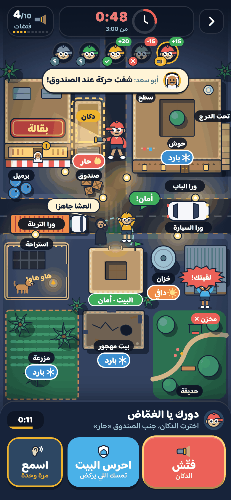 | 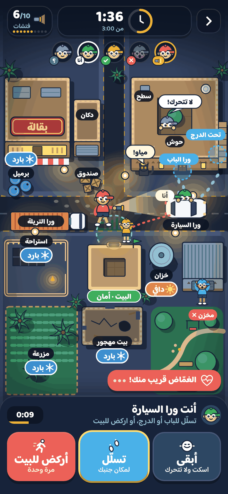 |
| **(ب) مشهد جانبي مثل الكرتون** ❌ | 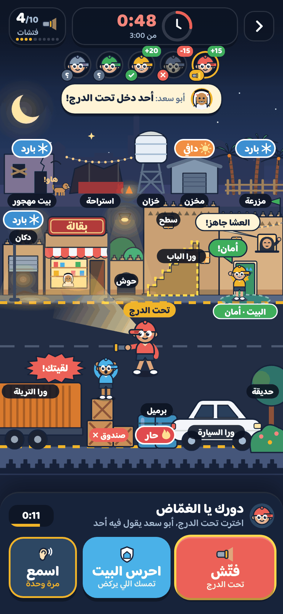 | 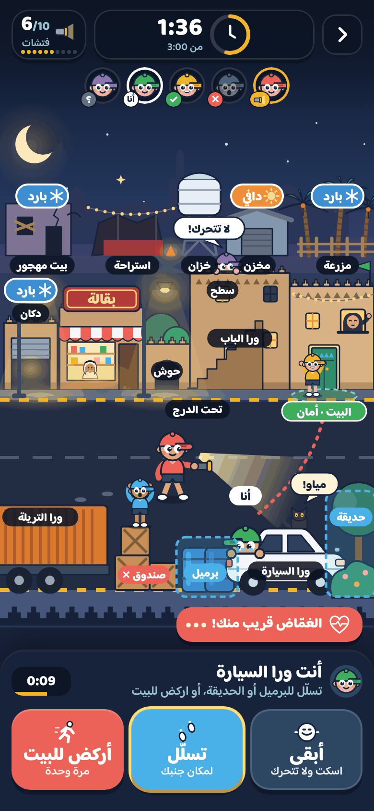 |
| **(ج) مربعات بس أجمل** ❌ (كان المستحسن) | 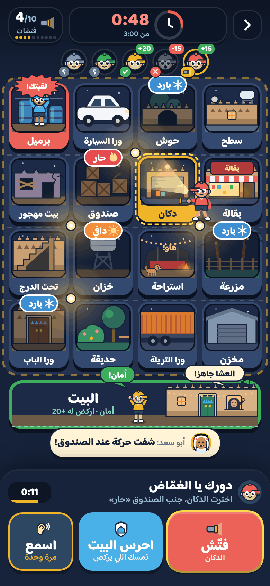 | 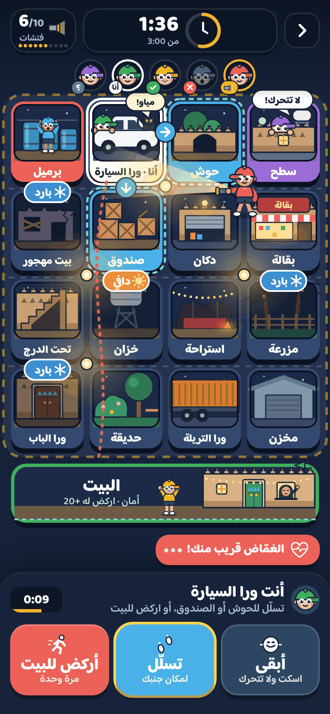 |

### النسخة الأولى (شبكة 4×4) قبل ما تنرفض

| الغمّاض يختار | المتخبّي يقرر | النهاية |
|---|---|---|
| 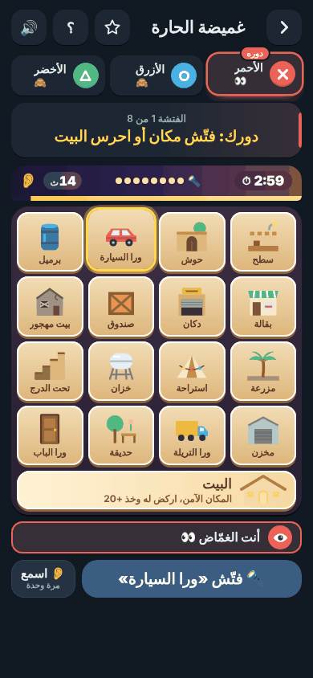 | 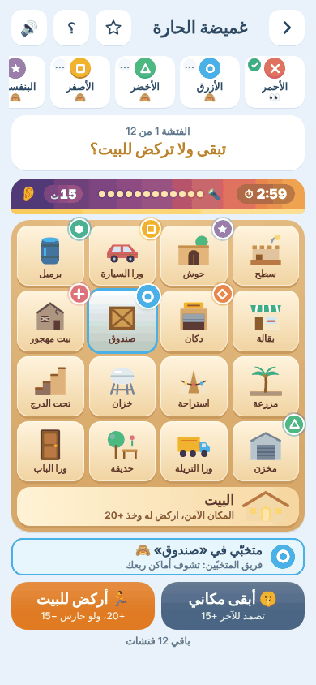 | 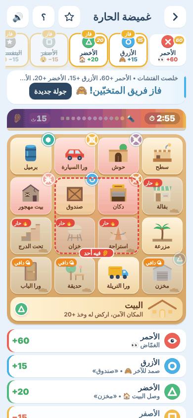 |

### النسخة الثانية (المنشورة)

| دور الغمّاض | الغمّاض يختار | المتخبّي يقرر (داكن) |
|---|---|---|
| 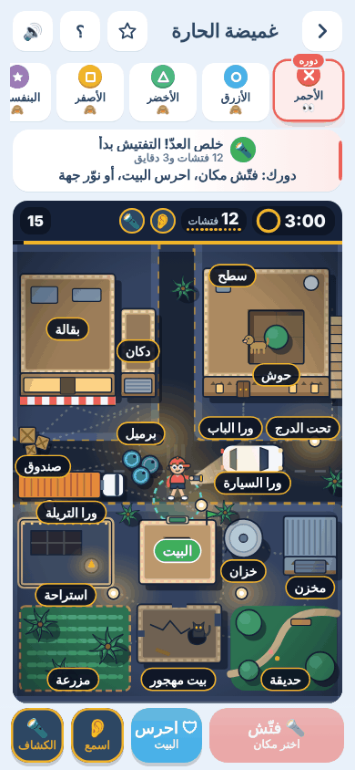 | 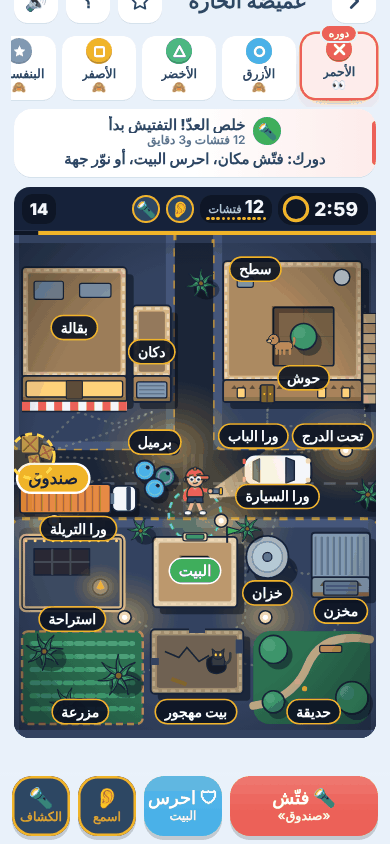 | 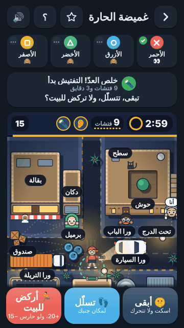 |
| **«اسمع» على جهة** | **الكشاف** | **النهاية (داكن)** |
| 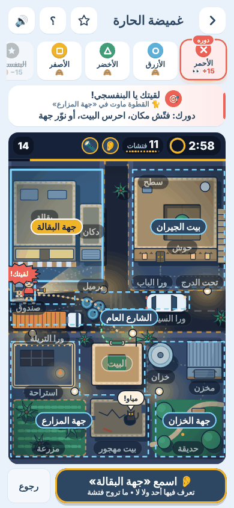 | 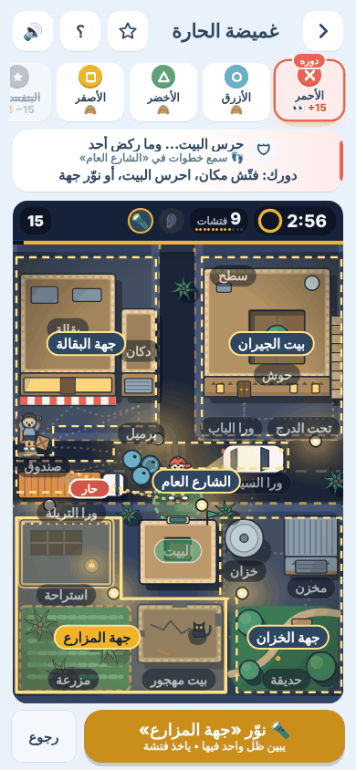 | 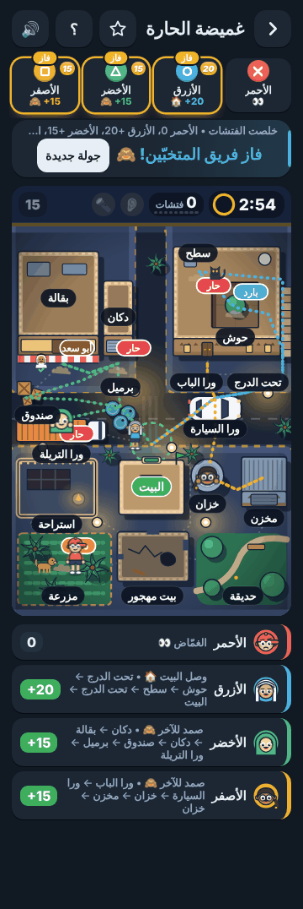 |

### ملاحظات البناء
- **قوة البوت** (200 جولة لكل تركيبة): الغمّاض الصعب ضد متخبّين سهلين يمسك 55 إلى 59%، والغمّاض السهل ضد متخبّين صعبين 19 إلى 23%. الغمّاض الصعب يستخدم «اسمع» تقريبًا كل جولة.
- **الأسرار أونلاين:** مكان كل متخبّي، والممرات اللي مشاها، واختيار الغمّاض، كلها مخفية لكل مقعد. التفاصيل في [street-games.md](../street-games.md).

## السجل

<!-- auto:start history -->
<!-- هذا الجزء يتولّد آليًا بالأمر node tools/gen-game-logs.js. لا تعدّل بين auto:start وauto:end، واكتب ملاحظاتك برا. -->

من git، الأحدث أول (الإصدارات والدمج العادي ما تنعرض):

| التاريخ | وش تغيّر | الكومت |
|---|---|---|
| 2026-11-24 | تجربة الرسمة الجديدة لـ«عيال الحارة» (بموافقة صاحب المشروع: «طبقه خلني اجربه»): جسم على هيكل عظمي بأطراف متصلة، وعيون صغيرة والحواجب تبيّن المزاج، وبدون غترة ولا شماغ ولا حجاب، ولبس المهن انرسم من جديد على الجسم | `486b5fd` |
| 2026-11-15 | أسماء تنسيق خاصة بكل مجموعة ألعاب، وفحص يمنع التداخل | `99b50f8` |
| 2026-11-15 | الشات والتفاعلات صارت بشريط ثابت تحت الشاشة ما يدخل على اللعبة، وتنبيه الرسائل الجديدة فوق زر الشات مباشرة، و«انسحب من اللعبة» انتقل لإعدادات اللعبة (⚙️ بشريطها العلوي) | `f2e5506` |
| 2026-11-14 | شارة أعرض لأبو سعد | `3e0925a` |
| 2026-11-14 | الخريطة: الشخصيات الثمان من `KH`، وشارات التلميح بعيد عن الأسماء، ورمشة اللمبات، وفقاعة العدّ، ونص القوانين | `c391277` |
| 2026-11-14 | النسخة الثانية: خريطة حارة ليلية مرسومة (الأسلوب أ) بممرات حقيقية، على عدّة الحارة المشتركة `KH` | `4b67fce` |
| 2026-11-14 | دمج اللعبة في النسخة الأساسية، ولعبة النقاط ما ينهيها هدف الفوز (3 أو 5 أو 10) | `c1ccb6d` |
| 2026-11-14 | بوتات أذكى، وأيقونة الطفل اللي يطل، وقوانين أوضح، وترتيب أضيق يكفي 8 لاعبين | `cc78851` |
| 2026-11-14 | **انضافت اللعبة.** النسخة الأولى من تصميم صاحب المشروع: شبكة 4×4 بالأماكن الستة عشر والبيت، وجدول النقاط ونقلها | `c219a23` |
<!-- auto:end history -->

### من المحادثات (الأحدث أول)

- **2026-11-24:** صاحب المشروع وافق يجرّب الرسمة الجديدة لـ«عيال الحارة»: «طبقه خلني اجربه». الخريطة والقوانين ما تغيّرت. الغمّاض صار يغطي عيونه بيدينه وهو يعدّ، ويمسك كشاف صغير قدّامه وهو يدوّر، والمتخبّي يطل براسه ويدينه ماسكة الحافة، واللي انمسك يحط يدينه على راسه بحواجب مرفوعة، واللي وصل البيت يهلل بعيون مسكّرة. التفاصيل في [characters.md](../characters.md).
- **2026-11-15:** صاحب المشروع أرسل صور من اللعبة وقال: «حسن مكان الشات مكانها غير صحيح وداخل على اللعبه خلي مكانها ثابت ولا يدخل على اللعبه . والرسائل تظهر فوقه مباشره. وانسحب تكون في مكان إعدادات اللعبه مب وسط الشاشه». انصلحت لكل الألعاب (الكومت `f2e5506`، انظر القرارات).
- **2026-11-14:** في فرز الأقسام انحسبت «ما تنفع أبدًا» على جوال واحد، وانشالت من «على نفس الجهاز».
- **2026-11-14:** بعد ما شاف صور النسخة الثانية قال: «ارفعها»، وانرفعت على الموقع. وبعدها مباشرة: «و الشخصيات اعتمدها».
- **2026-11-14:** انبنت من جديد على الأسلوب (أ) وعلى عدّة الحارة المشتركة (`KH`): ممرات، وتسلّل، و«اسمع» على 5 جهات، وعدّ، وأصوات، وأحداث، ومشهد نهاية.
- **2026-11-14:** صاحب المشروع اختار: «اختار أ وممكن اغيره ، بس حل عيوبه اول . وبعطيك العاب كثير مستقبلا نفس الطريقة ، هي اساسا العاب حركية واقعيه ودورنا نخليها لعبه رقميه بطابعها الحركي الواقعي».
- **2026-11-14:** انرسمت الأشكال الثلاثة (أ، ب، ج)، والمستحسن كان (ج).
- **2026-11-14:** رفض النسخة الأولى: «الغميضه مب زي اللي اقصده لا شكل ولا تفاعل ولا حبكة». وجاوب على الأسئلة: الشكل «اعرضها علي كلها»، والتفاعل كله (شخصيات تتحرك، الغمّاض يعدّ ويغمّض، أصوات وحركات كشف، المتخبّي يتحرك خلسة)، والحبكة كلها (قصة وجو، أدوات ومفاجآت، مراحل أوضح).
- **2026-11-14:** النسخة الأولى انرفعت (المجموع صار 222 لعبة): شبكة 4×4 بأرقام صاحب المشروع كلها.
- **2026-11-14:** صاحب المشروع كتب التصميم كامل وقال: «ضيف هذي اللعبه ولها الأولوية ، طورها و حسنها وطلعها بأفضل شكل». التصميم الأصلي مكتوب في [street-games.md](../street-games.md).

## القرارات

### 2026-11-15 ✅ الشات بمكان ثابت ما يدخل على اللعبة، و«انسحب» في إعدادات اللعبة
- **كلام صاحب المشروع** (مع صور من الغميضة): «حسن مكان الشات مكانها غير صحيح وداخل على اللعبه خلي مكانها ثابت ولا يدخل على اللعبه . والرسائل تظهر فوقه مباشره. وانسحب تكون في مكان إعدادات اللعبه مب وسط الشاشه».
- **وش انسوّى** (لكل الألعاب):
  - زر الشات وأزرار التفاعل بشريط ثابت لحالها تحت الشاشة، والصفحة وأزرار اللعبة والتنبيهات كلها فوقه، فما يغطي اللعبة.
  - تنبيه الرسائل الجديدة يطلع فوق زر الشات مباشرة.
  - «انسحب من اللعبة» انتقل لورقة إعدادات اللعبة من زر ⚙️ جديد بشريط اللعبة العلوي، ومعه زر الصوت.
- الكومت `f2e5506`، والقرار في [decisions.md](../decisions.md).

### 2026-11-14 ✅ انشالت من «على نفس الجهاز»
- كل خطوة (15 ثانية) فيها الغمّاض يختار بالسر وبعده كل متخبّي، فيتمرر الجوال على الكل بكل خطوة، وتضيع لحظة الترقب.
- كانت من الثلاث اللي «ما تنفع أبدًا» على جوال واحد، وصاحب المشروع اختار «نشيل الـ٦٣ كلها».
- باقية أونلاين وضد البوت وقريب بدون نت.

### 2026-11-14 ✅ «ارفعها» و«الشخصيات اعتمدها»
- النسخة الثانية انرفعت على الموقع بكلمة صاحب المشروع «ارفعها».
- الشخصيات الثمان اللي انرسمت لها صارت شخصيات التطبيق كله: «و الشخصيات اعتمدها». انظر [characters.md](../characters.md).

### 2026-11-14 ✅ الأسلوب (أ)، وعيوبه تنحل أول
- «اختار أ وممكن اغيره ، بس حل عيوبه اول».
- ومعها قاعدة لكل ألعاب الحارة الجاية: «هي اساسا العاب حركية واقعيه ودورنا نخليها لعبه رقميه بطابعها الحركي الواقعي».

### 2026-11-14 ❌ النسخة الأولى انرفضت
- «الغميضه مب زي اللي اقصده لا شكل ولا تفاعل ولا حبكة».

### 2026-11-14 ✅ تصميم صاحب المشروع، وله الأولوية
- «ضيف هذي اللعبه ولها الأولوية ، طورها و حسنها وطلعها بأفضل شكل».
- أرقامه كلها انحفظت في النسختين: التفتيشات (6 + عدد المتخبّين، بحد 12)، و3 دقايق، و15 ثانية للخطوة، وجدول النقاط (+15 و−15 على المسكة، +20 للبيت، +15 للي يصمد، و+10 بونص)، والنقاط ما تنزل تحت الصفر.

## الاقتراحات

**الحالات:** ✅ معتمد • ❌ مرفوض • ⏸ معلّق • ❓ ينتظر قرار صاحب المشروع

### 2026-11-14: تحسينات على تصميم صاحب المشروع (النسخة الأولى)
- ✅ **اختيار الغمّاض سري لين يختار المتخبّين:** لو مكشوف، ما أحد بيركض وهو يحرس، وتضيع المخاطرة.
- ✅ **الراكض يتحسم أول:** طلع من مكانه قبل لا يوصله الغمّاض.
- ✅ **الحار والبارد و«اسمع» يشوفها الكل**، عشان المتخبّي يحس إن الغمّاض قرّب.
- ✅ **بالفريق (4 وفوق) المتخبّي يشوف أماكن ربعه.**
- ✅ **لو اثنين اختاروا نفس المكان:** الأول ياخذه، والثاني «المكان مأخوذ».
- ✅ **الوقت:** أونلاين صارم، وعلى جوال واحد يوقف وقت التمرير.
- ✅ **البوتات:** بوت متخبّي يتذكر عادات الغمّاض، وبوت غمّاض يرسم خريطة احتمالات.
- ✅ **المحرك:** هدف الفوز (3 أو 5 أو 10) ما ينهي لعبة نقاط مثل الغميضة من أول جولة (الكومت `c1ccb6d`).

### 2026-11-14: بعد رفض النسخة الأولى
- **الشكل** (صاحب المشروع طلب يشوفها كلها):
  - ✅ (أ) خريطة حارة مرسومة من فوق بالليل.
  - ❌ (ب) مشهد جانبي مثل الكرتون: الأماكن اللي ورا صغيرة ومتداخلة، والحركة أثقل.
  - ❌ (ج) مربعات بس أجمل: كانت المستحسنة لأنها الأوضح والأخف، وصاحب المشروع اختار (أ).
- **التفاعل:** ✅ شخصيات تتحرك، ✅ الغمّاض يعدّ ويغمّض، ✅ أصوات وحركات كشف، ✅ المتخبّي يتحرك خلسة.
- **الحبكة:** ✅ قصة وجو (عمود النور يرمش، والأم تنادي «العشا جاهز!»)، ✅ أدوات ومفاجآت (الكشاف، القطو، الكلب، أبو سعد)، ✅ مراحل أوضح (العدّ، التفتيش، النهاية).

### 2026-11-14: تصليح عيوب الأسلوب (أ)
- ✅ الأسماء على شريط بخلفية وخط واضح، وكل مكان ينضغط بسهولة.
- ✅ أول ضغطة تكبّر المكان، والثانية تأكد.
- ✅ ممرات مشي حقيقية: التسلّل للمكان اللي جنبك على الممر، والحار والبارد بعدد الخطوات.
- ✅ «اسمع» على جهات الحارة الطبيعية بدل مربع 2×2.
- ✅ عدّة مشتركة (`KH`) للألعاب الحركية الجاية: رسومات الحارة، والعيال بحركاتهم، والممرات، والأصوات.

## ملاحظات مفتوحة

- «لكل من ما استخدم ركضته فرصة» وقت نداء الأم ما انضافت: الركضة مرة وحدة أصلًا، والنداء بس يقصّر الخطوات.
- على جوال 360×640 الخريطة تحتاج تمرير تحت شريط الأزرار الثابت (الأسماء تبقى 13 بكسل أو أكثر بدل ما تصغر).
- وضعية «زعلان» صارت في الجسم والوجه مع الرسمة الجديدة (الراس مايل، والحواجب، والدمعة). تنتظر رأي صاحب المشروع بعد التجربة.
- `kit-hara.js` ينحمّل مع الألعاب بعد أول شاشة. إذا بتستخدم الشخصيات في شريط اللاعبين أو الغرفة، لازم ينتقل لأول السكربتات ([characters.md](../characters.md)).
