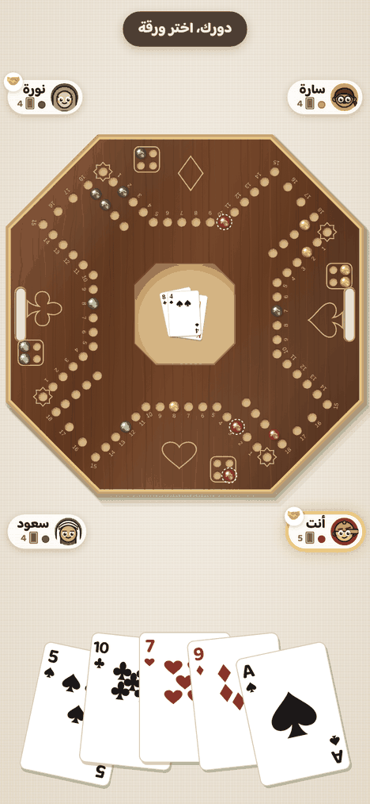
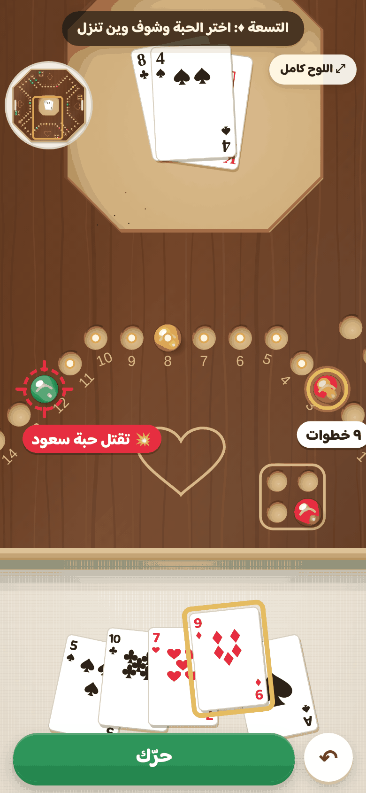
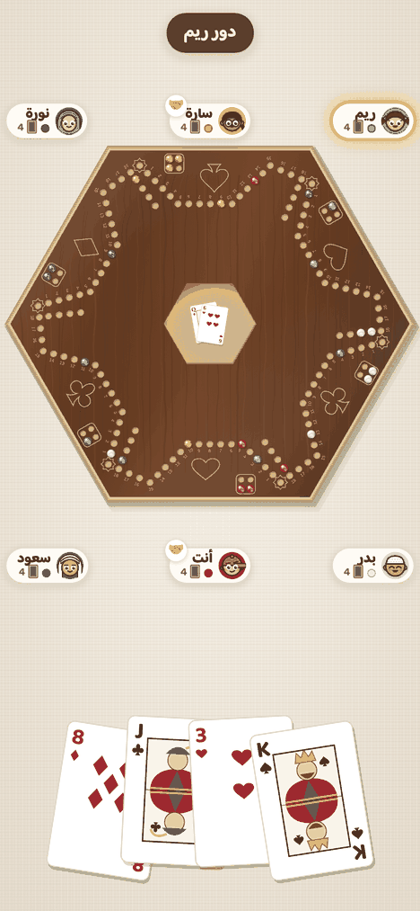
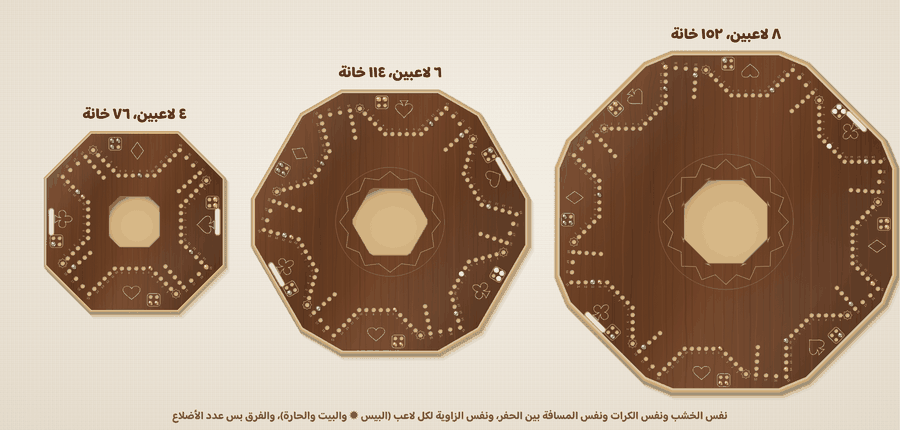
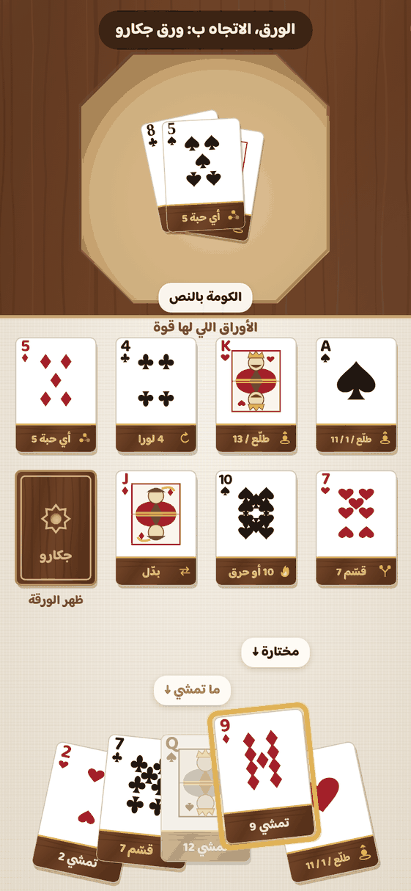
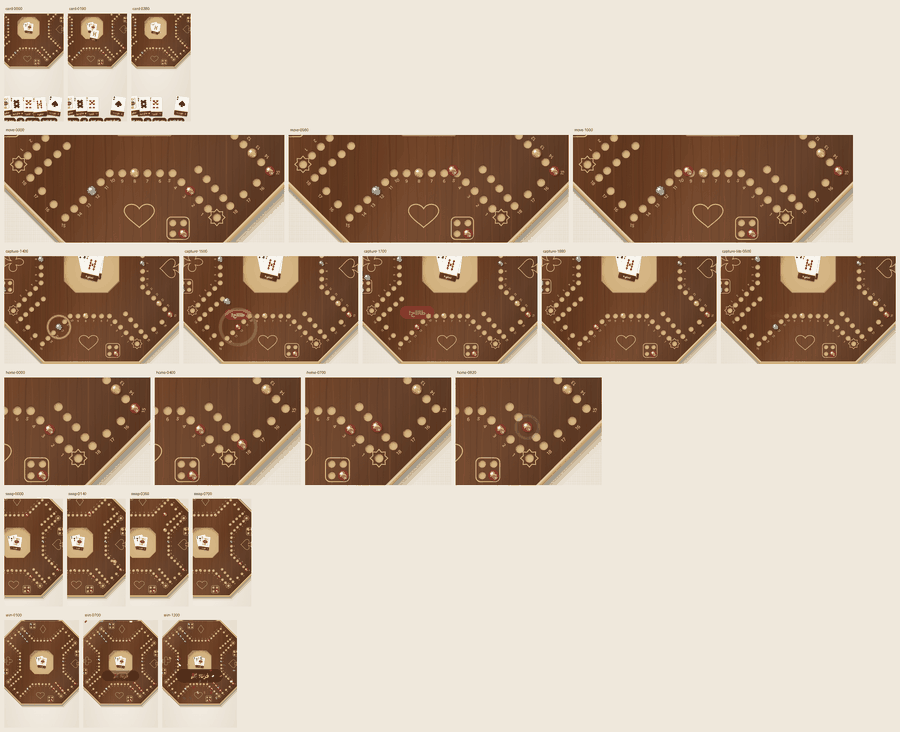
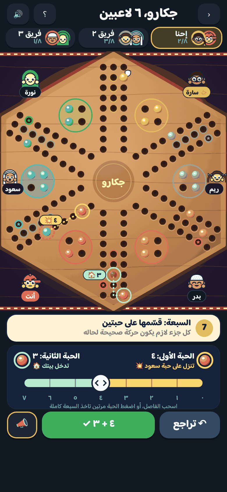
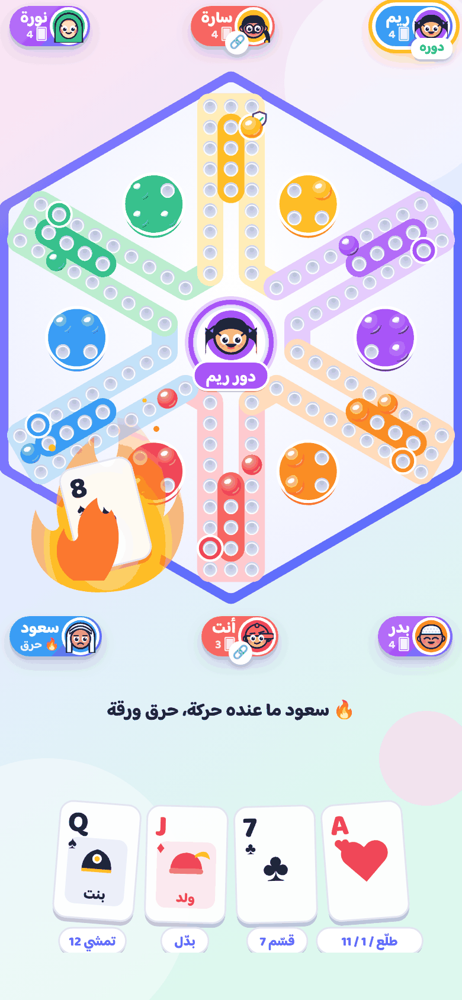

# جكارو

> جكارو قيد إعادة البناء بطلب صاحب المشروع («طور جكارو»): قوانين سعودية صحيحة، ولوحة «زي اللوحة الحقيقية بالضبط»، وثلاث مستويات قوانين. «القوانين» تحت تتولّد من الكود، فهي للنسخة الحالية لين تنرفع الجديدة.

<!-- auto:start header -->
<!-- هذا الجزء يتولّد آليًا بالأمر node tools/gen-game-logs.js. لا تعدّل بين auto:start وauto:end، واكتب ملاحظاتك برا. -->

| | |
|---|---|
| **الاسم** | جكارو |
| **المعرّف** | `jakaro` |
| **القسم** | [ألعاب لوحة](README.md#cat-board) |
| **اللاعبين** | من 2 إلى 8 |
| **الفرق** | فرقها من قوانينها (هذي اللعبة لها فرقها الخاصة (المتقابلين فريق): اختيار الفرق يحدد مين مع مين.) |
| **البوت** | بوت خاص فيها (سهل، متوسط، صعب) |
| **معلومات مخفية أونلاين** | `hide.seat`: `hd` (كل لاعب يشوف حقه بس)؛ `hide.all`: `deck` (مخفي عن الكل) |
| **الملفات** | `public/js/games/race.js`، وقوانينها في `HELP.jakaro` |
| **في الكتالوج** | [games.md](../games.md#g-jakaro) |

## يناسب أي طريقة لعب

| الطريقة | يناسب؟ | ليش |
|---|---|---|
| على نفس الجهاز | ✅ نعم | تنلعب بالدور، والسر (إن وجد) يكفيه غطاء واحد بكل دور |
| ضد البوت | ✅ نعم | لها بوت خاص بثلاث مستويات (سهل، متوسط، صعب) |
| أونلاين / قريب بدون نت | ✅ نعم | كل الألعاب تنلعب أونلاين وقريب بدون نت |

القاعدة في [game-checklist.md](../game-checklist.md)، والقرار في [decisions.md](../decisions.md) (2026-11-14: «كل طريقة لعب لها ألعابها»).

## القوانين

من زر «؟» داخل اللعبة (`HELP`):

- كل لاعب عنده 4 حبات، والورق يحركها.
- الإكة: تطلّع حبة أو تمشي 1 أو 11.
- الشايب: يطلّع حبة أو يمشي 13.
- البنت 12، العشرة 10، والولد يبدّل حبتك مع حبة خصم.
- السبعة تقدر تقسمها على حبتين، والأربعة ترجع لورا.
- الحبة اللي توقف عليها ترجع بيتها، والحبة الواقفة على بدايتها محمية وما ينقطع طريقها.
- لو ما عندك ورقة تمشي تحرق ورقة.
- مع 4 أو 6 أو 8 لاعبين تلعبون فرق (الشريك قدامك)، ولما توصّل حباتك تكمل بحبات شريكك.
- لو طلع لاعب من الغرفة ترجع حباته لبيتها، وفي الفرق تبقى لشريكه بس بدايتها ما تحميها.
- وإذا طالت اللعبة لين 150 ورقة لكل لاعب، يفوز اللي حباته أبعد (وفي الفرق مجموع الفريق).
<!-- auto:end header -->

## التصميم والشخصيات

<!-- auto:start design -->
<!-- هذا الجزء يتولّد آليًا بالأمر node tools/gen-game-logs.js. لا تعدّل بين auto:start وauto:end، واكتب ملاحظاتك برا. -->

من الكود:

- **ملف اللعبة:** `public/js/games/race.js`.
- **«عيال الحارة»:** ملف اللعبة ما يستخدم عدّة الحارة (`KH`) لين الحين. التعميم على كل الألعاب جاري ([roadmap.md](../roadmap.md)).
- **طريقة اللعب:** على جوال واحد فيها شاشة تغطية وتمرير للجوال.
- **صور التصميم:** 18 صورة في [img/jakaro/](img/jakaro/).
<!-- auto:end design -->

### اللوحة والحبات المعتمدة (الجولة الثالثة)

> «جكارو: تصميم الطاوله و الأحجار ممتاز ، باقي تصميم الورق والتفاعل والتحريك.» (صاحب المشروع، 2026-11-15)

اللوحة مرسومة على صور منتجات حقيقية من متاجر سعودية (بس للرجوع لها، وما انقصّ منها شي):
- **الشكل:** ثماني (مربع بزوايا مقصوصة)، خشب جوزي لامع، وكل الثقوب والأرقام والرموز محفورة بلون الخشب الفاتح، **بدون ألوان مصبوغة**. لون كل لاعب يجي من كراته الزجاج بس.
- **المسار:** 76 ثقب، 19 لكل لاعب، مرقمة من 1 إلى 18. البيس في الزاوية معلّم بشمس محفورة ✹.
- **الحارة (الأمان):** 4 خانات مايلة للنص. **البيت:** 4 خانات على شكل وجه زهر جنب البيس.
- **الوسط:** حفرة ثمانية للورق المرمي، ورمز ورق محفور على كل جهة (♥ ♣ ♦ ♠)، ومقابض على الجنبين.
- **على الجوال:** اللوحة كاملة بعرض الشاشة (الحبة حوالي 11 بكسل، وهذي نسبتها الحقيقية). لما تختار ورقة تتقرّب على حركتك وتصير الحبة 26 إلى 30 بكسل، وخريطة صغيرة بالزاوية.

| لوحة 4 كاملة | تقريب على الحركة | لوحة 6 | تقسيم السبعة |
|---|---|---|---|
|  |  |  |  |

### عائلة الألواح: 4 و6 و8 (الجولة الرابعة)

> «جكارو : لوحة سته لاعبين و٨ لاعبين لازم تكون متناسقه .»

نفس زاوية كل لاعب ونفس المسافة بين الحفر ونفس حجم الكرة. اللي يتغير بس عدد الأضلاع: 76 خانة على ثماني لأربعة، و114 على 12 ضلع لستة، و152 على 16 ضلع لثمانية. صورة اللوح الستة والثمانية من فوق ما لقيناها، فرسمناها على منطق اللوح الرباعي.

### الورق: ثلاث اتجاهات، وانختار (أ)

| ✅ (أ) كلاسيكي بلمسة | ❌ (ب) ورق جكارو (كان المستحسن) | ❌ (ج) أرقام كبيرة |
|---|---|---|
|  |  |  |
| شدّة عادية، والأوراق اللي لها قوة عليها ميدالية جوزية صغيرة فيها رمز القوة، والظهر عنابي بنقش ذهبي. الأقرب للورق الحقيقي | الوجه عادي وتحته شريط خشب مكتوب فيه شغل الورقة («قسّم ٧»، «١٠ أو حرق»، «بدّل»)، والظهر خشب مكتوب عليه «جكارو» | رقم ضخم وحافة ملونة لكل نوع قوة، والظهر كحلي بنقش سدو. الأوضح بس الأبعد عن الورق الحقيقي |

لأن ورق (أ) ما فيه كلام، قوة الورقة اللي تختارها تنكتب فوق زر «حرّك» (مثل «قسّم ٧ بين حبتين»).

### التفاعل والحركة (الجولة الرابعة، معتمدة)

**الدور:** تختار ورقة فترتفع واللوح يتقرب على زاويتك والحبات اللي تمشي تلمع، تختار حبة فيطلع الطريق منقّط والحبة الشبح وين تنزل وعلامة القتل، وتضغط «حرّك». **الحالات الخاصة:** السبعة بسلايدر بين حبتين، والولد على خطوتين بقوس «تكسب ٦٧ خطوة»، والحرق لما ما عندك حركة، وورقك باهت وقت دور غيرك، وتلعب بحبات شريكك لما تخلص حباتك، و«العشرة عليك: ارمِ ورقة».

**الحركة** (transform وopacity بس، وكل خطوة 450 ملي ثانية أو أقل، والوضع الخفيف بدون قفزات ولا أقواس):

| الحركة | المدة | الوضع الخفيف |
|---|---|---|
| الورقة تطير للكومة بقوس وتلف | 380 ملي ثانية | تختفي وتطلع بالكومة (160) |
| الحبة تمشي خانة خانة مع قفزة صغيرة | 120 للخانة، والحركة كلها 900 أو أقل | نقلة وحدة (160) |
| القتل: ضربة وحلقة وشعار «طاااح!» والضحية تطير لبيتها | 420 للقوس | تختفي وتطلع ببيتها (240) |
| دخول الحارة بتوهج أخضر | 130 للخانة و420 للتوهج | نقلة وتوهج (300) |
| تبديل الولد بقوسين متعاكسين | 420 | تبادل (240) |
| الفوز: الحبات الثمان تنبض وشعار «فزنا!» وقصاصات | 360 للشعار | الشعار بس (200) |

### مستويات القوانين (الجولة الرابعة، معتمدة)

صاحب الغرفة يختار المستوى قبل اللعب والكل يشوفه، ومستوى البوت شي ثاني. كل قاعدة مكتوب جنبها هل هي تقليدية أو من لعبة أخت أو من عندنا. التفاصيل تحت في «القرارات» و«الاقتراحات».

### الجولات المرفوضة

**الجولة الأولى (الأسلوب الليلي مع «عيال الحارة» حول اللوحة) ❌ مرفوضة:**

| لوحة 4 | السبعة على لوحة 6 | القتل وتبديل الولد |
|---|---|---|
|  |  |  |

**الجولة الثانية (اتجاهين «مثل تطبيقات المتجر») ❌ مرفوضة:**

| (1) لامع ملوّن | (1) حرق على لوحة 6 | (2) خشب فاخر | (2) أكل على لوحة 6 |
|---|---|---|---|
|  |  |  |  |

في هالجولة صارت لوحة الأربعة حلقة حول مربع بدل الصليب، عشان الحبات تكبر على عرض الجوال.

## السجل

<!-- auto:start history -->
<!-- هذا الجزء يتولّد آليًا بالأمر node tools/gen-game-logs.js. لا تعدّل بين auto:start وauto:end، واكتب ملاحظاتك برا. -->

من git، الأحدث أول (الإصدارات والدمج العادي ما تنعرض):

| التاريخ | وش تغيّر | الكومت |
|---|---|---|
| 2026-11-14 | ألعاب الزهر: الزهر يترمى عند صاحب الغرفة، وبوتات أذكى، وزهر يتدحرج، ومشي أقصر | `00d0e65` |
| 2026-11-14 | شكل احترافي لألعاب الزهر والسباق والعقارات والقتال | `2fe244b` |
| 2026-11-13 | أونلاين: الأسرار تنرسل مشفّرة لصاحبها بس، وصاحب الغرفة يمشّي اللعبة، واللاعب يرجع لمقعده | `280a3a1` |
| 2026-11-13 | نص القوانين في «؟» صار يطابق الألعاب | `acf1756` |
| 2026-11-13 | تصليحات لودو وجكارو والعقارات والألعاب القتالية | `e15a933` |
| 2026-11-13 | الفرق: أي لعبة تنلعب فريقين أو ثلاث أو أربع | `d2599ee` |
| 2026-11-13 | **انضافت اللعبة.** العقارات ولودو وجكارو و5 ألعاب قتالية، وتحسين «خمّن الشخص»، وأوراق لعب جديدة | `483522b` |
<!-- auto:end history -->

### من المحادثات (الأحدث أول)

- **2026-11-15:** صاحب المشروع اختار الورق: «اختار ورق أ والباقي اعتمده و بجرب وبعطيك الملاحظات .»، وبدأ البناء.
- **2026-11-15:** انرسمت الجولة الرابعة: ثلاث اتجاهات للورق، وخطوات الدور (12 إطار)، ونموذج حركة، وعائلة الألواح 4 و6 و8، والمستويات الثلاث.
- **2026-11-15:** «جكارو : نخليها مستويات ، مستوى كلاسيكي وهي القواعد الشائعة و مستوى مخمخه نحط فيها بعض القواعد الخاصه ، و مستوى الحريف نخليها قواعد معقده واشياء غير متوقعه».
- **2026-11-15:** «جكارو : لوحة سته لاعبين و٨ لاعبين لازم تكون متناسقه .»
- **2026-11-15:** «جكارو: تصميم الطاوله و الأحجار ممتاز ، باقي تصميم الورق والتفاعل والتحريك.»
- **2026-11-15:** الجولة الثالثة: اللوحة الحقيقية (ثماني جوزي، 76 ثقب) من صور متاجر سعودية، و4 صور.
- **2026-11-15:** «تمام . و تصاميم جكارو مرفوضة»، واختار «زي اللوحة الحقيقية بالضبط» من بين: يرسل صورة، أو اللوحة الحقيقية، أو يوصف بالكلام.
- **2026-11-15:** الجولة الثانية: اتجاهين، «لامع ملوّن» و«خشب فاخر»، ولكل واحد 3 صور.
- **2026-11-15:** «ما عجبني التصميم» (وبعدها «اقصد جكارو»). اختار وش ما عجبه: اللوحة نفسها، والزحمة والعناصر الصغيرة، والألوان والجو، والورق وطريقة اللعب. والجو اللي يتخيله: «مثل تطبيقات المتجر».
- **2026-11-15:** الجولة الأولى: بحث القوانين السعودية من أكثر من مصدر، وتدقيق اللعبة الحالية، و3 صور بالأسلوب الليلي مع «عيال الحارة».
- **2026-11-15:** صاحب المشروع: «طور جكارو».
- **2026-11-13:** المراجعة الأولى لقت إن ورق كل اللاعبين وترتيب الشدّة في الحالة المشتركة (أي لاعب أونلاين يقدر يشوفها)، وإن اللعبة تعلق لو انتخطى لاعب كان آخر واحد معه ورق، وإن حبة لاعب طلع تسد بيسه للأبد. انصلحت (`e15a933`)، والورق صار مخفي فعليًا مع محرك الأونلاين الجديد (`280a3a1`).

## ينضاف من سجل البناء

<!-- هذا القسم ينضاف من سجل بناء جكارو الجديدة (وكيل البناء): وش انبنى، والقرارات وقت البناء، والاختبارات، وقوة البوت، والصور. -->

(ينتظر سجل البناء.)

## القرارات

### 2026-11-15 ✅ الورق (أ)، والباقي كله معتمد
- «اختار ورق أ والباقي اعتمده و بجرب وبعطيك الملاحظات .»
- «الباقي» = كل اللي في الجولة الرابعة: التفاعل، والحركة، وعائلة الألواح، والمستويات بقواعدها، والأجوبة الافتراضية لأسئلة القوانين تحت.
- يعني الأسئلة اللي كانت مفتوحة في [decisions.md](../decisions.md) و[roadmap.md](../roadmap.md) (الشايب، فرق الستة، الثمانية) انحسمت بالافتراضي:
  - **الشايب:** بالكلاسيكي يطلّع أو يمشي 13 ويقتل بس اللي يوقف عليه. بالمخمخة يدعس كل اللي بطريقه حتى حبّك.
  - **6 لاعبين:** 3 فرق، كل فريق اثنين متقابلين (مثل الكتيّب السعودي).
  - **8 لاعبين:** ندعمه بلوح ثمانية: 4 فرق من اثنين، وشدّتين، وتوزيع 4-4-5.
  - **لون اللوح:** الجوزي (مثل اللوح المعتمد).

### 2026-11-15 ✅ ثلاث مستويات قوانين
- «نخليها مستويات ، مستوى كلاسيكي وهي القواعد الشائعة و مستوى مخمخه نحط فيها بعض القواعد الخاصه ، و مستوى الحريف نخليها قواعد معقده واشياء غير متوقعه».
- **كلاسيكي** (كله تقليدي): التوزيع 4-4-5، والخمسة لأي حبة، والعشرة تمشي 10 أو تحرق على اللي بعدك، والولد يبدّل، والسبعة تنقسم، والأربعة لورا، والإكة تطلّع أو 1 أو 11، والشايب يطلّع أو 13، وما تنقز على حبّك، وحبتين ورا بعض سد، والبيس محمي، والطلعة تقتل اللي على بيسك، والحارة بالعدد بالضبط، واللعب إجباري والحرق إذا ما فيه حركة، وتكمل بحبات شريكك.
- **مخمخة** = الكلاسيكي، وفوقه: الشايب يدعس (تقليدي)، والبنت الحمراء تحرق ورقة من اللي بعدك والسودا 12 (تقليدي من «الكومبلكس»)، والولد الأحمر 11 والأسود يبدّل (تقليدي)، وورقة للشريك أول التوزيعة (من لعبة أخت)، وجوكرين (تقليدي بنسخ).
- **الحريف** = المخمخة، وفوقه (كلها من عندنا، ومكشوفة وتبين بشعار لما تصير): خانات مفاجأة معلّمة من البداية (🌀 دفعة +3، 🪤 فخ يرجّعك 4، 🛡 درع)، وكرت مخفي لكل لاعب يلعبه مرة باللعبة («دفعة +2» أو «ترس» أو «عكس»)، وورقة حظ تنقلب أول كل توزيعة ويشوفها الكل (مثل «السبعة تدعس»)، و«قتلة وزيادة»: اللي يطيّح حبة يلعب ورقة زيادة مرة بالدور.
- القواعد مبنية كعلامات بيانات (`JK_RULES`) نقدر نضبطها بعد ما يجرب صاحب المشروع، والبوت يقرا نفس العلامات.

### 2026-11-15 ✅ ألواح 6 و8 متناسقة مع لوح الأربعة
- «جكارو : لوحة سته لاعبين و٨ لاعبين لازم تكون متناسقه .»

### 2026-11-15 ✅ اللوحة والحبات
- «جكارو: تصميم الطاوله و الأحجار ممتاز ، باقي تصميم الورق والتفاعل والتحريك.»

### 2026-11-15 ✅ «زي اللوحة الحقيقية بالضبط»
- بعد رفض جولتين، اختار هالخيار بدل ما يرسل صورة أو يوصف بالكلام.

### 2026-11-15 ❌ التصاميم الأولى انرفضت
- الجولة الأولى: «ما عجبني التصميم»، وكل الأسباب: اللوحة نفسها، والزحمة، والألوان والجو، والورق وطريقة اللعب.
- الجولة الثانية: «تمام . و تصاميم جكارو مرفوضة».
- يعني ثلاث تصاميم انرفضت: الأسلوب الليلي، و«لامع ملوّن» (الحلاوة)، و«خشب فاخر».

### 2026-11-15 ✅ القوانين السعودية بدل الحالية
- انعرض إن اللعبة الحالية «لودو بورق أكثر من كونها جكارو»، وانعتمد التصحيح مع الكلاسيكي. التفاصيل في «الاقتراحات».

## الاقتراحات

**الحالات:** ✅ معتمد • ❌ مرفوض • ⏸ معلّق • ❓ ينتظر قرار صاحب المشروع

### الجولة الأولى: بحث القوانين وتدقيق اللعبة (2026-11-15)

**المصادر:** مدونة جواكر (العادي والكومبلكس)، وكتيّب لوح جاكارو (عربي وإنجليزي، 6 لاعبين)، ومدونة متجر سعودي (4-4-5، الشايب يدعس، العشرة تحرق على اللي على يمينك)، وشروحات بلهجة سعودية، و«دليلك إلى جاكارو»، وVIP جاكارو، وويكيبيديا العربية، وقوانين بيت مجموعة لعب.

**تصحيح القوانين (لازم):**
- ✅ اللوح **19 خانة لكل لاعب** (76 لأربعة) بدل 13. المسافات القصيرة كانت تخرّب وزن القتل والشايب والإكة 11.
- ✅ التوزيع **4 ثم 4 ثم 5** من الشدّة كاملة بدل 4 كل مرة ورمي الباقي (كانت ترمي 20 ورقة مع أربعة، وتجيب شدّة جديدة كل توزيعة تقريبًا مع 6 و8، فعدّ الورق ما ينفع). ولستة وثمانية شدّتين.
- ✅ **الخمسة** تمشي أي حبة على الطريق (حبتك أو شريكك أو خصمك).
- ✅ **العشرة** تمشي 10 أو **تحرق** على اللي بعدك (يرمي ورقة وينحرق دوره).
- ✅ **ما تنقز على حبّك أبد**، و**حبتين ورا بعض سد**.
- ✅ الموزّع وأول لاعب يتغيرون كل خلطة.
- ❓ باقي السبعة يروح لحبات الشريك إذا دخلت حبتك الأخيرة بجزء منها (قاعدة بيت، خيار).
- ✅ إذا خلص الوقت، يلعب حركة البوت المتوسط بدل أول ورقة تمشي (كان ممكن يحرق شايب أو ولد على الفاضي).
- ✅ نص «؟» يتحدّث بالخمسة والعشرة والسد.

**أرقام من محاكاة البوتات (12 جيم لكل عدد):** الحرق يصير بـ28 إلى 34% من الأدوار، وطول اللعبة 66 ورقة للاعب في الأربعة و85 في الستة و124 في الثمانية، والبوت الصعب قتل حبة شريكه 7 مرات (أغلبها مجبور).

**تجربة اللعب:**
- ✅ أنت تحت دايم وشريكك قدامك (اللوح ما كان يدوّر).
- ✅ ورقة ← الحبات تلمع ← حبة ← معاينة ← «حرّك ✓» أو «↶ تراجع» (ما كان فيه معاينة ولا تراجع).
- ✅ السبعة بسلايدر بدل أزرار 1 إلى 7 تحت اللوح.
- ✅ الولد: حلقة ذهبية لحبتك، وأهداف بحلقة متقطعة، وقوس ⇄ «تكسب ٤٢ خطوة».
- ❌ سطر قوة تحت كل ورقة: كان في الورق (ب)، وانختار (أ)، فالقوة تنكتب فوق زر «حرّك».
- ✅ التقريب التلقائي على حركتك مع 6 و8.

**الشريك:**
- ❓ **إشارات سريعة** (زر 📣): «عندي سبعة»، «احميني»، «خلّها لي»، «معي ولد»، «ارجع بأربعة»، 👍، إشارة وحدة كل دور. ما كانت في الجولة الرابعة، فتنتظر.
- ✅ **تبادل ورقة مع الشريك أول التوزيعة:** مو من الجكارو السعودي (أصله من لعبة «دوغ» السويسرية)، فما صار بالكلاسيكي، وصار من قواعد المخمخة.
- ❓ **شريط «إحنا / هم»** فيه عدد اللي وصلوا من 8.

**البوت:**
- ❓ يعرف شريكه (ما يقتله إلا مجبور، يفضّي البيس، يسد على الخصم)، ويحسب الخطر والقتل، والصعب يعدّ الورق، ويرد على الإشارات. ما انعرضت في الجولة الرابعة، وتنبني مع البناء.

**خيارات «قوانين البيت»:**
- ✅ تحولت للمستويات: بدل قائمة خيارات (سعودي، عادي جواكر، كومبلكس، الشايب يدعس، الحرق ورقة أو كل الورق…)، صارت ثلاث مستويات بطلب صاحب المشروع.

**عدد اللاعبين:**
- ✅ 4 فريقين (الأصل)، و6 ثلاث فرق، و8 أربع فرق بشدّتين.
- ❌ **فريقين من ثلاثة** للستة: نخليه لبعدين.
- ❌ **حبتين لكل لاعب** مع الثمانية، أو **نوقف عند 6**: انحسمت بدعم الثمانية كاملة.
- ✅ لاعبين اثنين: واحد ضد واحد (جواكر وVIP عندهم)، وما نخترع «كل واحد لونين» إلا بموافقة صاحب المشروع.
- ❓ **3 و5 و7:** ما لها لوح معروف. أفكار: 3 على لوح 6 كل واحد لونين، و5 على لوح 6 بكرسي فاضي، و7 نخفيها. **قرار لصاحب المشروع.**

### الجولة الثانية: اتجاهين «مثل تطبيقات المتجر»
- ❌ **(1) لامع ملوّن** و❌ **(2) خشب فاخر**: «تصاميم جكارو مرفوضة».
- ❌ **لوحة الأربعة حلقة حول المربع** بدل الصليب عشان الحبات تكبر.

### الجولة الثالثة: اللوحة الحقيقية
- ✅ اللوحة الثمانية الجوزية والكرات الزجاج: «ممتاز».
- ✅ **اللون:** الجوزي، مو الأسود (الثنتين موجودة بالمحلات).
- ✅ **لوحة الستة:** ما لقينا صورة لها من فوق، فانرسمت على منطق الرباعي، وبعدها صارت عائلة 4 و6 و8.

### الجولة الرابعة: الورق والتفاعل والحركة والمستويات
- ✅ **الورق (أ)** «كلاسيكي بلمسة». ❌ **(ب)** «ورق جكارو» (كان المستحسن). ❌ **(ج)** «أرقام كبيرة».
- ✅ **التفاعل** (12 إطار)، ✅ **الحركة** (المواصفات فوق)، ✅ **عائلة الألواح**.
- **أفكار الحريف اللي انعرضت قبل الجولة الرابعة:**
  - ✅ خانات خاصة على الطريق (اختصار وفخ ودرع): صارت «خانات المفاجأة».
  - ✅ كرت قوة مخفي: صار «كرت الحريف».
  - ✅ ورقة «حظ» مفاجأة: صارت «ورقة الحظ» المكشوفة.
  - ❌ **جولة الدور العكسي:** شلناها لأنها «تلخبط أكثر ما تمتّع» وتخرّب حساب الكل.
  - ❌ **سرقة ورقة من خصم:** شلناها لأن البنت الحمراء تكفي.
  - ❌ **أي عشوائية ما تبين على اللوح:** مستبعدة، كل مفاجأة لازم تنعرض بوضوح لما تصير.
- **أفكار المخمخة اللي انعرضت:** ✅ الشايب يقتل، ✅ ورقة للشريك أول كل توزيعة، ✅ دخول الحارة بالعدد بالضبط (صار بالكلاسيكي)، ✅ الشريك يحرك حباتك لما تخلص (صار بالكلاسيكي: تكمل بحبات شريكك).
- ❓ **«تقريبًا 25 دقيقة»** تنكتب بالغرفة مع الثمانية لأن اللعبة أطول.

## ملاحظات مفتوحة

- **قيد البناء:** القوانين السعودية والمستويات واللوحة الجديدة والورق (أ). صاحب المشروع بيجرب ويعطي ملاحظاته.
- **تنتظر قرار:** 3 و5 و7 لاعبين، وإشارات الشريك.
- **اللوحة الحالية** على 360×640 تحتاج تمرير (مراجعة الجودة، 2026-11-14).
- **قوانين الحريف** من عندنا، وأرقامها (دفعة +3، فخ −4…) تنضبط بعد التجربة.
