# طاق طاق طاقية

> لعبة صاحب المشروع، وثاني «لعبة حارة». النسخة الأولى منشورة وانرفضت، والثانية قيد البناء. القوانين والتصميم بالتفصيل في [street-games.md](../street-games.md) (القسم 2)، وهذا السجل يجمع التاريخ والقرارات والاقتراحات. «القوانين» تحت هي قوانين النسخة المنشورة حاليًا.

<!-- auto:start header -->
<!-- هذا الجزء يتولّد آليًا بالأمر node tools/gen-game-logs.js. لا تعدّل بين auto:start وauto:end، واكتب ملاحظاتك برا. -->

| | |
|---|---|
| **الاسم** | طاق طاق طاقية |
| **المعرّف** | `taqiya` |
| **القسم** | [جماعية](README.md#cat-party) |
| **اللاعبين** | من 4 إلى 8 |
| **الفرق** | كل واحد لحاله (أو لها أطرافها الخاصة) |
| **البوت** | بوت خاص فيها (سهل، متوسط، صعب) |
| **معلومات مخفية أونلاين** | `mask`: اللعبة تحدد بنفسها وش يشوف كل مقعد؛ `privShow`: وش ينعرض من الجزء الخاص لكل لاعب؛ `net`: ضغطات تحتاج الحالة المخفية يلعبها صاحب الغرفة |
| **الملفات** | `public/js/games/n-taqiya.js`، `public/css/n-taqiya.css`، وقوانينها في `HELP.taqiya` |
| **في الكتالوج** | [games.md](../games.md#g-taqiya) |

## يناسب أي طريقة لعب

| الطريقة | يناسب؟ | ليش |
|---|---|---|
| على نفس الجهاز | ❌ مخفية من القسم | لحظة الانتباه لازم تكون سرية: لما يمرّرون الجوال للمستهدف عشان «شفتها!»، الكل بيعرف إنه هو. وكل خطوة فيها أكثر من لاعب يقرر بالسر |
| ضد البوت | ✅ نعم | لها بوت خاص بثلاث مستويات (سهل، متوسط، صعب) |
| أونلاين / قريب بدون نت | ✅ نعم | كل الألعاب تنلعب أونلاين وقريب بدون نت |

القاعدة في [game-checklist.md](../game-checklist.md)، والقرار في [decisions.md](../decisions.md) (2026-11-14: «كل طريقة لعب لها ألعابها»).

## القوانين

من زر «؟» داخل اللعبة (`HELP`):

- طاق طاق طاقية بالليل في الحوش: الكل قاعدين بدائرة، وواحد «اللفّاف» يلف حولهم وبيده الطاقية.
- 1) الخطة بالسر: يختار ورا مين بيحطها، وكم لفّة يلف (لفّة +10، لفّتين +15، ثلاث +20)، وحقيقية ولا مزيّفة (لكل واحد طاقيتين مزيّفة باللعبة، وعدّادها ظاهر للكل).
- ومرة باللعبة يقدر يخليها «ذهبية» (النقاط ضعف)، ومرة يسوي «غفلة» (شاشة اللي وراه تتغبّش ثانيتين).
- 2) اللف: كل لفّة بعد الأولى تترك أثر للكل: «حسّيت إنه بطّأ ورا فلان وفلان»، واحد منهم هو المقصود.
- الجالسين يخمّنون بالسر ورا مين (+5 للي يصيب)، وكل واحد عنده «صرخة» وحدة باللعبة: لو صرخ باسم اللي وراه صح ياخذ ثانيتين زيادة وينتبه، ولو غلط −5 على اللي صرخ.
- 3) الانتباه: اللي وراه الطاقية بس يشوفها تلمع، وعنده 4 ثواني يضغط «شفتها!».
- «تحسّس» مرة باللعبة: ياكل ثانيتين ويقولك حقيقية ولا مزيّفة.
- لو ما انتبه للحقيقية: اللفّاف يقعد مكانه وياخذ نقاط اللفّات منه، وهو يصير اللفّاف.
- لو ضغط على مزيّفة −5، ولو طنّشها ما صار شي واللفّاف يلف مرة ثانية.
- 4) المطاردة لو شاف الحقيقية: كل واحد يختار بالسر «طريق الشارع» أو «الحوش» أو «السطح» (وعادات كل واحد ظاهرة).
- لو اختلفوا: اللفّاف يفلت وياخذ النقاط والثاني يصير اللفّاف.
- لو نفس الطريق: سباق ضغط 3 ثواني، الأسرع ياخذ +5: لو اللي وراه ضغط أكثر (أو تعادلوا) يمسك اللفّاف وياخذ النقاط منه واللفّاف يلف مرة ثانية، ولو اللفّاف أسرع يفلت.
- كل جولة فيها حدث: 🐈 قطو يعدّي ورا واحد (انتباهه أقصر بثانية)، 🌑 النور ينطفي (السطح مسكّر والآثار أغمض: ثلاث أسماء)، 🍦 بيّاع الآيس كريم (الجولة الجاية لفّة وحدة).
- اللعبة 5 دقايق أو جولتين لكل لاعب، واللي ما لفّ ياخذ دوره قبل النهاية.
- النقاط ما تنزل تحت الصفر، والأكثر نقاط يفوز.
<!-- auto:end header -->

## التصميم والشخصيات

<!-- auto:start design -->
<!-- هذا الجزء يتولّد آليًا بالأمر node tools/gen-game-logs.js. لا تعدّل بين auto:start وauto:end، واكتب ملاحظاتك برا. -->

من الكود:

- **ملف اللعبة:** `public/js/games/n-taqiya.js` وتنسيقه `public/css/n-taqiya.css`.
- **«عيال الحارة»:** ملف اللعبة يرسم بعدّة الحارة (`KH` في `public/js/kit-hara.js`)، يعني الشخصيات الثمان بلبسها. التفاصيل في [characters.md](../characters.md).
- **طريقة اللعب:** فيها مراحل اختيار سري بنفس الوقت، على جوال واحد فيها شاشة تغطية وتمرير للجوال، لها ساعتها الخاصة.
- **صور التصميم:** 11 صورة في [img/taqiya/](img/taqiya/).
<!-- auto:end design -->

### النسخة الأولى: الصور اللي انعرضت قبل البناء (2026-11-15)

خمس شاشات بنفس شكل الغميضة، والاقتراحات عليها علامة «✦ مقترح»:

| تخطيط اللفّاف | اللف حول الدائرة | لحظة الانتباه | المطاردة | النتيجة |
|---|---|---|---|---|
| 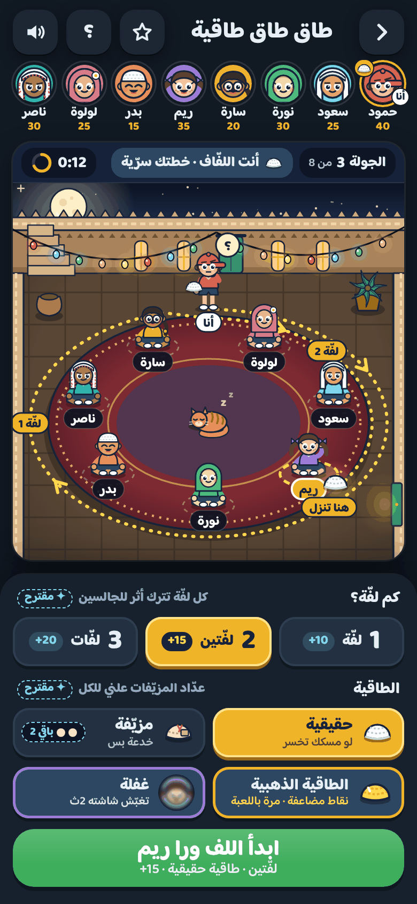 | 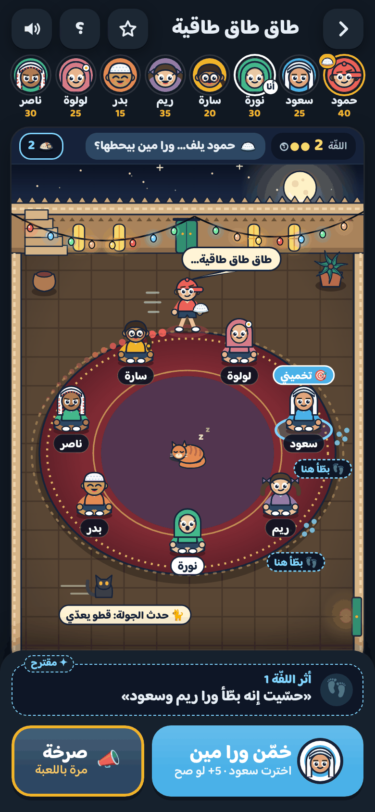 | 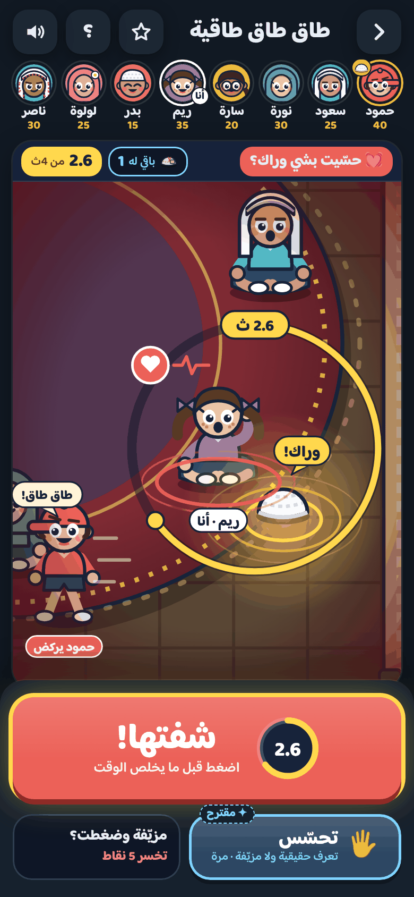 | 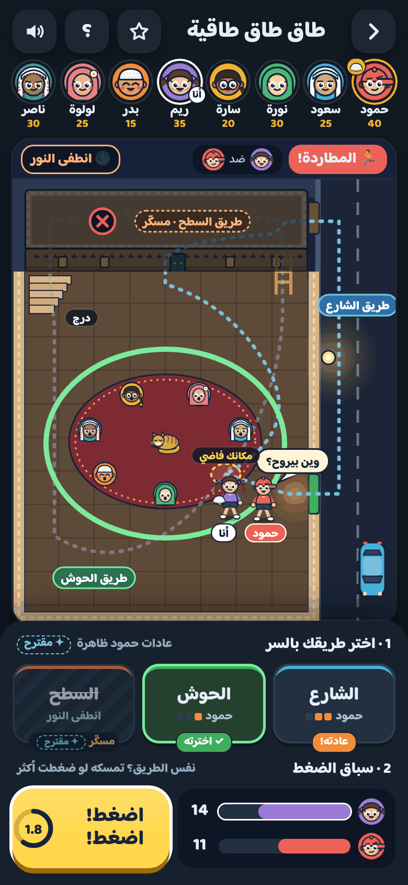 | 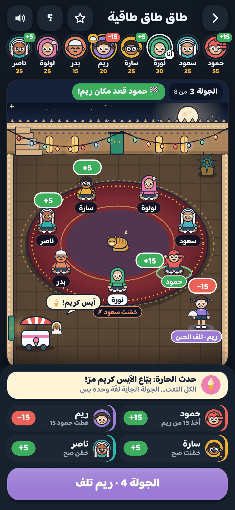 |

### النسخة الأولى: لقطات من اللعبة المنشورة

| التخطيط | الانتباه | اختيار الطريق |
|---|---|---|
| 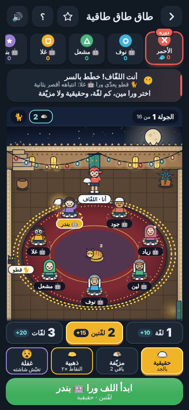 | 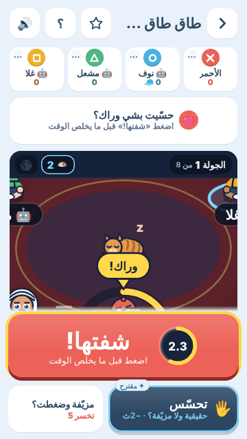 | 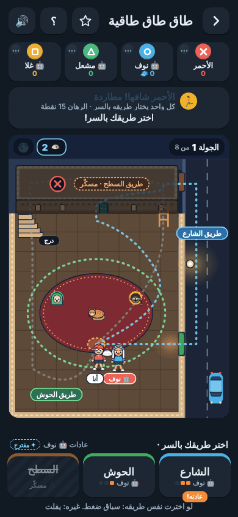 |

### النسخة الثانية: الصور المعتمدة مبدئيًا (2026-11-15)

| من عيونك وأنت قاعد | اللفّاف يمشي بإصبعه | المطاردة بلف الإصبع |
|---|---|---|
| 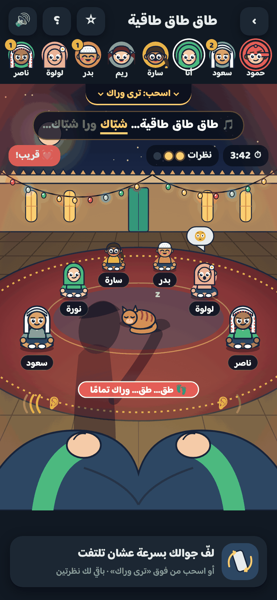 | 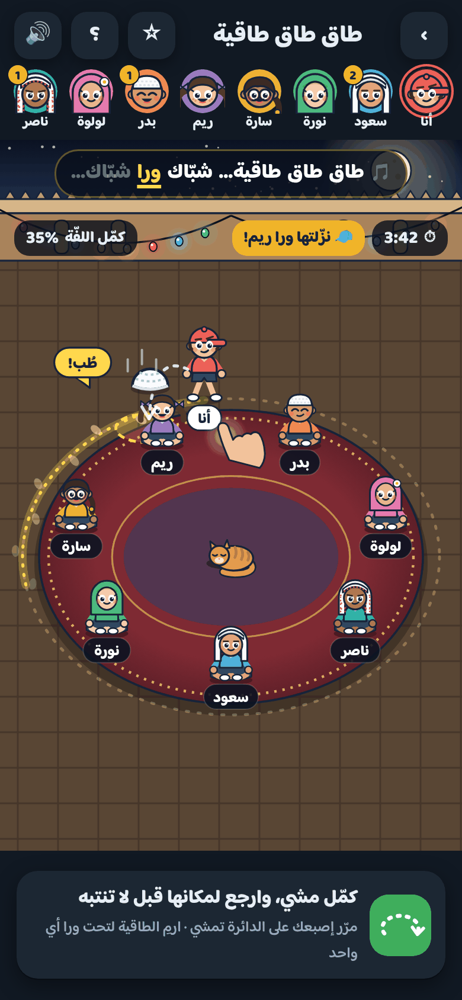 | 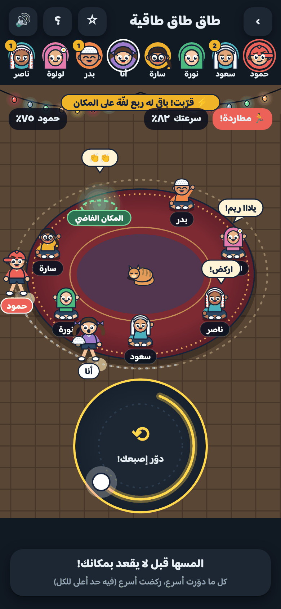 |

**الشخصيات:** «عيال الحارة» قاعدين بدائرة على زولية في الحوش بالليل، تحت لمبات وقمر، وقطو نايم بالنص. القطع اللي انضافت للعدّة لهاللعبة (`KH.sit`، `KH.cap`، القطو النايم، قطع الحوش) في آخر `kit-hara.js`.

### ملاحظات بناء النسخة الأولى
- **المصدر:** لعبة الدائرة التقليدية «طاق طاق طاقية»، بتصميم صاحب المشروع وكل اقتراحات «✦».
- **قوة البوت:** بوتين صعبين ضد بوتين سهلين (300 جيم): الصعب فاز 89%. والصعب يشوف 85 إلى 87% من الطواقي الحقيقية، والسهل 55 إلى 64%.
- **أرقام مؤقتة انعتمدت:** 4 ثواني للانتباه، +2 للصرخة، −1 للقطو، −2 لـ«تحسّس»، 5 ثواني للفّة، 12 ثانية للطرق، 3 ثواني لسباق الضغط.

## السجل

<!-- auto:start history -->
<!-- هذا الجزء يتولّد آليًا بالأمر node tools/gen-game-logs.js. لا تعدّل بين auto:start وauto:end، واكتب ملاحظاتك برا. -->

من git، الأحدث أول (الإصدارات والدمج العادي ما تنعرض):

| التاريخ | وش تغيّر | الكومت |
|---|---|---|
| 2026-11-15 | دمج «طاق طاق طاقية»: تنلعب أونلاين وضد البوت، وما تنعرض على نفس الجهاز | `3cf4e23` |
| 2026-11-15 | رد المستهدف في لحظة الانتباه صار سري (بدون علامات للي جاوبوا)، وتكبير وتمرير لشاشة المستهدف، وتلميع | `661a9f4` |
| 2026-11-15 | **انضافت اللعبة.** النسخة الأولى: لعبة الدائرة في الحوش بالليل، بالتخطيط السري واللف والانتباه والمطاردة، وقطع جديدة في عدّة الحارة (`KH.sit` و`KH.cap`) | `374b781` |
<!-- auto:end history -->

### من المحادثات (الأحدث أول)

- **2026-11-15:** على صور النسخة الثانية قال صاحب المشروع: «طاقيه: مبدئيا كويس اجربها واعطيك ملاحظاتي.»، وبدأ بناء النسخة الثانية.
- **2026-11-15:** انرسمت 3 صور للنسخة الثانية (من عيونك، اللفّاف بإصبعه، المطاردة بالإصبع).
- **2026-11-15:** جاوب على الأسئلة: التفاعل كله (تشوف من مكانك، اللفّاف يمشي بإصبعه، تلتفت بحركة الجوال، المطاردة بلف الإصبع)، وفي التصميم «أصوات حقيقية» وكتب: «أكثر شسء يهم الحبكة والتفاعل».
- **2026-11-15:** رفض النسخة الأولى: «اللعبه جدا غبيه وغير واضحة الحبكة جدا معقدة وبدون هدف ، اقصد طاقيه». ولما انعرضت عليه نسخة مبسطة قال: «لا اقصد الحبكة و التصاميم والتفاعل مافي شيء حقيقي ولا مميز».
- **2026-11-15:** النسخة الأولى انرفعت (أونلاين وضد البوت، مو على جوال واحد)، وصاحب المشروع رد: «تمام».
- **2026-11-15:** اعتمد النسخة الأولى بكل الاقتراحات والأرقام المؤقتة: «اعتمد طاقية بجربها وعطيك الملاحظات اذا وجدت».
- **2026-11-15:** انرسمت خمس صور للنسخة الأولى.
- **2026-11-14:** صاحب المشروع كتب تصميمه: «طاق طاق طاقية - دائرة الحارة»، وقال: «هذي لو سويناها صح بتكون أجمل من الغميضة»، و«اي اقتراح او تحسين اعرضه علي». انعرضت عليه 9 اقتراحات، وقال: «عطني اشوف».

## ينضاف من سجل البناء

<!-- هذا القسم ينضاف من سجل بناء النسخة الثانية (وكيل البناء). اكتب هنا: وش انبنى، والقرارات وقت البناء، والاختبارات، وقوة البوت، والصور. -->

(ينتظر سجل بناء النسخة الثانية.)

## القرارات

### 2026-11-15 🛠 النسخة الثانية: «مبدئيا كويس»
- على الصور الثلاث: «طاقيه: مبدئيا كويس اجربها واعطيك ملاحظاتي.»
- **التصميم:** هدف واحد (تمسك مقعد)، واللفّاف يمشي بسحب الإصبع ويرمي الطاقية بنفضة، والجالس يشوف من مكانه ويسمع الخطوات وراه بصوت ستيريو ويشوف الظل، والالتفات بحركة الجوال أو سحبة (3 التفاتات بالجولة)، والمطاردة برسم دواير، والنقاط +1 للمقعد و+1 للمسكة و−1 للي ينمسك غافل، و5 دقايق.
- **الأهزوجة:** تحتاج تسجيل حقيقي بأصوات عيال، ومكانها جاهز (`public/audio/taqiya-chant.mp3`). لين يجي التسجيل، تصفيق بإيقاع والكلمات على الشاشة.

### 2026-11-15 ✅ التفاعل والتصميم للنسخة الثانية
- اختار التفاعلات الأربع كلها: «تشوف من مكانك»، «اللفاف يمشي بإصبعه»، «تلتفت بحركة الجوال»، «المطاردة بلف الإصبع».
- وفي التصميم اختار «أصوات حقيقية»، وما اختار «رسم واقعي أكثر» ولا «تفاصيل الحارة»، وكتب: «أكثر شسء يهم الحبكة والتفاعل».

### 2026-11-15 ❌ النسخة الأولى انرفضت
- «اللعبه جدا غبيه وغير واضحة الحبكة جدا معقدة وبدون هدف ، اقصد طاقيه».
- «لا اقصد الحبكة و التصاميم والتفاعل مافي شيء حقيقي ولا مميز».

### 2026-11-15 ✅ ما تنعرض «على نفس الجهاز»
- لحظة الانتباه لازم تكون سرية: لما يمرّرون الجوال للمستهدف، الكل بيعرف إنه هو. فهي أونلاين وضد البوت وقريب بدون نت بس (انضافت لـ`NOLOCAL` وقت الدمج).

### 2026-11-15 ✅ النسخة الأولى انعتمدت للتجربة
- «اعتمد طاقية بجربها وعطيك الملاحظات اذا وجدت»: بكل الاقتراحات والأرقام المؤقتة.

### 2026-11-14 ✅ تصميم صاحب المشروع
- دائرة في حوش بالليل «مثل رقم أ في الغميضة، بس الدائرة هي الحارة»: لمبات وقمر وقطو نايم في النص، واللفّاف يمشي حول الدائرة فعلًا.
- أفكاره: اللفّاف يخطط بالسر (ورا مين، كم لفة، حقيقية ولا وهمية)، و4 ثواني للانتباه، والمطاردة بثلاث طرق (الشارع، الحوش، السطح) مع سباق ضغط، والباقين يخمنون ولهم صرخة، والطاقية الذهبية، و«غفلة»، وحدث حارة كل دور، ونقل النقاط عشان يصير ثأر، والفوز بعد ما الكل يصير لفّاف أو بعد 5 دقايق.

## الاقتراحات

**الحالات:** ✅ معتمد • ❌ مرفوض • ⏸ معلّق • ❓ ينتظر قرار صاحب المشروع

### 2026-11-15: النسخة الثانية
- ❌ **النسخة المبسطة** (انعرضت أول ما انرفضت الأولى): هدف واحد وثلاث حركات (اللف، وزر «التفت» بثلاث مرات، وسباق ضغط)، ونقاط ±1، وتنشال كل الإضافات. رد صاحب المشروع: «لا اقصد الحبكة و التصاميم والتفاعل مافي شيء حقيقي ولا مميز».
- **التفاعل:** ✅ تشوف من مكانك، ✅ اللفّاف يمشي بإصبعه، ✅ تلتفت بحركة الجوال، ✅ المطاردة بلف الإصبع.
- **التصميم:** ✅ أصوات حقيقية، ❌ رسم واقعي أكثر (ما انختار)، ❌ تفاصيل الحارة (ما انختار).
- ✅ **الصور الثلاث** للنسخة الثانية: «مبدئيا كويس».
- ❓ **تسجيل حقيقي للأهزوجة:** ما نقدر نسجل أصوات عيال، فمكانه جاهز لين يرسله صاحب المشروع.

### 2026-11-14: اقتراحات على تصميم صاحب المشروع (النسخة الأولى)
كلها انعتمدت مع النسخة الأولى («اعتمد طاقية…»)، وبعدها انشالت كلها مع رفض النسخة الأولى:
- ✅ **طاقيتين وهميتين بس** لكل لاعب باللعبة، وعدّادها ظاهر للكل، و**«تحسّس» مرة وحدة**: يعرف حقيقية ولا وهمية بثانيتين من الأربع. (القرار بدون معلومة كان حظ 50%).
- ✅ **أثر لكل لفّة:** «حسّيت إنه بطّأ ورا ريم وسعود»، عشان «الكل يبدأ يشك» يصير له معنى.
- ✅ **الصرخة باسم بالسر:** إذا صابت تنبّه المستهدف وتزيده ثانيتين، وإذا غلطت −5.
- ✅ **المطاردة:** عادات كل لاعب بالطرق تطلع للكل، والحدث يقدر يسكّر طريق، وسباق الضغط +5 للأسرع.
- ✅ **من 4 إلى 8 لاعبين** (بثلاثة يصير التخمين 50%).
- ✅ **النهاية:** 5 دقايق أو جولات بعدد ضعف اللاعبين، واللي ما صار لفّاف ياخذ دوره قبل النهاية.
- ✅ **العدل أونلاين:** الأربع ثواني تنحسب على جوال المستهدف نفسه.
- ✅ **الطاقية الذهبية** مرة باللعبة، يختارها الخادم وتنعلن.
- ✅ **الشكل** على طريقة (أ) في الغميضة بنفس «عيال الحارة».
- ❓ **سؤال:** على جوال واحد كيف لحظة الانتباه؟ (الاقتراح «مرّروا الجوال لريم» بدون سبب). ما انجاوب، وانحسمت بإن اللعبة ما تنعرض على جوال واحد.

### قرارين وقت بناء النسخة الأولى
- ✅ **رهان المطاردة** نفس نقاط اللفّات (×2 مع الذهبية) بدل 15 ثابتة.
- ✅ **نفس الطريق:** المستهدف يمسكه إذا ضغط أكثر أو تعادلوا، والأسرع +5.

## ملاحظات مفتوحة

- **النسخة الثانية قيد البناء**، وصاحب المشروع بيجربها ويعطي ملاحظاته.
- **الأهزوجة:** ينتظر تسجيل حقيقي (`public/audio/taqiya-chant.mp3`).
- «القوانين» في الأعلى تتولّد من الكود، فهي للنسخة الأولى لين تنرفع الثانية.
