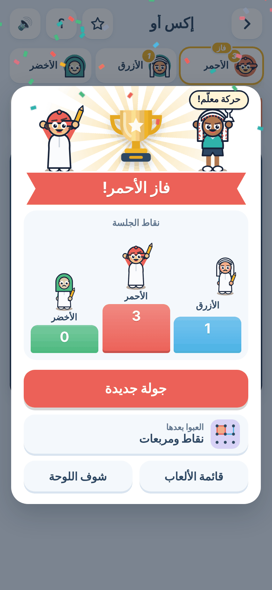

# سجل الاقتراحات

كل اقتراح انعرض في المشروع، على مستوى لعبة أو على مستوى التطبيق، وحالته. طلب صاحب المشروع: «أهم شي كل التفاصيل توثق في مستودع المشروع حتى الاقتراحات، ولكل لعبه سجلها».

- **الحالات:** ✅ معتمد (انبنى أو قيد البناء) • ❌ مرفوض أو ما انختار • ⏸ معلّق • ❓ ينتظر قرار صاحب المشروع، أو انعرض وما انرد عليه.
- الاقتراح اللي يخص لعبة مكتوب بالتفصيل في سجلها ([docs/games/](games/README.md))، وهنا سطر واحد ورابط. القرارات نفسها في [decisions.md](decisions.md)، والشغل الجاري في [roadmap.md](roadmap.md).
- الاقتباسات بين «» كلام صاحب المشروع نفسه. التواريخ بتوقيت UTC مثل [decisions.md](decisions.md).
- **اقتراح جديد:** أضفه هنا وفي سجل لعبته، بتاريخه وحالته، وحدّث الحالة لما يرد صاحب المشروع.

---

## 1. التطبيق كله

### المراجعة الأولى وخطة الإصلاح (2026-11-13)
صاحب المشروع طلب: «راجع المشروع وعطني تقرير بالاخطاء وعطني خطه إصلاح ، وأي شيء تقدر تسويه بشكل أفضل أعرض علي». التقرير طلع بـ136 خطأ مؤكد، والخطة بخمس مراحل، ورد: «ابدأ بحطه التصحيح» و«لا تتوقف حتى تنتهي».

| # | الاقتراح | الحالة |
|---|---|---|
| 1 | المرحلة 0، أمان عاجل: إشعار التحديث، ومفتاح توقيع جديد في أسرار GitHub، وسد حقن الكود، وصلاحيات الغرفة لصاحبها، وحماية خادم الغرف | ✅ |
| 2 | المرحلة 1، أخطاء اللعب: أول نقلة في الجولة الجديدة، والبوتات، والسودوكو، وعرض التعادل في الشطرنج، والأزرار | ✅ |
| 3 | المرحلة 2، لما يطلع لاعب: إصلاح واحد في المحرك (`onSkip`) لحوالي 20 لعبة | ✅ |
| 4 | المرحلة 3، إخفاء الأسرار فعليًا، والخيار (أ): الاختيارات تنرسل مشفّرة وتنكشف بعد ما يختار الكل، وبعدها صاحب الغرفة يوزع، ورقم لاعب ثابت. صاحب المشروع ما اختار، فمشى الشغل على التوصية | ✅ |
| 5 | المرحلة 4، المحتوى: شرح القوانين، وREADME، والأسئلة المكررة | ✅ |
| 6 | التقرير كصفحة ويب تنشارك | ❓ ما انرد عليه |
| 7 | فتح Pull Request بدل الدمج: صاحب المشروع قال «ادمجه مباشرة في main» | ❌ |

### التحسينات العامة (16 اقتراح، 2026-11-13)

| # | الاقتراح | الحالة |
|---|---|---|
| 8 | نقل مفتاح توقيع أندرويد لأسرار GitHub. صاحب المشروع اختار: «اختار انك تسويه انت عادي مب مشكلة» | ✅ |
| 9 | فحص تلقائي لكل تعديل (ESLint) وسكربت فحص وملف تعليمات للوكلاء | ❓ |
| 10 | اختبار تلقائي في GitHub يلعب كل الألعاب بالبوتات مع كل تعديل (أدوات الاختبار نفسها انحفظت في `tools/test/`، وما انربطت بـ GitHub) | ❓ |
| 11 | صاحب الغرفة هو الوحيد اللي يكتب حالة اللعبة ويتأكد من الحركات | ✅ |
| 12 | الأسرار خاصة من الأساس: صاحب الغرفة يوزع، وكل لاعب ياخذ جزؤه بس | ✅ |
| 13 | رقم لاعب ثابت: يرجع لمقعده، والطرد يثبت، والنقاط تتبعه | ✅ |
| 14 | دعوة برابط: رابط الغرفة، ومشاركة واتساب، وQR، وروابط تفتح التطبيق | ❓ |
| 15 | بوت يكمّل عن اللاعب اللي انقطع أونلاين. صاحب المشروع طلبها بعدين: «اذا طلع اللاعب بدون ينسحب يلعب مكانه البوت بشكل تلقائي واذا رجع يقدر يلغي اللعب التلقائي» | ✅ |
| 16 | حماية خادم الغرف: حد للرسائل والغرف | ✅ |
| 17 | تقارير أعطال خفيفة من جوالات اللاعبين | ❓ |
| 18 | إصدارات أندرويد مرقمة، وتحقق تحديث ما يأشر على ملف ناقص، وطريق لمتجر Play | ❓ |
| 19 | الموقع يشتغل بدون نت ويتثبت كتطبيق (خط محلي، Service Worker). انسوّى جزء: أيقونة للموقع ويفتح كتطبيق من الشاشة الرئيسية | ❓ |
| 20 | سجل ألعاب ومكتبة مشتركة وتقسيم `core.js` | ❓ |
| 21 | فحص بنوك الأسئلة وتعبئة الحزم الناقصة | ✅ |
| 22 | مكاسب صغيرة: إحصائيات، ومساعدة أول مرة، وإعدادات صوت، وحفظ الألعاب المحلية، ومتفرجين ظاهرين. انسوّى منها الإحصائيات وحفظ اللعبة المحلية | ❓ الباقي |
| 23 | تحميل كود الألعاب عند الحاجة (صارت الألعاب تنحمّل بعد أول شاشة) | ✅ |

### «طور كل الألعاب» (2026-11-14)

| # | الاقتراح | الحالة |
|---|---|---|
| 24 | لعب أعمق (مستحسن)، وبوتات أذكى، ومحتوى أكثر، وحركات ومؤثرات: صاحب المشروع اختار الأربعة كلها | ✅ |
| 25 | الألعاب الكلاسيكية تبقى بقوانينها الحقيقية، وتطويرها في البوت والحركة | ✅ |
| 26 | تبسيطات في قوانين ألعاب الورق الجديدة (الكذاب، الثمانيات، كوت، كونكان، تركس): «لو تبي أي قانون منها مثل اللعب الأصلي، قول لي» | ❓ ما انرد عليه |
| 27 | ترتيب ألعاب الأحجار والزهر مع 8 لاعبين على جوال صغير، والورق المتداخل في الكذاب والرئيس والوزير للاعبين: «إذا أي وحدة تضايقك قول لي» | ❓ ما انرد عليه |

### الموقع والدردشة والإيموجي والألعاب الجديدة (2026-11-14)
طلب صاحب المشروع: «ابيك تطور الموقع بشكل عام ، وتطور الشات ، وتطور الايموجي وتخليه ايموجي خاص باللعبه، وطور كل الألعاب ماطورتها كلها . وابيك تضيف العاب أكثر فوق ٢٠٠ لعبه».

| # | الاقتراح | الحالة |
|---|---|---|
| 28 | قائمة ألعاب لأكثر من 200: أقسام، وبحث يتجاهل التشكيل والهمزات، ومفضلة، ولعبة عشوائية، وتبهيت اللي ما تناسب عدد اللاعبين | ✅ |
| 29 | الدردشة: عبارات جاهزة، وملصقات، وعدّاد للرسائل الجديدة، وحماية من الإزعاج، وصاحب الغرفة يقفل الشات | ✅ |
| 30 | إيموجي خاص باللعبة مرسوم (نرد يضحك، جمل، دلّة، صقر، «كفو»، «يا حظك»…) | ✅ |
| 31 | ألعاب جديدة من ألعاب تراثية أو أفكار أصلية بأسماء عربية، بدون نسخ ألعاب تجارية بأسمائها | ✅ |
| 32 | الصفحة الرئيسية ثابتة بدون تمرير، والأزرار الأربعة 2×2، و«كمّل اللعبة» بس إذا فيه لعبة، وعدد الألعاب يتحدث لحاله | ✅ |
| 33 | شيل الكلام التقني من كل الصفحات، و«قريب بدون نت» في التطبيق بس | ✅ |
| 34 | تصليحات البلوتوث (الأذونات، وإعادة المحاولة، والرسائل الكبيرة). باقي التجربة على جوالين حقيقيين | ✅ و❓ التجربة |
| 35 | أيقونة للتطبيق من شعار النردين، وشاشة بداية، وأيقونة للموقع | ✅ |
| 36 | المقاسات والصفحات والحركة والتفاعل لكل الشاشات، وزر الرجوع في أندرويد يرجع صفحة | ✅ |
| 37 | شرائط «جديد» و«مطوّرة» على المربعات | ❌ انشالت (صارت زحمة) |

### الغرف والأونلاين (2026-11-14)

| # | الاقتراح | الحالة |
|---|---|---|
| 38 | رمز ما أحد فتحه ينرفض قبل الدخول (بعد ما الحل الأول كان يدخّل اللاعب ثواني) | ✅ |
| 39 | تحديث الصفحة يرجّعك لنفس المكان | ✅ |
| 40 | «ما انحسبت حركتك»: الحركة على لوحة أقدم تنحسب، ورسالة واضحة بالسبب | ✅ |
| 41 | الرجوع للغرفة بدون ما تعلق على آخر لعبة | ✅ |
| 42 | زر «انسحب من اللعبة»، والباقين يكملون | ✅ |
| 43 | اختبار المسارات الشاذة أونلاين وعلى الجهاز («وسوي اختبار المسارات الغير متوقعه والشاذه») | ✅ |
| 44 | وضع «الحركة الخفيفة» للجوالات المتواضعة، بعد شكوى «صارت اللعبه جدا بطيئة» | ✅ |
| 45 | الشات بشريط ثابت ما يدخل على اللعبة، والرسائل فوقه، و«انسحب» في إعدادات اللعبة (طلب صاحب المشروع على صور الغميضة، 2026-11-15) | ✅ |

### الشخصيات (2026-11-14)

| # | الاقتراح | الحالة |
|---|---|---|
| 46 | «عيال الحارة» يصيرون شخصيات التطبيق كله، وكل لعبة تلبّسهم بطابعها. صاحب المشروع: «نبي تصاميم العيال تكون هي شخصيات اللعبه بشكل عام» و«و الشخصيات اعتمدها» | ✅ 🛠 التعميم جاري |
| 47 | في كل مكان يطلع فيه اللاعب: صف اللاعبين، والغرف، والدردشة، والنتائج («الفايز يفرح»)، و«دورك!»، وشاشة التمرير، والرئيسية | ✅ 🛠 (صور: [img/cast/](games/img/cast/)) |
| 48 | تختار الطفل اللي يمثلك | ❓ انعرض ضمن الخطة |

### فرز الأقسام (2026-11-14)

| # | الاقتراح | الحالة |
|---|---|---|
| 49 | «على نفس الجهاز»: نشيل الـ3 اللي ما تنفع ونصلح الـ60 الثقيلة (مستحسن) | ❌ صاحب المشروع اختار «نشيل الـ٦٣ كلها» |
| 50 | «على نفس الجهاز»: نشيل الـ63 كلها | ✅ |
| 51 | «ضد البوت»: نشيل الـ19 (مستحسن) | ✅ |
| 52 | «ضد البوت»: نشيل الـ9 بس | ❌ |
| 53 | إصلاح «جاوب كل الأسئلة بدورك» لـ32 لعبة أسئلة على جوال واحد | ❌ (مع رقم 49) |
| 54 | إصلاح «تصويت مكشوف على شاشة وحدة» لمين الأكثر وحقيقتين وكذبة والمافيا | ❌ (مع رقم 49) |
| 55 | حلبة القتال بجولات أقل، واللقطة والحرب الكبرى بلاعبين أو ثلاثة وأزرار على الأطراف، والألغاز بلغز لكل لاعب | ❌ (مع رقم 49) |

الألعاب وأسبابها في سجل كل لعبة (جدول «يناسب أي طريقة لعب»)، والقاعدة الدائمة في [game-checklist.md](game-checklist.md).

### التوثيق (2026-11-15)

| # | الاقتراح | الحالة |
|---|---|---|
| 56 | توثيق كل شي في `docs/` بالعربي: «وثق كل شيء في ملف المشروع على GitHub» | ✅ |
| 57 | سجل لكل لعبة وسجل للاقتراحات: «ولكل لعبه سجلها» | ✅ (هذا الملف و[games/](games/README.md)) |

---

## 2. الألعاب الثنائية: طرق لعب لأكثر من اثنين ⏸

26 لعبة أصلها لاعبين اثنين. صاحب المشروع: «وفي العاب اساسا ماتنلعب باكثر من ٢ وهذي اعرضها علي ونطورها سوا»، وبعد الأفكار: «اقترح شيء يعتبر تطوير مب مجرد تكبير طاوله تو زياده أوراق او أحجار»، وآخر شي: **«علقها حاليا ولا تعتمد شيء»**.

الألعاب: [شطرنج](games/chess.md)، [داما](games/dama.md)، [طاولة الزهر](games/tavla.md)، [قو](games/b_go.md)، [الشطرنج الصيني](games/b_xiangqi.md)، [حصار الملك](games/b_tablut.md)، [المنقلة](games/b_mancala.md)، [التسعة](games/b_morris9.md)، [الثلاثة](games/b_morris3.md)، [القِرق](games/b_alquerq.md)، [السيجة](games/b_seega.md)، [فانورونا](games/b_fanoron.md)، [الملكات والسهام](games/b_amazons.md)، [السداسي](games/b_hex.md)، [المحبوسة](games/b_mahbusa.md)، [عظام الكعب](games/d_knuck.md)، [كورة بالنرد](games/d_foot.md)، [المثلثات](games/g_sim.md)، [الدومينو المتقاطع](games/g_domin.md)، [القناني](games/g_kayles.md)، [ستة في صف](games/g_conn6.md)، [البرج](games/g_tower.md)، [الخطوط](games/g_lines.md)، [صندوق الألوان](games/g_chomp.md)، [العلامات](games/g_notakto.md)، [الشبكة الذهبية](games/g_hacken.md).

| # | الاقتراح | لمين | الحالة |
|---|---|---|---|
| 58 | بطولة طاولات (مستحسن) | الكل | ❌ صاحب المشروع اختار «نعرضها لعبة لعبة» |
| 59 | الفايز يبقى | الكل | ❌ نفس السبب |
| 60 | فريقين يتشاورون | الكل | ❌ نفس السبب |
| 61 | شطرنج رباعي، وبطولة، والفايز يبقى، وفريقين يتشاورون | [الشطرنج](games/chess.md) | ❌ «ولا شي منها» |
| 62 | الفايز يبقى (مستحسن)، وبطولة، وفريقين | [الطاولة](games/tavla.md) و[المحبوسة](games/b_mahbusa.md) | ⏸ بدون اختيار |
| 63 | داما صينية من 3 إلى 6 (مستحسن)، والفايز يبقى، وبطولة، وفريقين | [الداما](games/dama.md) | ⏸ بدون اختيار |
| 64 | شطرنج التبديل (bughouse) | [الشطرنج](games/chess.md) | ⏸ |
| 65 | شطرنج الضباب بالفرق | [الشطرنج](games/chess.md) | ⏸ |
| 66 | الشوِت (chouette): واحد ضد فريق | [الطاولة](games/tavla.md) و[المحبوسة](games/b_mahbusa.md) | ⏸ |
| 67 | المجلس والخاين | الكل | ⏸ |
| 68 | التتابع الصامت | الكل | ⏸ |
| 69 | الرهان للمتفرجين | الكل | ⏸ |

---

## 3. ألعاب لها جولات تصميم

### [غميضة الحارة](games/hide.md)

| # | الاقتراح | الحالة |
|---|---|---|
| 70 | ثمان تحسينات على تصميم صاحب المشروع (اختيار الغمّاض سري، الراكض أول، التلميحات للكل، الفريق يشوف ربعه، المكان المأخوذ، الوقت على جوال واحد، البوتات، هدف الفوز ما ينهي لعبة النقاط) | ✅ |
| 71 | الشكل (أ) خريطة حارة مرسومة | ✅ «اختار أ» |
| 72 | الشكل (ب) مشهد جانبي كرتون | ❌ |
| 73 | الشكل (ج) مربعات بس أجمل (كان المستحسن) | ❌ |
| 74 | التفاعل: شخصيات تتحرك، العدّ، الأصوات، التسلّل | ✅ كلها |
| 75 | الحبكة: قصة وجو، أدوات ومفاجآت، مراحل أوضح | ✅ كلها |
| 76 | تصليح عيوب (أ): أسماء واضحة، ضغطتين، ممرات، «اسمع» على جهات | ✅ |
| 77 | عدّة مشتركة `KH` لألعاب الحارة الجاية | ✅ |

### [طاق طاق طاقية](games/taqiya.md)

| # | الاقتراح | الحالة |
|---|---|---|
| 78 | طاقيتين وهميتين وعدّاد ظاهر، و«تحسّس» | ✅ ثم انشال مع النسخة الأولى |
| 79 | أثر لكل لفّة | ✅ ثم انشال |
| 80 | الصرخة باسم بالسر | ✅ ثم انشال |
| 81 | عادات الطرق، وحدث يسكّر طريق، و+5 للأسرع | ✅ ثم انشال |
| 82 | من 4 إلى 8 لاعبين | ✅ |
| 83 | النهاية بـ5 دقايق أو جولات بضعف اللاعبين، وكل واحد لفّاف مرة | ✅ ثم تغيّر |
| 84 | الأربع ثواني تنحسب على جوال المستهدف | ✅ |
| 85 | الطاقية الذهبية يختارها الخادم وتنعلن | ✅ ثم انشال |
| 86 | الشكل على طريقة (أ) بعيال الحارة | ✅ |
| 87 | سؤال: لحظة الانتباه على جوال واحد | ❓ انحسم بإنها ما تنعرض على جوال واحد |
| 88 | النسخة المبسطة بعد الرفض (هدف واحد وزر «التفت») | ❌ «لا اقصد الحبكة و التصاميم والتفاعل مافي شيء حقيقي ولا مميز» |
| 89 | تشوف من مكانك | ✅ |
| 90 | اللفّاف يمشي بإصبعه | ✅ |
| 91 | تلتفت بحركة الجوال | ✅ |
| 92 | المطاردة بلف الإصبع | ✅ |
| 93 | أصوات حقيقية | ✅ |
| 94 | رسم واقعي أكثر | ❌ ما انختار |
| 95 | تفاصيل الحارة (باب حديد، نخلة، جيران يطلّون) | ❌ ما انختار |
| 96 | تسجيل حقيقي للأهزوجة من صاحب المشروع | ❓ |

### [جكارو](games/jakaro.md)

| # | الاقتراح | الحالة |
|---|---|---|
| 97 | تصحيح القوانين للسعودي: 19 خانة، و4-4-5، والخمسة لأي حبة، والعشرة تحرق، وما تنقز على حبّك، وسد الحبتين، والموزّع يتغير | ✅ |
| 98 | باقي السبعة لحبات الشريك (خيار) | ❓ |
| 99 | انتهاء الوقت يلعب حركة البوت المتوسط | ✅ |
| 100 | أنت تحت دايم، ومعاينة وتأكيد وتراجع، والسبعة بسلايدر، وواجهة الولد، والتقريب مع 6 و8 | ✅ |
| 101 | سطر القوة تحت كل ورقة | ❌ (الورق «أ» بدون كلام، والقوة فوق زر «حرّك») |
| 102 | إشارات الشريك السريعة | ❓ |
| 103 | تبادل ورقة مع الشريك أول التوزيعة | ✅ في المخمخة |
| 104 | بوت يعرف شريكه ويعدّ الورق | ❓ ما انعرض بالجولة الرابعة |
| 105 | خيارات «قوانين البيت» | ✅ تحولت للمستويات |
| 106 | 6 لاعبين: فريقين من ثلاثة | ❌ لبعدين |
| 107 | 8 لاعبين: حبتين لكل لاعب أو نوقف عند 6 | ❌ (الثمانية كاملة) |
| 108 | 3 و5 و7 لاعبين على ألواح ثانية | ❓ |
| 109 | الجولة الأولى: الأسلوب الليلي مع العيال | ❌ «ما عجبني التصميم» |
| 110 | الجولة الثانية: «لامع ملوّن» | ❌ «تصاميم جكارو مرفوضة» |
| 111 | الجولة الثانية: «خشب فاخر» | ❌ |
| 112 | لوحة الأربعة حلقة بدل الصليب | ❌ |
| 113 | الجولة الثالثة: اللوحة الحقيقية الجوزية | ✅ «ممتاز» |
| 114 | الورق (أ) كلاسيكي بلمسة | ✅ «اختار ورق أ» |
| 115 | الورق (ب) ورق جكارو (كان المستحسن) | ❌ |
| 116 | الورق (ج) أرقام كبيرة | ❌ |
| 117 | التفاعل (12 إطار)، والحركة، وعائلة الألواح 4 و6 و8 | ✅ «والباقي اعتمده» |
| 118 | المستويات: كلاسيكي، ومخمخة، والحريف بقواعدها | ✅ |
| 119 | الحريف: الدور العكسي | ❌ يلخبط أكثر ما يمتّع |
| 120 | الحريف: سرقة ورقة من خصم | ❌ البنت الحمراء تكفي |
| 121 | «تقريبًا 25 دقيقة» بالغرفة مع الثمانية | ❓ |

### [عائلة التخمين](games/guess.md)

| # | الاقتراح | الحالة |
|---|---|---|
| 122 | ست ألعاب منفصلة بمحتوى مرسوم وأسئلة تخص كل موضوع | ✅ |
| 123 | تبويبات أسئلة بجمل طبيعية | ✅ |
| 124 | عدّاد «يشيل تقريباً ٩ من ١٦» | ❌ «لا مابي تلميحات قبل الاجابه لازم عنصر المفاجأة» |
| 125 | يد أسئلة (3 أو 4 بطاقات كل دور) | ❌ ما انختارت |
| 126 | لحظة الجواب مشهد وشريط تاريخ | ✅ |
| 127 | «كل واحد سره والسؤال للكل» افتراضي | ✅ |
| 128 | «الكل ضد واحد» | ✅ إضافي |
| 129 | الفرق يصوتون على السؤال | ✅ |
| 130 | سؤال ذهبي مفتوح | ❌ ما ينجاوب آليًا |
| 131 | كذبة وحدة مسموحة | ❌ تخرّب قلب البطاقات |
| 132 | ورقة الشخصيات الجديدة (8 رجال و33 مهنة) | ❓ |
| 133 | خمّن الطير | ❓ |
| 134 | خمّن الفاكهة والخضار | ❓ |
| 135 | خمّن المدينة السعودية | ❓ |
| 136 | خمّن الرياضة | ❓ |
| 137 | خمّن الأداة | ❓ |
| 138 | خمّن المركبة | ❓ |

---

## 4. اقتراحات ألعاب ثانية

| # | الاقتراح | اللعبة | الحالة |
|---|---|---|---|
| 139 | تنخفى من «ضد البوت» لأنها حظ بحت | [السلم والثعبان](games/snakes.md)، [شيكاغو](games/d_chi.md)، [بونكو](games/d_bunco.md)، [سي لو](games/d_ceelo.md)، [غولف النرد](games/d_golf.md)، [ارسم الخنفساء](games/d_beetle.md) | ✅ |
| 140 | تنخفى من «ضد البوت» لأن روحها الكلام بين ناس | [برة السالفة](games/bara.md)، [المافيا](games/mafia.md)، [الرسام المزيف](games/p_fake.md)، [البطاطا الحارة](games/p_potato.md) | ✅ |
| 141 | «مونوبولي» يتغير اسمها (علامة تجارية) | [عقارات الحارة](games/mono.md) | ✅ |

---

**المجموع: 141 اقتراح.** منها في سجلات الألعاب تفاصيل أكثر (مثل التحسينات في كل لعبة).
