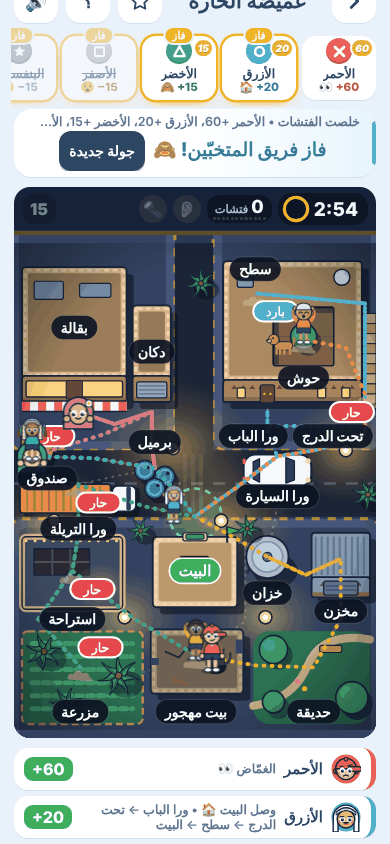

# ألعاب الحارة

ألعاب الحارة فكرة صاحب المشروع نفسه: **ناخذ ألعاب الشارع الحقيقية اللي لعبناها صغار، ونسويها رقمية، وتبقى فيها نفس الإحساس الحقيقي.** يعني:
- تحس إنك فعلًا متخبّي ورا الباب، وقلبك يدق والغمّاض قريب؛
- الشخصيات تمشي في الحارة؛
- فيه قطو يموء، وكلب ينبح، وأم تنادي «العشا جاهز!».

كل ألعاب الحارة مبنية على عدّة واحدة مشتركة: `KH` في `public/js/kit-hara.js`. فيها رسم الحارة بالليل، و«عيال الحارة» (انظر [characters.md](characters.md))، والممرات، والمشي، والأصوات. وأسلوب الرسم المعتمد موصوف في [design.md](design.md) (القسم 10).

| اللعبة | المعرّف | الحالة | اللاعبين | طرق اللعب |
|---|---|---|---|---|
| غميضة الحارة | `hide` | منشورة، النسخة الثانية | 3 إلى 8 | أونلاين، ضد البوت، قريب بدون نت |
| طاق طاق طاقية | `taqiya` | الأولى منشورة، **الثانية قيد التصميم** | 4 إلى 8 | أونلاين، ضد البوت، قريب بدون نت |

**الاثنتين مخفيات من «على نفس الجهاز»**: كل خطوة فيها قرارات سرية من أكثر من لاعب، فتمرير الجوال يقتل لحظة الترقب.

---

## 1. «غميضة الحارة» (`hide`)

الملفات: `public/js/games/n-hide.js` و`public/css/n-hide.css`، وقوانينها في `HELP.hide` آخر ملف اللعبة.

### فكرة صاحب المشروع (الأصل)

قال صاحب المشروع: «ضيف هذي اللعبه ولها الأولوية، طورها وحسنها وطلعها بأفضل شكل». وتصميمه الأصلي كان كذا:

- **الفكرة:** الغميضة القديمة في الشارع صارت لعبة جوال، كلها أدوار وضغطات، بدون حركة لحظية. والمهم يبقى إحساسها الحقيقي: توتر التخبّي، والمخاطرة بين إنك تبقى مكانك أو تركض للبيت، وتخمين وين تخبوا أصحابك.
- **الأدوار:** من 3 إلى 8 لاعبين. واحد يدوّر («الغمّاض») والباقين يتخبون، والغمّاض يتغير كل جولة.
- **الفرق:** من 4 لاعبين المتخبّين فريق واحد ويفوزون سوا. مع 3 لاعبين كل متخبّي لحاله.
- **الخريطة:** حارة سعودية فيها 16 مخبا (سطح، حوش، ورا السيارة، برميل، بقالة، دكان، صندوق، بيت مهجور، مزرعة، استراحة، خزان، تحت الدرج، مخزن، ورا التريلة، حديقة، ورا الباب)، و«البيت» مكان الأمان.
- **التخبّي:** كل متخبّي يختار مكان بالسر، ومكان واحد لكل واحد.
- **الفتشات:** 6 + عدد المتخبّين، وأقصاها 12.
- **الوقت:** 3 دقايق للعبة كلها، و15 ثانية لكل فتشة.
- **كل دور:**
  - الغمّاض يفتّش مكان أو يحرس البيت؛
  - بعد كل فتشة فاضية يجي تلميح «حار، دافي، بارد» عن أقرب متخبّي؛
  - كل متخبّي يقرر يبقى أو يركض للبيت، ويركض مرة وحدة باللعبة.
- **«اسمع»:** قوة للغمّاض مرة وحدة باللعبة: يعرف إذا فيه أحد في جهة من الخريطة.
- **النقاط:** تنتقل بين اللاعبين: يلقى واحد = +15 للغمّاض و−15 على اللي انمسك، وتوصل البيت = +20، وتصمد للآخر = +15، ويلقاهم كلهم = +10 زيادة.
- **البوتات:** ذكية، مو عشوائية.

### القوانين مثل ما انبنت

بعد النسخة الأولى (شبكة 4×4) طلب صاحب المشروع خريطة حقيقية، واختار **الأسلوب A** (حارة بالليل من فوق). بعدها انبنت من جديد على عدّة الحارة:

- **الخريطة:** حارة بالليل فيها نفس المخابي الـ16 بنفس الترتيب، كل مكان بموقعه الحقيقي، و«البيت» بالنص.
  - بينها **27 ممر** على الشوارع والجدران، والمسافة تنحسب بعدد خطوات الممرات.
  - الخريطة مقسومة **5 جهات**: بيت الجيران (4 أماكن)، وجهة البقالة، والشارع العام، وجهة المزارع، وجهة الخزان (3 أماكن لكل وحدة).
- **الأدوار:** الغمّاض هو اللي يبدأ الجولة، و«جولة جديدة» تعطي الدور اللي بعده.
- **الفتشات:** `min(12, 6 + عدد المتخبّين)`.
- **الوقت:**
  - العدّ 25 ثانية؛
  - كل خطوة 15 ثانية، و10 ثواني بعد نداء الأم؛
  - اللعبة 3 دقايق.

### المراحل

1. **العدّ:**
   - الغمّاض يغمّض عند البيت ويعدّ «واحد… عشرة!» بفقاعة كلام وصوت.
   - كل متخبّي يختار مخباه بالسر ويمشي له على الممرات ويطل منه.
   - إذا اثنين اختاروا نفس المكان، الأقل ترتيبًا ياخذه، والثاني يوصله بالسر «المكان مأخوذ، اختر غيره».
   - اللي ما يختار خلال 25 ثانية يطلع له مكان عشوائي فاضي.
2. **التفتيش.** كل دور فيه ثلاث خطوات:
   - **الغمّاض يختار بالسر** وحدة من:
     - يفتّش مكان 🔦؛
     - يحرس البيت 🛡؛
     - مرة باللعبة «الكشاف»: ينوّر جهة ويبين **ظل** واحد متخبّي فيها لدور واحد، بدون اسمه، وياخذ فتشة.
     - وقبلها يقدر يستخدم **«اسمع 👂»** مرة باللعبة: يختار جهة ويعرف «فيه أحد / ما فيه أحد». الجواب يشوفه الكل، وما ياخذ فتشة.
   - **كل متخبّي باقي يختار بالسر** وحدة من:
     - يبقى 🤫؛
     - **يتسلّل 👣** لمكان فاضي جنبه على الممرات؛
     - يركض للبيت 🏃 (مرة باللعبة).
   - **الكشف للكل مرة وحدة**، بالترتيب:
     1. **الراكضين:** إذا البيت محروس ينمسكون، وإذا مو محروس يوصلون بأمان. حتى لو الغمّاض فتّش مكانهم القديم، هم طلعوا منه قبل.
     2. **المتسللين:** إذا اثنين قصدوا نفس المكان، أو مكان أحد باقي فيه، التسلل ينسد وصاحبه يدري بالسر. والتسلل يسوي صوت: الغمّاض أحيانًا (35%) «يسمع خطوات» بالجهة.
     3. **الفتشة:** اللي في المكان ينمسك. وإذا المكان فاضي يطلع للكل تلميح عن أقرب متخبّي بعدد خطوات الممرات: 🔥 حار (خطوة)، 🌤 دافي (خطوتين)، ❄️ بارد (أبعد).
3. **النهاية:**
   - **متى تخلص الجولة:** إذا الكل انمسك أو وصل البيت، أو خلصت الفتشات، أو خلصت الدقايق الثلاث.
   - **الخريطة:** تبين مسار كل متخبّي بلونه (البيت ← المخبا ← التسللات ← البيت)، وعلامات «لقيتك!»، والتلميحات.
   - **القائمة:** وجه كل لاعب، ووش صار له، ومساره، والنقاط اللي تحركت.

### الأحداث والمفاجآت

صاحب الغرفة (أو الجوال) يسحبها بالحظ كل جولة، وكل وحدة تصير مرة بالجولة كحد أقصى:

| الحدث | وش يسوي |
|---|---|
| 🐈 **القطو** | قاعد على مكان. اللي يتسلل جنبه يموء القطو (75%)، ويعرف الغمّاض الجهة |
| 🐕 **الكلب** | بعيد عن القطو. إذا الغمّاض اختار بالسر مكان قريب من الكلب، ينبح والكل يسمعه وقت قرار المتخبّين، فيصير تحذير لهم |
| 🧔 **أبو سعد** | صاحب البقالة، موجود 70% من الجولات. أول فتشة للبقالة ما تلقى أحد وما تعطي تلميح، سواء فيها أحد ولا لا، فما تفضح شي |
| 👩 **الأم** | آخر 40 ثانية تنادي «العشا جاهز!» (شريط وفقاعة وصوت)، والخطوات تصير 10 ثواني |
| 💡 **عمود النور** | يرمش مرة وحدة عند كل كشف |
| 💓 **نبض القلب** | على جوال المتخبّي إذا الغمّاض صار على بعد خطوة منه |

ومعها أصوات صغيرة: خطوات، و«لقيتك!»، و«أمان!»، ومواء، ونباح، ونداء الأم، وتكات العدّ. وفيه جمل سواليف قصيرة بلهجتنا عند الأحداث.

### جدول النقاط

النقاط تنحسب على طول الجولة وتطلع فوق الشخصيات («+15» و«−15»). وفي النهاية تتحول لنقاط الجلسة عن طريق `d.dsc`، والمجموع ما ينزل تحت الصفر.

| الحدث | الغمّاض | المتخبّي |
|---|---|---|
| الغمّاض يلقى متخبّي (فتشة أو راكض والبيت محروس) | +15 | −15 (وإذا عنده أقل من 15 يوصل صفر بس) |
| المتخبّي يوصل البيت | 0 | +20 |
| المتخبّي يصمد للآخر بدون ما ينمسك | 0 | +15 |
| الغمّاض يلقى الكل قبل ما تخلص الفتشات والوقت | +10 زيادة | |

- **مين يفوز:** إذا الغمّاض لقى الكل، يفوز. وإذا صمد واحد على الأقل أو وصل البيت، يفوز طرف المتخبّين.
- **الفريق:** من 4 لاعبين المتخبّين كلهم يفوزون سوا. مع 3 لاعبين يفوز اللي ما انمسك بس.

### البوتات (سهل، متوسط، صعب)

البوت يشوف بس اللي يشوفه مقعده (`GAMES.hide.mask(d, seat)`)، ما يغش.

- **البوت الغمّاض:**
  - يحسب احتمال كل مكان من كل اللي انعرف: التلميحات (ويقلل وزنها مع كل دور، لأن المتخبّي يقدر يتسلل خطوة كل دور)، والأماكن المفتشة، وأجوبة «اسمع»، والخطوات والمواء اللي انسمعت، وظل الكشاف.
  - الصعب يتذكر كمان عادات التخبّي من الجولات اللي قبل.
  - يستخدم «اسمع» على الجهة الأقرب لـ 50/50 لما الاحتمالات متساوية، والكشاف على أثقل جهة، ويحرس البيت لما الوقت متأخر والتلميحات باردة وفيه ناس باقي لهم ركضة.
- **البوت المتخبّي:**
  - يتخبى بعيد عن الأماكن اللي يفتشها هالغمّاض، ويبعد عن القطو، ويحب البقالة لما أبو سعد موجود.
  - يتسلل بعيد لما تدفى عليه (الغمّاض على بعد خطوة، أو الكلب نبح بجهته، أو الظل عليه)، لمكان أقل احتمال وأبعد عن الغمّاض وما يمر جنب القطو.
  - يركض للبيت لما الحسبة تقول إنها تستاهل.
- **السهل** فيه عشوائية كثيرة، و**الصعب** حاد.
- **نسبة الإمساك** (200 جولة لكل مواجهة، 3/5/8 لاعبين):

  | المواجهة | نسبة الإمساك |
  |---|---|
  | غمّاض صعب ضد متخبّين سهلين | تقريبًا 55 إلى 59% |
  | غمّاض سهل ضد متخبّين صعبين | تقريبًا 19 إلى 23% |

### الأسرار أونلاين

| السر | مين يشوفه |
|---|---|
| أماكن المتخبّين (`d.at`) ومساراتهم (`d.hp`) | المتخبّي نفسه، وأماكن ربعه من 4 لاعبين. الغمّاض ما يشوف شي لين ينمسك أحد أو تخلص الجولة |
| اختيار الغمّاض (`d.ch`) | الغمّاض بس، لين الكشف |
| «المكان مأخوذ» (`d.tk`) و«التسلل انسد» (`d.bl`) | صاحبها بس |
| الاختيارات | السرية تنرسل مشفّرة لصاحب الغرفة، وهو يتأكد إن التسلل لمكان جار فعلًا (`privOk`) |

### وش انقرر وليش

| القرار | السبب |
|---|---|
| اختيار الغمّاض سري لين يختار المتخبّين | لو المتخبّي يشوف إن الغمّاض يحرس البيت، ما أحد بيركض أبد، ولو يشوف إنه يفتّش، ما أحد بيخاف يركض. السرية هي اللي تخلي الركضة مخاطرة حقيقية |
| الراكضين يتحسبون قبل الفتشة | المتخبّي طلع من مكانه قبل لا يوصله الغمّاض، مثل الواقع |
| التلميحات و«اسمع» يشوفها الكل | تزيد التوتر عند المتخبّين: كلهم يدرون إن الغمّاض دفى |
| من 4 لاعبين المتخبّي يشوف أماكن ربعه | «التوقع وين ربعك يتخبون» جزء من متعة الفريق |
| خريطة حقيقية بالأسلوب A بدل شبكة 4×4 | صاحب المشروع اختارها، والممرات والجهات خلت «حار وبارد» والتسلل منطقيين على الخريطة |
| التسلل والقطو والكلب وأبو سعد والأم | تعطي إحساس الحارة الحقيقي وقرارات أكثر، وكل وحدة تصير مرة بالجولة عشان ما تطغى |
| على جوال واحد: مخفية | كل خطوة (15 ثانية) فيها تمرير للجوال على الكل، فتضيع لحظة الترقب (مراجعة طرق اللعب) |
| ساعات اللعبة يمشّيها صاحب الغرفة بس، و`noTimer` | ما تتعارض مع وقت الدور العام، وما يقدر أحد يقدّم الوقت عنده |
| النقاط تنتقل عن طريق `d.dsc` | النقاط تتحرك بين اللاعبين (مو بس «فاز واحد»)، وما تنزل تحت الصفر |

ملاحظة مفتوحة: «لكل من ما استخدم ركضته فرصة» وقت نداء الأم ما انضافت. الركضة مرة وحدة أصلًا، والنداء بس يقصّر الخطوات.

---

## 2. «طاق طاق طاقية» (`taqiya`)

الملفات: `public/js/games/n-taqiya.js` و`public/css/n-taqiya.css`، وقوانينها في `HELP.taqiya` آخر ملف اللعبة. الإضافات اللي سوتها في العدّة (`KH.sit`، `KH.cap`، القطو النايم، قطع الحوش: القمر، اللمبات، الزولية، الزير، الدرج، عربية الآيس كريم) في آخر `kit-hara.js`.

### النسخة الأولى (منشورة الحين)

العيال قاعدين بدائرة في الحوش بالليل، وواحد «اللفّاف» يلف وبيده الطاقية.

1. **الخطة بالسر:**
   - ورا مين يحطها؛
   - كم لفّة (1 أو 2 أو 3 = 10 أو 15 أو 20 نقطة)؛
   - حقيقية ولا مزيّفة (لكل لاعب مزيّفتين باللعبة، وعدّادها ظاهر للكل)؛
   - ومرة باللعبة «ذهبية» (النقاط ضعف)، ومرة «غفلة» (شاشة اللي وراه تتغبّش ثانيتين).
2. **اللف:**
   - 5 ثواني لكل لفّة.
   - كل لفّة بعد الأولى تترك أثر للكل: «حسّيت إنه بطّأ ورا فلان وفلان»، واحد منهم هو المقصود.
   - الجالسين يخمّنون بالسر (+5 للي يصيب).
   - وكل واحد عنده «صرخة» وحدة باللعبة: إذا صرخ صح، اللي وراه ياخذ ثانيتين زيادة، وإذا غلط ينقص 5 على اللي صرخ.
3. **الانتباه:**
   - اللي وراه الطاقية بس يشوفها تلمع مع نبض قلب، وعنده 4 ثواني يضغط «شفتها!».
   - «تحسّس» مرة باللعبة: تاكل ثانيتين وتقول حقيقية ولا مزيّفة.
4. **المطاردة:**
   - كل واحد يختار بالسر طريق: الشارع، أو الحوش، أو السطح.
   - إذا اختلفوا، اللفّاف يفلت.
   - إذا نفس الطريق، سباق ضغط 3 ثواني.

**حدث كل جولة:** 🐈 قطو يعدّي (انتباه أقصر بثانية)، أو 🌑 النور ينطفي (السطح مسكّر، والآثار ثلاث أسماء)، أو 🍦 بيّاع الآيس كريم (الجولة الجاية لفّة وحدة).

**مدة اللعبة:** 5 دقايق أونلاين أو جولتين لكل لاعب.

**البوتات** بثلاث مستويات لكل دور، وتقرا بس اللي يشوفه مقعدها.

**رأي صاحب المشروع في الأولى:** رفضها، وقال: «معقدة وبدون هدف وما فيها شي حقيقي». فيها أنظمة كثيرة (مزيّفة، ذهبية، غفلة، صرخة، تحسّس، طرق)، وما فيها إحساس اللعبة الحقيقية: تحس بالخطوات وراك، وتلتفت، وتركض.

### النسخة الثانية: قيد التصميم

الهدف: **ترجع لروح اللعبة الحقيقية، بهدف واحد واضح، وكل حركة فيها جسدية.**

| الجانب | التصميم الجديد |
|---|---|
| **الهدف** | واحد: تمسك مقعد. اللفّاف يبي يقعد، والجالس يبي ما ينغفل |
| **اللفّاف** | يمشي حول الدائرة **بسحب الإصبع** على الشاشة، ويرمي الطاقية **بنفضة** (flick) ورا اللي يبيه |
| **الجالسين** | كل واحد يشوف من مكانه **بعينه هو** (منظور أول شخص): الدائرة قدامه والحوش، و**يسمع الخطوات وراه** بصوت ستيريو (يمين ويسار حسب مكان اللفّاف)، ويشوف **الظل** |
| **الالتفات** | بحركة الجوال (تلف الجوال) أو بسحبة على الشاشة، و**3 التفاتات بس كل جولة** |
| **المطاردة** | **ترسم دواير بإصبعك** حول الدائرة: الأسرع يوصل المقعد الفاضي |
| **النقاط** | +1 للي ياخذ مقعد، و+1 للي يمسك، و−1 للي ينمسك غافل (الطاقية وراه وما انتبه) |
| **المدة** | 5 دقايق |
| **الأصوات** | أصوات حقيقية (خطوات، تراب، نفس)، ومكان جاهز لتسجيل حقيقي لأهزوجة «طاق طاق طاقية» (`public/audio/taqiya-chant.mp3`) |

**ليش هذا التصميم:**
- **هدف واحد** بدل نقاط وأنظمة كثيرة.
- **الإحساس الحقيقي** يجي من الجسد (السحب والنفض والالتفات والدواير) ومن الصوت (الخطوات وراك)، مو من القوائم والأزرار.
- **3 التفاتات** تخلي الالتفاتة قرار: لو التفت كثير تخلص، ولو ما التفت تنغفل.
- النقاط صغيرة وواضحة (±1)، فاللعبة تصير سريعة وكل جولة تفرق.

القرارات النهائية والتفاصيل تنكتب هنا وفي [decisions.md](decisions.md) لما يعتمدها صاحب المشروع.

---

## 3. الجاي

صاحب المشروع بيجيب ألعاب شارع ثانية من عنده. كل وحدة تنبني على نفس العدّة (`KH`) ونفس الشخصيات ونفس الأسلوب، وتنقاس لكل طريقة لعب قبل ما تنضاف ([game-checklist.md](game-checklist.md)). انظر [roadmap.md](roadmap.md).
